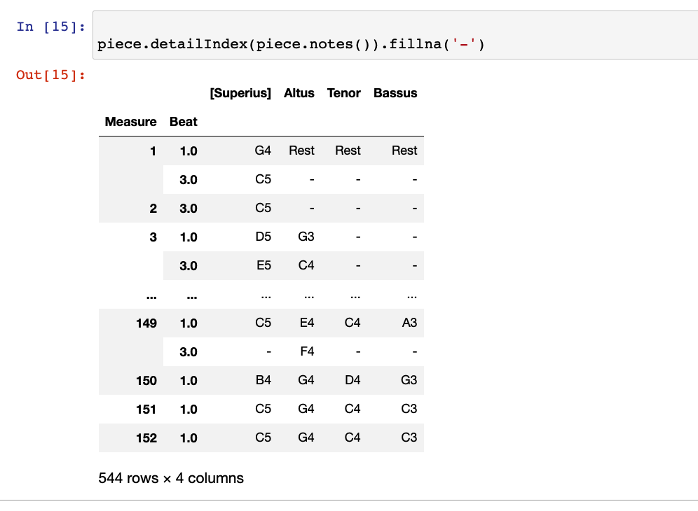
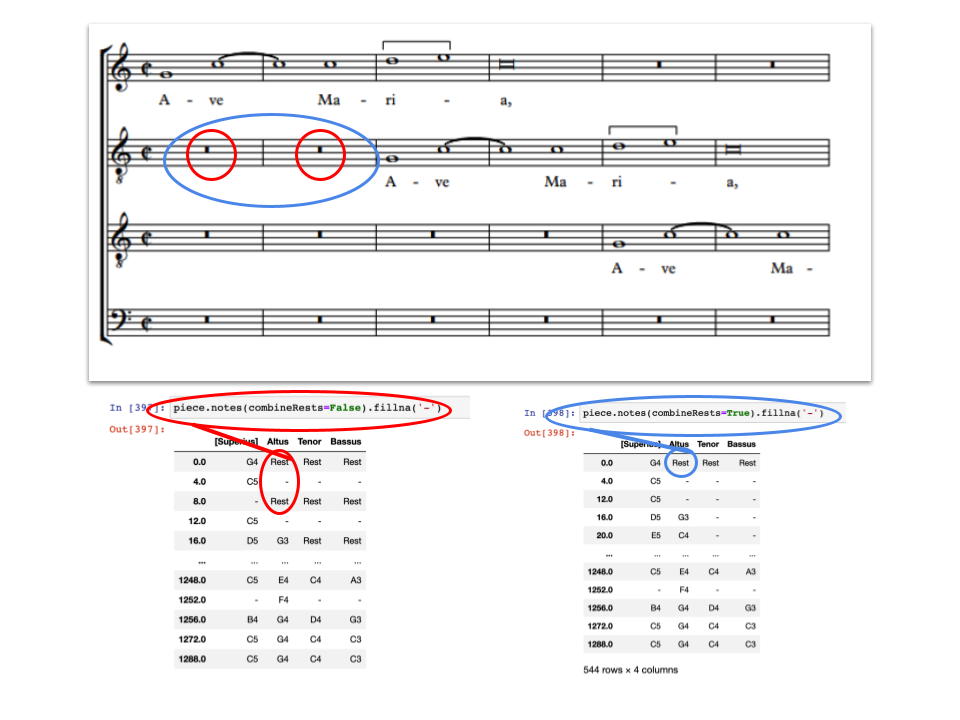
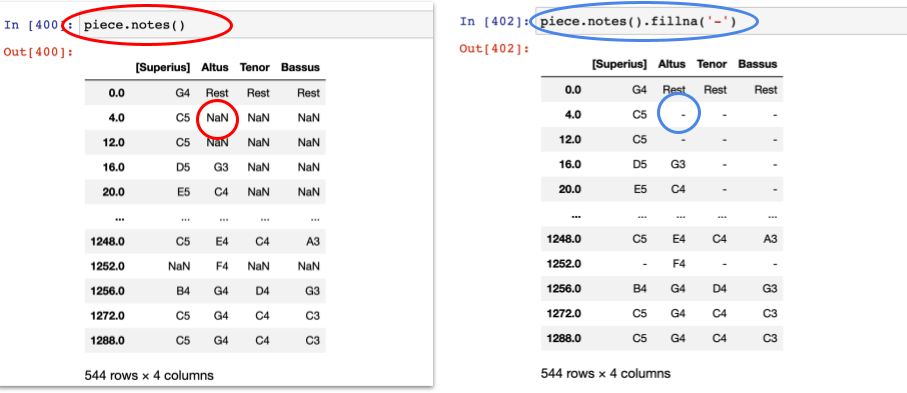
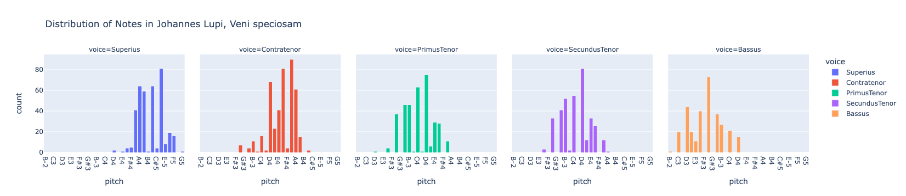
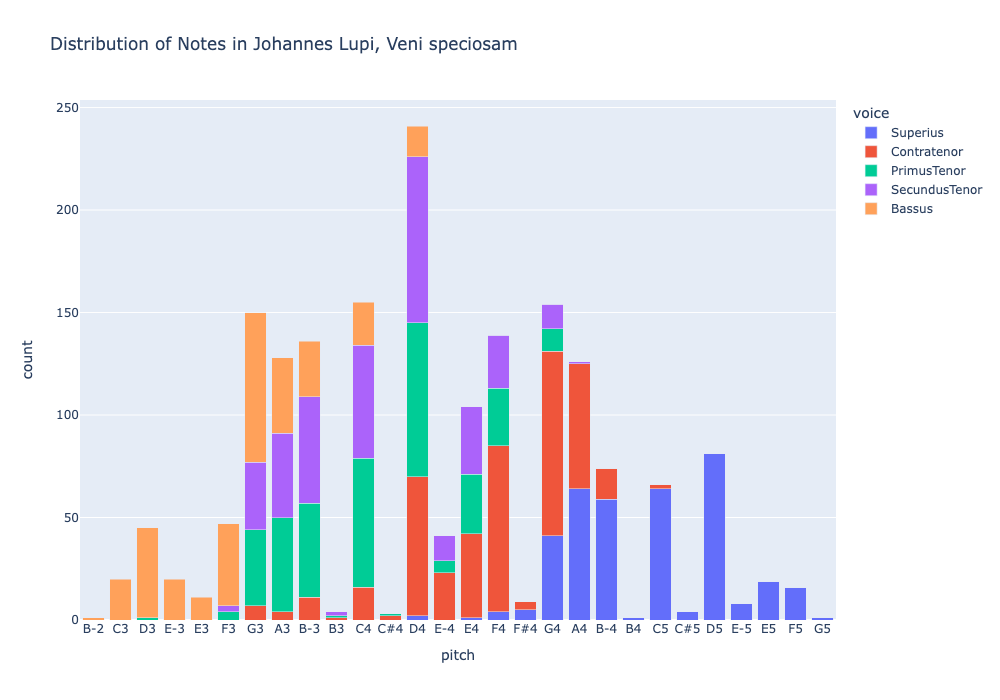
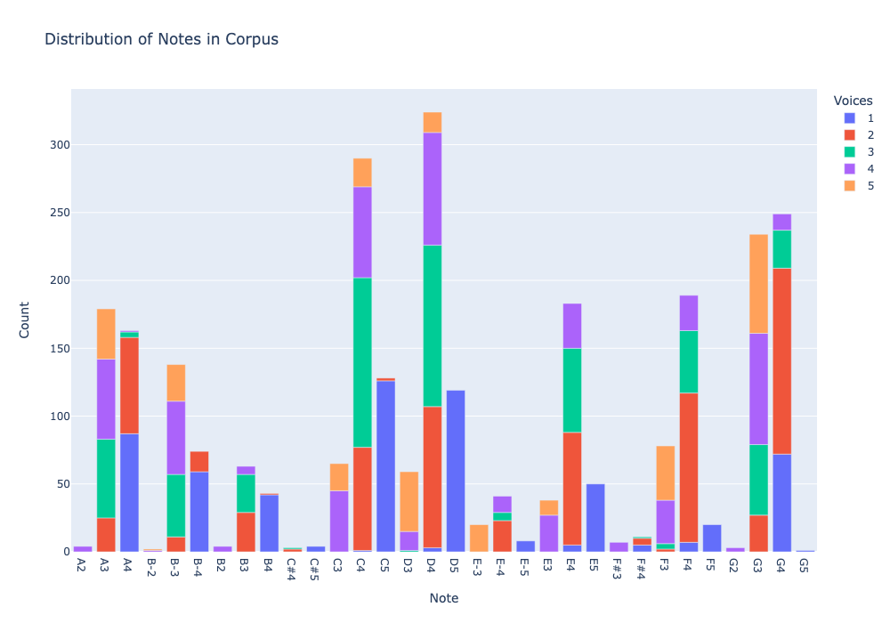

# Finding the Notes and Rests in Pieces

## Table of Contents
1. [The `notes()` Function in Brief](#the-notes-function-in-brief)
2. [`notes()` Parameters](#notes-parameters)
3. [More About Measures, Beats, and Offsets: The `detailIndex()` Function](#more-about-measures-beats-and-offsets-the-detailindex-function)
4. [Plots and Charts of Notes](#plots-and-charts-of-notes)
5. [Notes in a Corpus](#notes-in-a-corpus)
6. [Barcharts of Notes in a Corpus](#barcharts-of-notes-in-a-corpus)
7. [Sections in this guide](#sections-in-this-guide)

## The `notes()` Function in Brief

After importing one or more pieces, the `notes()` function can be run to create a table of all of a piece's notes and rests, in order.  Here is the function and its optional parameters: 

```python
piece.notes(combineRests=True, combineUnisons=False)
```

These notes will be printed in a table, where each new row contains some new note in any voice. The left-most column is an index representing the offset of the change in note, where 0 represents the first note of the piece, and 1 unit of offset represents a quarter note. 


## `notes()` Parameters  

While in its simplest form, the `notes()` function simply produces a DataFrame of each note or group of rests, it can be modified through its parameters:  

* `combineUnisons` controls how consecutive pitch repetitions are treated; default treats unisons as separate notes  
* `combineRests` controls how consecutive rests are treated; default sums consecutive rests into a single extended rest  


### Dealing with Consecutive Pitch Repetition: The `combineUnisons` Parameter:  

A unison is when a new note is sounded, but the pitch remains the same (e.g. a C5 half note followed by a C5 quarter note). Normally we want to record these separately (in that case just leave the ), but it is sometimes useful to *combine* such unisons in order to find melodic similarity.  

With `notes(combineUnisons=True)` these unisons will be treated as a continuation of the previous note, effectively adding a tie between those notes. As a result, the table output of the `notes()` function will not printing anything at the offset of the given note's repetiton. For example:

```python
# unisons are kept separate by default
piece.notes(combineUnisons = False)
# or combine them with True:
piece.notes(combineUnisons = True)  

```   




### Consecutive Rests: The `combineRests` Parameter:  

The `combineRests` parameter operates in the opposite way: Rests are *combined* by default, but can be recorded separately if preferred. For example"

```python
# default value:  
piece.notes(combineRests = True)

# or report Rests separately:
piece.notes(combineRests = False)  
```



### Adjusting Both Parameters at Once

The `combineRests()` and `combineUnisons()` parameters may be changed simultaneously as follows:  

```python
piece.notes(combineRests = False, combineUnisons = True).head(20)
```

### Dealing with "NaN" Outputs: The `fillna()` Function  

It is important to realize that in code, '0' is not the same as Nothing. Where the former is an integer value, the latter is the lack of any value. These 'absent values' are often called 'Nulls' or, in Python and Pandas, 'NaN' values. Inevitably, appling the CRIM Intervals functions to a piece will result in some 'NaN' values. This is because the `notes()` function, for example, indicates any point where a pitch or rest *begins*, but does not indicate when it is *held*. 

Any offset of the piece where a note is held in any voice will thus produce a 'NaN' value in that frame. To decrease the visual clutter of the table, these "NaN" outputs can be replaced with the `fillna()` function, which is used as follows; The `fillna()` function accepts a parameter of any data to replace the "NaN" elements of the `notes()` output table. This field may contain empty quotes, as shown above, or another symbol such as '-'. Any of the following are valid ways to replace "NaN" values with a more discrete symbol (though `fillna(0)` is somewhat more specialized):  

```python
# fill with empty string (thus a blank cell)
piece.notes().fillna('')  

# fill with a dash or other character
piece.notes().fillna('-')  

# fill with the integer 0
piece.notes().fillna(0)
```


 

## More About Measures, Beats, and Offsets: The `detailIndex()` Function  

By default, the `notes()` function returns a DataFrame which indexes by offsets: That is, events in the piece are counted by which cumulative value of the in the piece they fall on. This is useful for measuring time distances between events, but not for a human reader to refer back to the musical score itself. 

But it is also possible to report measure and beat information passing the result of the `notes` function `detailIndex()`.  For example:

```python
notes_rests = piece.notes()  
notes_rest_detail_index = piece.detailIndex(notes_rests)
```

For more information about the `detailIndex` function, consult [the function's documentation](09_DetailIndex.md).  


## Plots and Charts of Notes

Bar charts are used to display categorical data. They consist of vertical or horizontal bars that represent different categories and their corresponding values. Bar charts are excellent for comparing data across different categories.  Learn more at [Plotly Express](https://plotly.com/python/bar-charts/)


### Bar Graphs of Notes in Each Voice

Here we the counts of each pitch (including octave) in each voice of a given piece.  Note that we can declare a custom 'order' for the pitches, so it's possible to present these as you like.  Here we have sorted them from lowest to highest.  You could also display only a subset of pitches.

Note that the CRIM Intervals code includes various predefined possibilities for ordering the pitches in these charts.  These are set out in the `sorting_lists.py` code, which is imported along with `main_obs.py` and `corpus_tools.py`.



<br>

<Details>

<Summary>Code to Produce this Chart</Summary>

```python
# assuming all the usual CRIM Intervals imports already done .  . 
url = 'https://crimproject.org/mei/CRIM_Model_0001.mei'
piece = importScore(url)

# give the chart a meaningful title based on your piece:
md = piece.metadata  
chart_title = "Distribution of Notes in " + md['composer'] + ", " + md['title']

# set the custom order for pitches (defined in `sorting_lists.py` or any custom order here)
order = pitch_order
# get the notes and create the dataframe for the chart
nr = piece.notes().fillna('-')  
nr = nr.apply(pd.Series.value_counts).fillna(0).astype(int).reset_index().copy()  
nr.rename(columns={'index': 'pitch'}, inplace=True)  
nr['pitch'] = pd.Categorical(nr["pitch"], categories=order)  
nr = nr.sort_values(by="pitch").dropna().copy()  
voices = nr.columns.to_list()[1:]  # Exclude 'pitch' column
# melt the dataframe to long format suitable for px.bar
melted_nr = nr.melt(id_vars='pitch', var_name='voice', value_name='count')
# create a custom color palette
custom_palette = px.colors.qualitative.Plotly + px.colors.qualitative.Dark24 + px.colors.qualitative.Light24
color_dict = {voice: custom_palette[i % len(custom_palette)] for i, voice in enumerate(voices)}
# Plot using Plotly Express with stacked bars
fig = px.bar(melted_nr, 
             x='pitch', 
             y='count', 
             color='voice', 
             facet_col='voice', 
             category_orders={'pitch': order}, 
             color_discrete_map=color_dict, barmode='stack',
             height=700,
             width=1000,
             title=chart_title)

fig.update_layout(showlegend=True)
fig.show()
``` 
</Details>


### Barcharts of Notes in Each Voice Stacked in One Chart




<Details>

<Summary>Code to Produce this Chart</Summary>

```python
import plotly.express as px

# set the custom order for pitches (defined in `sorting_lists.py` or any custom order here)
order = pitch_order

nr = piece.notes().fillna('-')  
nr = nr.apply(pd.Series.value_counts).fillna(0).astype(int).reset_index().copy()  
nr.rename(columns={'index': 'pitch'}, inplace=True)  
nr['pitch'] = pd.Categorical(nr["pitch"], categories=order)  
nr = nr.sort_values(by="pitch").dropna().copy()  

voices = nr.columns.to_list()[1:]  # Exclude 'pitch' column

# Melt the dataframe to long format suitable for px.bar
melted_nr = nr.melt(id_vars='pitch', var_name='voice', value_name='count')

# Create a custom color palette
custom_palette = px.colors.qualitative.Plotly + px.colors.qualitative.Dark24 + px.colors.qualitative.Light24
color_dict = {voice: custom_palette[i % len(custom_palette)] for i, voice in enumerate(voices)}

# Create the stacked bar chart
fig = px.bar(nr_melted, 
             x='pitch', 
             y='count', 
             color='voice', 
             barmode='stack',
            title="Chart of Melodic Intervals")

fig.show()
```

</Details>


## Notes in a Corpus

The CRIM Intervals Corpus Tools (defined in `corpus_tools.py`) also has convenient methods for working with a collection of pieces.  For notes, these include:

```python
# Creates table of notes and rests in a corpus.
corpus_notes(corpus, combine_unisons_choice=True, combine_rests_choice=False, key_sig=False)

# Counts occurrences of notes and rests in a corpus, and reports them as percentages of the whole
corpus_note_scaled(corpus, combine_unisons_choice=True, combine_rests_choice=False, key_sig=False)

# Calculates durations of notes in a corpus (see Durations.md for more detail)
corpus_note_durs(corpus, pitch_class=True)

# Calculates pitch class weights by duration in a corpus
corpus_note_weights(corpus, include_rests=True, key_sig=False)
```

Here is now to use them:

First, build your corpus, with a list of remote or local files:


```python
# build the file lists and corpus
local_file_list = ['MEI/Bach_BWV_0772.mei', 'MEI/Bach_BWV_0773.mei']
corpus = CorpusBase(local_file_list)
# or 
remote_file_list  = ['https://crimproject.org/mei/CRIM_Model_0001.mei',
       'https://crimproject.org/mei/CRIM_Mass_0002_1.mei']
corpus = CorpusBase(local_file_list)  
```

Now pass that corpus to the chosen function:

```python
# get weighted notes
corpus_notes_df = corpus_notes(corpus)
corpus_notes_df
```


## Barcharts of Notes in a Corpus

Here we show various ways to make charts of notes in a corpus:



<br>


<Details>

<Summary>Code to Run</Summary>

```python


# load corpus
file_list = ['https://crimproject.org/mei/CRIM_Model_0001.mei', 'https://crimproject.org/mei/CRIM_Model_0008.mei']
corpus = CorpusBase(file_list)

# pass that corpus to the given method, along with optional arguments
corpus_notes_df = corpus_notes(corpus, combine_unisons_choice=True, combine_rests_choice=False, key_sig=False)

# dropping metdata for purposes of the chart
corpus_notes_df_no_mdata = corpus_notes_df.drop(['Composer', 'Title', "Date"], axis=1)

# new df with value counts
nr_counts = pd.DataFrame(corpus_notes_df_no_mdata.apply(pd.Series.value_counts))

# keep or exclude rests:
exclude_rests = True
if exclude_rests == True:
    nr_counts = nr_counts.drop('Rest', axis=0)
                                                               
voices = nr_counts.columns.to_list() 

chart_title = "Distribution of Notes in Corpus"
fig = px.bar(nr_counts, x=nr_counts.index, y=list(nr_counts.columns),
                    title=chart_title)
fig.update_layout(xaxis_title="Note", 
                    yaxis_title="Count",
                    legend_title='Voices',
                       height=700,
                       width=1000)
fig.show()
```

</Details>

<br>

-----

## Sections in this guide

  * [01_Introduction_and_Corpus](/tutorial/01_Introduction_and_Corpus.md)
  * [02_Notes_Rests](/tutorial/02_Notes_Rests.md)
  * [03_Durations](/tutorial/03_Durations.md)
  * [04_TimeSignatures_Beat_Strength](/tutorial/04_TimeSignatures_Beat_Strength.md)
  * [05_Detail_Index](/tutorial/05_Detail_Index.md)
  * [06_Melodic_Intervals](/tutorial/06_Melodic_Intervals.md)
  * [07_Harmonic_Intervals_Sonorities](/tutorial/07_Harmonic_Intervals_Sonorities.md)
  * [08_Ngrams_Heat_Maps](/tutorial/08_Ngrams_Heat_Maps.md)
  * [09_Contrapuntal_Modules](/tutorial/09_Contrapuntal_Modules.md)
  * [10_Lyrics_Homorhythm](/tutorial/10_Lyrics_Homorhythm.md)
  * [11_Cadences](/tutorial/11_Cadences.md)
  * [12_Presentation_Types](/tutorial/12_Presentation_Types.md)
  * [13_Musical_Examples_Verovio](/tutorial/13_Musical_Examples_Verovio.md)
  * [14_Model_Finder](/tutorial/14_Model_Finder.md)
  * [15_Network_Graphs](/tutorial/15_Network_Graphs.md)
  * [16_Python_Basics](/tutorial/16_Python_Basics.md)
  * [17_Pandas_Basics](/tutorial/17_Pandas_Basics.md)
  * [18_Visualizations_Summary](/tutorial/18_Visualizations_Summary.md)
  * [19_Music21_Basics_MEI](/tutorial/19_Music21_Basics_MEI.md)
  * [20_Melodic_Interval_Families](/tutorial/20_Melodic_Interval_Families.md)
  * [21_Corpus_Tools](/tutorial/21_Corpus_Tools.md)
  * [99_Local_Installation](/tutorial/99_Local_Installation.md)
