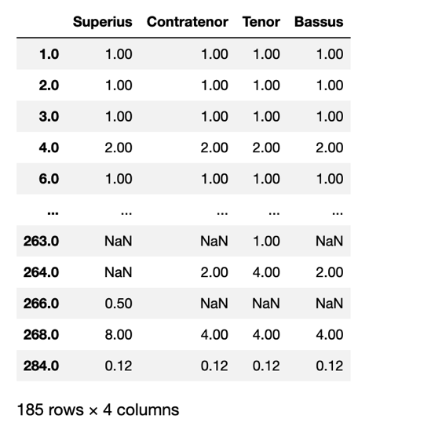
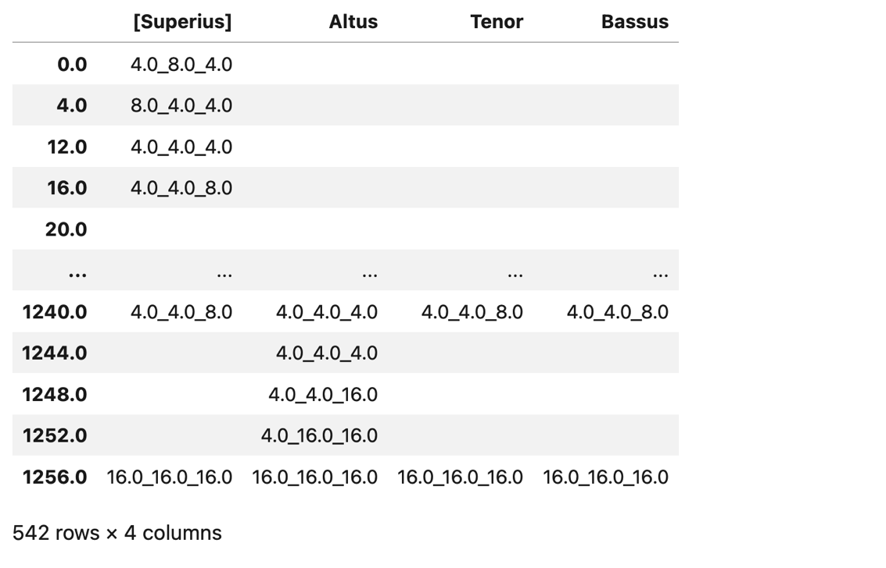

# Finding Durations of Notes in Pieces with  

## Table of Contents
1. [The `durations()` Function in Brief](#the-durations-function-in-brief)
2. [`durations()` Parameters](#durations-parameters)
3. [Selectively Finding Durations: The `mask_df` Parameter](#selectively-finding-durations-the-mask_df-parameter)
4. [Durational Ratios](#durational-ratios)
5. [Ngrams with Durations and Durational Ratios](#ngrams-with-durations-and-durational-ratios)
6. [More About Measures, Beats, and Offsets: The `detailIndex()` Function](#more-about-measures-beats-and-offsets-the-detailindex-function)
7. [Sections in this guide](#sections-in-this-guide)

## The `durations()` Function in Brief

The `durations()` function outputs a DataFrame of **floats** (number values with decimal), according to the scheme inherited from **music21**:  a quarter-note corresponds to '1.0', a half note to '2.0', and so on.   

```python
dur = piece.durations()
```

## `durations()` Parameters:  
This function's output can be modified by changing its various parameters:  

* The `df` parameter, which allows the `durations()` function to be applied to some the dataframe produced by some other CRIM Intervals process:  for instance the lengths of a table of `ngrams`. 
* The `n` parameter, which changes the amount of consecutive notes, intervals, or other objects in a DataFrame whose durations are summed together into each frame of the `durations()` output. By default, `n = 1`, which separates each consecutive duration into its own frame.
* The `mask_df` paramter which allows a filter to be applied to an existing DataFrame of information to selectively display certain DataFrames sampled from a different DataFrame.

We explain these below

### Durations and the `df` Parameter  

Normally `duration()` will be used with a complete piece, as in `piece.durations()`. But sometimes it is useful to pass only a selection of notes (as might be necessary if the `combineUnisons` parameter is **True** for `notes()`).  The only way to check the durations in that case is to first create the df of the notes with unisons combined and then pass that to durations().  For example:

```python
mel = piece.melodic(combineUnisons = True)  
piece.durations(df = mel) 
```


### Sizing the Duration-finding Window: The `n` Parameter  

We already saw `notes(combineUnisons)`, and `notes(combineRests)`.  Now we are combining **events**.  These could be notes, but also things like harmonic patterns or lyrics or anything that has a duration.  The `n` of this parameter represents the *number of successive non-NANs to be combined and 'summed' as a single aggregated duration*.   

When an `n` parameter is added to the `durations()` function, the DataFrame created will therefore combine the first *n* durations found after a given offset into a single sum at that first offset. 


For example at its default value of `1`, the `n` parameter returns *every individual duration*. 

```python
piece.durations()  
#is equivalent to
piece.durations(n = 1)  
```

If a piece contained 8 consecutive quarter notes, for example, this code will return 8 durations:  one at every offset of '1.0'. 

But if we set `n=2`, the same function will return *7 consecutive durations of '2.0'*, since the code is "looking ahead" to find the sum of the every *2 durations* (counting the duration of the offset itself as one duration). 

Another way to phrase this is that the following code will group together the durations found on beats 1 and 2, 2 and 3, 3 and 4...6 and 7, and 7 and 8, finding 7 total *pairs* of durations.  

```python
piece.durations(n = 2) 
``` 

There is a special case when `n = -1`, which will sum the largest possible groups of consecutive **non-rest** durations found in the piece. The code will output the durations of the longest series (no sub-sets within a phrase starting from the 2nd note, from the 3rd note, etc.) of every series of consecutive harmonic intervals in a piece. This type of application could be useful to find the length of a melody (if applied to melodic intervals), or how long two voices created harmonic intervals, as shown:  

```python
harm = piece.harmonic()  
longest_harm_durs = piece.durations(df = harm, n = -1)
```

## Selectively Finding Durations: The `mask_df` Parameter  

Rather than finding all of the durations in a piece, a `mask_df` DataFrame can be applied to the `durations()` function to only find durations which align with certain events found in *some other DataFrame*. 

For instance we could find all the melodic ngrams of length 'n', then find the duration of each of those ngrams: 


```python
mel = piece.melodic()
_n = 5
mel_ngrams = piece.ngrams(df = mel, n = _n).fillna('')
mel_ngram_Durations = piece.durations(df = mel, n = _n, mask_df = mel_ngrams).fillna('')
mel_ngram_Durations
```

Or the same for harmonic ngrams:

```python
har = piece.harmonic()
_n = 5
har_ngrams = piece.ngrams(df = har, n = _n).fillna('')
har_ngram_Durations = piece.durations(df = har, n = _n, mask_df = har_ngrams).fillna('')
har_ngram_Durations  
```

## Durational Ratios

Durational ratios are a good way to measure the 'temporal distance' from one note to the next.  For example one half-note followed another, the ratio of those events would be `1.0`. If the first half-note was followed by a quarter note, the ratio would `0.5`.  These durational ratios are in effect the equivalent of melodic intervals, and can used to find rhythmic motives at different metrical levels, or combined with melodic intervals to find specific soggetti, as we explain below.

Note that these can be irrational numbers (as when a quarter note follows a dotted half), we can round the results to any given number of decimal places:

```python
piece.durationalRatios().round(2)
```




## Ngrams with Durations and Durational Ratios

Each of the previous approaches could be used as the basis of ngrams (to find rhythmic motives), or combined with melodic intervals to describe motives in great detail.

But in this case we need to use Python `applymap(str)` to transform the original durational ratios (which are floats) into strings.  You might also need to dropna values, as noted above.

In addition, we should recall that the resulting ngrams will be expressed as *tuples*, which can prove difficult to work with for purposes of other work.  For instance, if you ran this:

```python
# the durs
dur = piece.durations().fillna('')

# convert the floats to strings
dur_strings = dur.map(str)

# ngrams
ng = piece.ngrams(df=dur_strings, n=3)
```

An individual cell in the resulting table would be a tuple of strings: `('0.25', '0.25', '0.25')`.


CRIM Intervals has two built-in functions that can help us clean up these tuples: 

* `ng = ng.map(tuple_to_list)` will transform a cell as a `list`: `['0.25', '0.25', '0.25']`

* `ng = ng.map(tuple_to_string)` will transform the cell as a single `string`:   `'0.25, 0.25, 0.25'`

You will want to apply these as appropriate to your needs.  For example:

```python
# the durs
dur = piece.durations().fillna('')

# convert the floats to strings
dur_strings = dur.map(str)

# ngrams
ng = piece.ngrams(df=dur_strings, n=3)

# as single string
ng_strings = ng.map(tuple_to_string)

```


Note that if we begin be filling the na values with empty strings or some neutral value, we will in the process create ngrams contain these 'blank' values, and so perhaps misrepresent the durational (or durationalRatio) ngrams in your piece.





## More About Measures, Beats, and Offsets: The `detailIndex()` Function  

By default, the `durations()` function returns a DataFrame which indexes by offsets: That is, events in the piece are counted by which overall beat in the piece they fall on. This is useful for measuring time distances between events, but not for a human reader to refer back to the musical score itself. It is easy to include measure and beat indexes by passing the result of the function to the `detailIndex()` function as shown:  

```python
piece_durs = piece.durations()  
piece_durs_DI = piece.detailIndex(piece_durs) 
 ```

For more information about the `detailIndex` function, consult [the function's documentation](09_DetailIndex.md).  

-----
## Sections in this guide

  * [01_Introduction_and_Corpus](/tutorial/01_Introduction_and_Corpus.md)
  * [02_Notes_Rests](/tutorial/02_Notes_Rests.md)
  * [03_Durations](/tutorial/03_Durations.md)
  * [04_TimeSignatures_Beat_Strength](/tutorial/04_TimeSignatures_Beat_Strength.md)
  * [05_Detail_Index](/tutorial/05_Detail_Index.md)
  * [06_Melodic_Intervals](/tutorial/06_Melodic_Intervals.md)
  * [07_Harmonic_Intervals_Sonorities](/tutorial/07_Harmonic_Intervals_Sonorities.md)
  * [08_Ngrams_Heat_Maps](/tutorial/08_Ngrams_Heat_Maps.md)
  * [09_Contrapuntal_Modules](/tutorial/09_Contrapuntal_Modules.md)
  * [10_Lyrics_Homorhythm](/tutorial/10_Lyrics_Homorhythm.md)
  * [11_Cadences](/tutorial/11_Cadences.md)
  * [12_Presentation_Types](/tutorial/12_Presentation_Types.md)
  * [13_Musical_Examples_Verovio](/tutorial/13_Musical_Examples_Verovio.md)
  * [14_Model_Finder](/tutorial/14_Model_Finder.md)
  * [15_Network_Graphs](/tutorial/15_Network_Graphs.md)
  * [16_Python_Basics](/tutorial/16_Python_Basics.md)
  * [17_Pandas_Basics](/tutorial/17_Pandas_Basics.md)
  * [18_Visualizations_Summary](/tutorial/18_Visualizations_Summary.md)
  * [19_Music21_Basics_MEI](/tutorial/19_Music21_Basics_MEI.md)
  * [20_Melodic_Interval_Families](/tutorial/20_Melodic_Interval_Families.md)
  * [21_Corpus_Tools](/tutorial/21_Corpus_Tools.md)
  * [99_Local_Installation](/tutorial/99_Local_Installation.md)
