# Harmonic Intervals and Sonorities  

## Table of Contents
1. [The `harmonic()` Function in Brief](#the-harmonic-function-in-brief)
2. [`harmonic()` Parameters](#harmonic-parameters)
3. [The `sonorities` Function in Brief](#the-sonorities-function-in-brief)
4. [Ngrams of Sonorities](#ngrams-of-sonorities)
5. [More About Measures, Beats, and Offsets: The `detailIndex()` Function](#more-about-measures-beats-and-offsets-the-detailindex-function)
6. [Sonority N-grams with the Bass Line](#sonority-n-grams-with-the-bass-line)
7. [Harmonic Intervals in a Corpus](#harmonic-intervals-in-a-corpus)
8. [Charts with Harmonic Intervals](#charts-with-harmonic-intervals)
9. [Harmonic Intervals in a Corpus](#harmonic-intervals-in-a-corpus-1)
10. [Sections in this guide](#sections-in-this-guide)

We have just seen how the `melodic()` function allows us to examine the points in the score where the pitch changes in a single voice, resulting in a melodic intervals. We are also able to examine harmonic intervals, which is the difference in pitch between two voices who sound a note simultaneously. 

Here we show two different approaches:

* The `harmonic()`, which reports intervals between all possible **pairs** of voices
* The `sonority()` function, which reports all the intervals above the lowest sounding part at once.  


## The `harmonic()` Function in Brief

```python
harmonic(kind='q', directed=True, compound=True, againstLow=False, df=None)
```

In its simplest form, `harmonic()` simply produces a DataFrame of each harmonic interval present in a piece, between all possible voice pairs:  

```python
path = 'https://crimproject.org/mei/CRIM_Model_0001.mei'
piece = importScore(path)
harmonic_intervals = piece.harmonic()
```

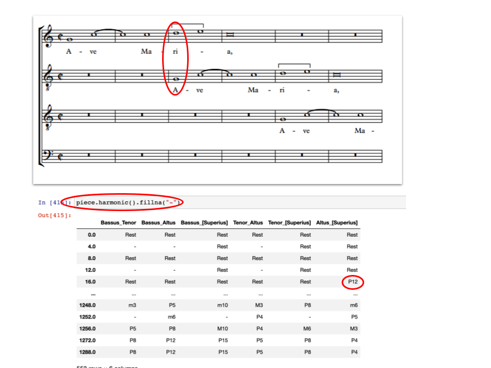

The function can, however, be modified by each of its parameters:  
* `kind`, for controlling if diatonic, chromatic, or other types of intervals are reported; default is diatonic  
* `directed`, for controlling whether the report is simply a raw interval, or also reports whether it goes up or down (indicated with a '-' if down); default includes direction  
* `compound`, whether intervals larger than an octave are reported as simpler versions; default reports compounds as they actually appear  
* `againstLow`, whether harmonic intervals are produced for every combination of voices, or just between each non-lowest voice and the lowest active voice at each harmonic offset; default generates every combination of voices

## `harmonic()` Parameters  

### Differentiating Between Diatonic, Chromatic, and Other Intervals with the `kind` Parameter  

The `harmonic()` function contains a parameter `kind`, which has a default value of "q". These inputs are case sensitive:  

**Diatonic with Quality**. These qualities are outputs such as "P8" for a perfect octave (e.g. C4 -> C5), "M3" for a major third interval (e.g. C5 -> E5), and "m3" for minor third interval (e.g. C5 -> E-5):  

```python
piece.harmonic(kind = 'q')
```

**Diatonic without Quality**. Provides outputs such as "8" for an octave, and "3" for a third interval:  

```python
piece.harmonic(kind = "d")
```  

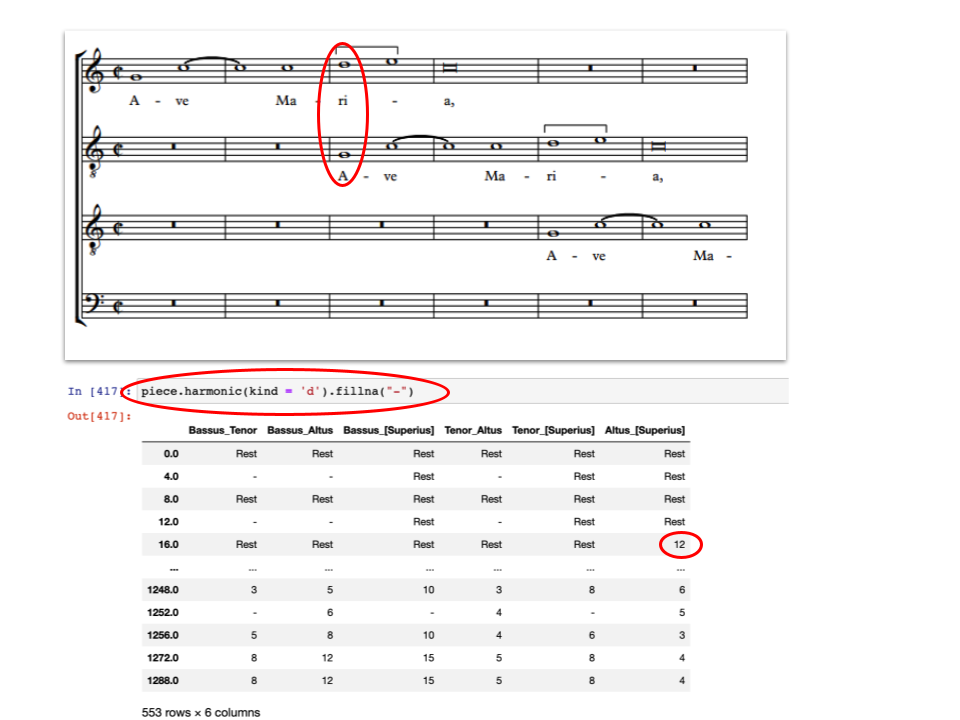

**Chromatic**. Simply the difference in pitch including all intermediary notes. Outputs "12" for an octave interval (e.g. C4 -> C5), "6" for a tritone interval (e.g. C5 -> F#5), and "0" for a unison (e.g. C5 -> C5):  

```python
piece.harmonic(kind = "c")
```  

**Zero-based**. Diatonic intervals, begins counting at 0 rather than 1. Outputs "7" for a perfect octave interval up (e.g. D3 -> D4), "-4" for a fifth interval down (e.g. F5 -> A5), "2" for a third interval up (e.g. G4 -> B5):  

```python
piece.harmonic(kind = "z")
```

### Up and Down vs. Aboslute: The `directed` Parameter  

By default, `directed = True`, which causes the melodic intervals to report their direction; "4" is an ascending fourth; "-4" is descending. It might be useful, however, simply to report the absolute distance without direction, such as if the aim is to know how many harmonic intervals of a sixth appear in a piece regardless of their direction.  In this case, use `directed = False`.  

```python
#Default value:  
piece.harmonic(directed = True)
``` 

[C5 -> G5] will return a diatonic interval of "4"  
[G5 -> C5] will return a diatonic interval of "-4"  

```python
piece.harmonic(directed = False)
```


[C5 -> G5] will return a diatonic interval of "4"  
[G5 -> C5] will return a diatonic interval of "4"  

### Managing Intervals Greater than an Octave: The `compound` Parameter  

The `harmonic()` function contains a parameter `compound`, with a default value of `True`. This means that intervals with a span greater than an octave will always be returned as such.  The interval from C4 to E5 would be a diatonic 10, a chromatic 16, M10 using 'with quality', and 9 using 'zero-based diatonic'. 

```python
piece.harmonic(compound = True)
```

Using `piece.harmonic(compound = False)`, in contrast, analyzes all intervals as if they are within a octave (what musicians call the 'simple' intervallic distances). In this case the interval from C4 to E5 would be a diatonic 3, a chromatic 4, M3 using 'with quality', and 2 using 'zero-based with quality'. Note that an octave itself is not reduced to a unison.  

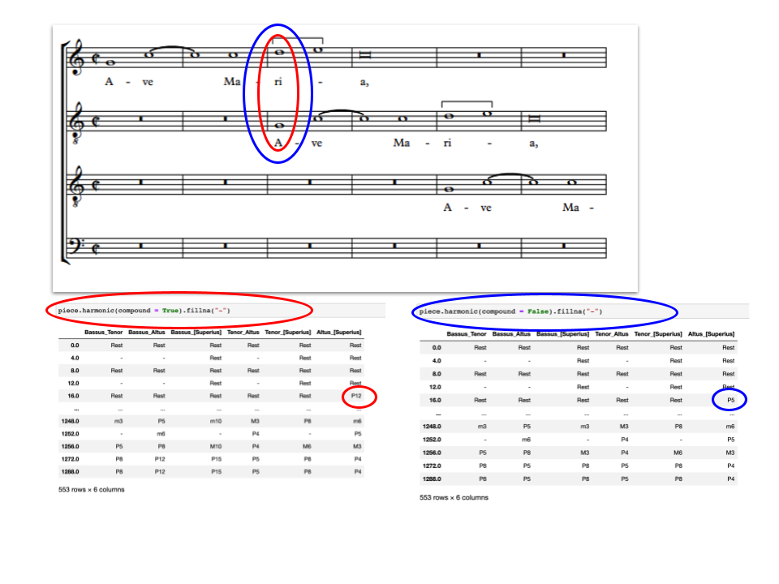

Note that with `compound = False` an octave itself is not reduced to a unison*. You could map the octave to a unison by using the `replace()` function, for instance:  

```python
piece.harmonic(kind = 'd', compound = False).replace('8', '1')
```

### The `againstLow` Parameter  

By default, `harmonic()` generates a DataFrame of the harmonic intervals between **all pairs** of voice parts present at a given offset. But it is also possible to report the interval *between each voice and the lowest voice present at each offset*. When changed to `True`, harmonic intervals will only be shown between the lowest voice and each other voice at a given offset:  

```python
piece.harmonic(againstLow = True)
```

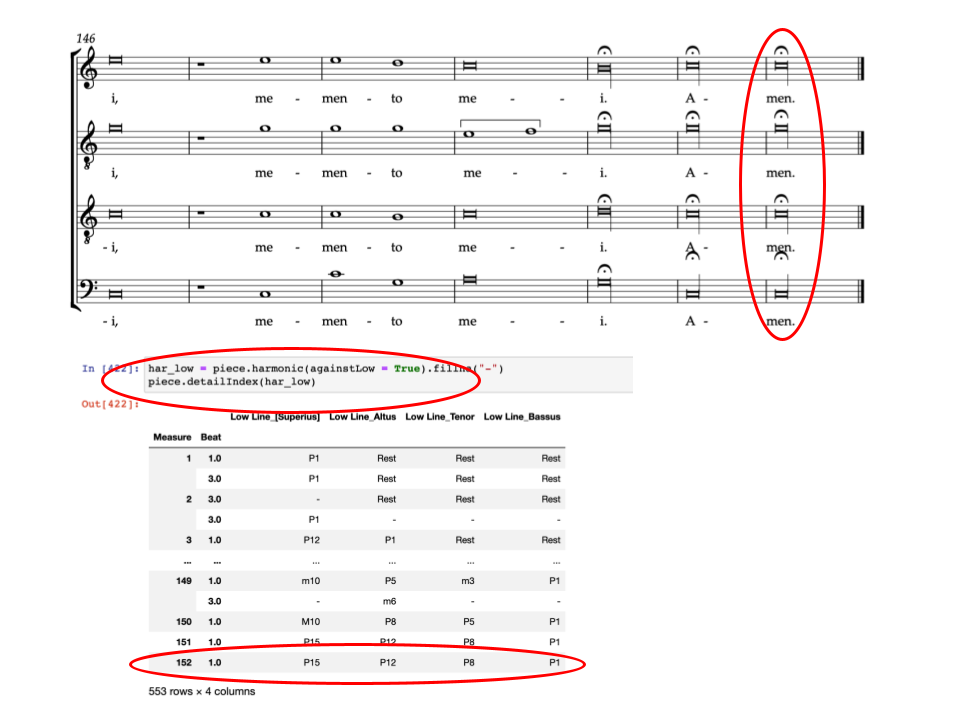

This means that if a piece contained a Bass, Tenor, Alto, and Soprano voice, all four voices were sounding, and `againstLow` was set to **True**, `harmonic()` will generate the interval between the Bass and the Tenor, the Bass and the Alto, and the Bass and the Soprano. It will **NOT** generate any harmonic interval between the Tenor and Alto, Tenor and Soprano, or Alto and Soprano. The same logic would also apply even if the Bass was not present, where only the harmonic intervals appearing would be between the Tenor and Alto voices, and between the Tenor and Soprano voices.  

## The `sonorities` Function in Brief

There is also a separate `sonorities` function, which in turn uses the results from harmonic to produce a single column representing all of the vertical intervals heard at each 'onset' of any note throughout the piece.  The result is something like a figured bass representation of the harmonies at each moment.

In its simplest form, we call this on piece as follows:

```python
piece.sonorities(kind='d', directed=True, compound='simple', sort=True)
```

There are also several parameters. The first three are simply those used with `harmonic`, as described above.  One additional parameter, `sort`, determines the *order* of the intervals.  If `sort=True` (which is the default), then the intervals will be sorted from largest to smallest.  Duplicates and unisons will be removed.  


```python
piece.sonorities(sort=True)
```

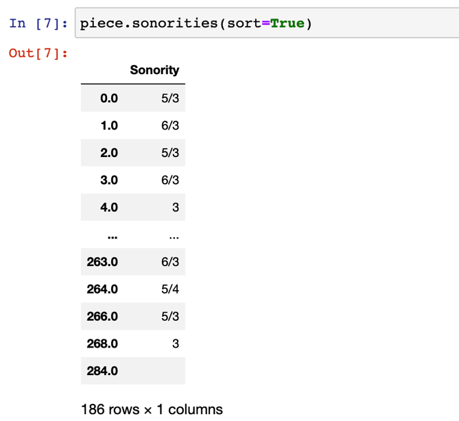

But if `sort=False`, then *all* intervals will be reported (unisons and duplicates included), and they will appear in order from top staff to bottom.

```python
piece.sonorities(sort=False)
```

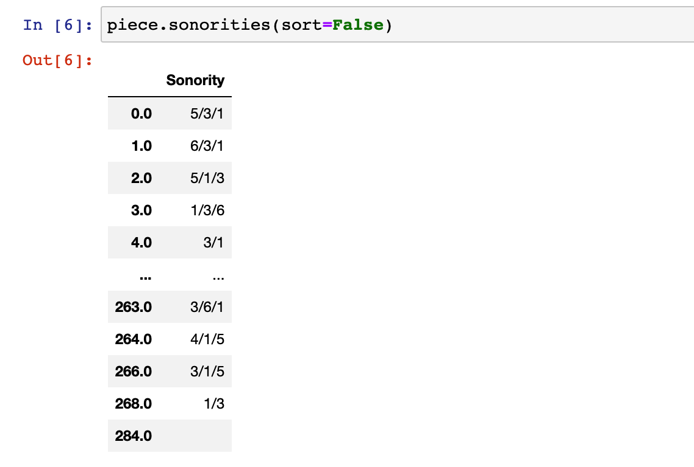

## Ngrams of Sonorities

We could also use the `ngrams()` function to find the **sequences of sonorities** in a piece, or across a corpus.  Here is an example of how to do this for a single piece:


```python
son = piece.sonorities(sort=False)
piece.ngrams(df = son, n=3)
```

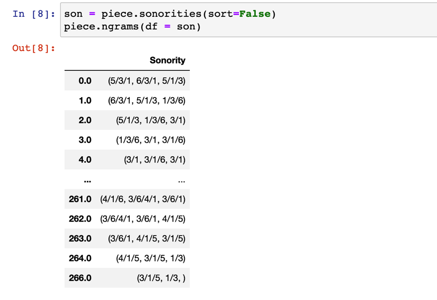


### Dealing with Consecutive Pitch Repetition/Rests: The `combineUnisons` and `combineRests` Parameters:  

Unlike the `notes()` functions, the `harmonic()` function does not contain `combineUnisons` or `combineRests` parameters. These parameters, however, can still be used in conjunction with the `harmonic()` function as follows:  

```python
nr_no_unisons = piece.notes(combineUnisons = True)
piece.harmonic(df = nr_no_unisons)
```

Or (though less useful),  

```python
nr_separate_rests = piece.notes(combineRests = False)  
piece.harmonic(df = nr_separate_rests)
```  


### `fillna()` and `dropna()` Functions  

We have previously seen the `fillna()` function which, when applied to a DataFrame, replaces all "NaN" objects with the chosen text. For example:  

```python
piece.harmonic().fillna('-')
``` 

We are also able to apply the `dropna()` function, which (by default) removes all rows (beats) from the table consisting *entirely* of "NaN" values.  

```python
piece.harmonic().dropna()
```

This would be equivalent to specifiying the function as follows:  

```python
piece.harmonic().dropna(how = 'all')
```


Alternatively, rows could be dropped if they contian *any* "NaN" values:  

```python
piece.harmonic().dropna(how = 'any')
``` 

## More About Measures, Beats, and Offsets: The `detailIndex()` Function  

By default, the `harmonic()` function returns a DataFrame which indexes by offsets: That is, events in the piece are counted by which overall beat in the piece they fall on. This is useful for measuring time distances between events, but not for a human reader to refer back to the musical score itself. It is easy to include measure and beat indexes by passing the result of the function to the `detailIndex()` function as shown:  

```python
har = piece.harmonic()  
har_DI = piece.detailIndex(har)
``` 

For more information about the `detailIndex` function, consult [the function's documentation](/tutorial/05_Detail_Index.md).  


## Sonority N-grams with the Bass Line

The ngrams of sonorities shown above say nothing about how the bass moves from one sonority to the next. `sonority_ngrams()` adds that: each event pairs the **melodic interval of the lowest voice** (or `Held` if the bass does not move) with the **sonority** above it, joined with `_`. A four-event n-gram looks like this:

```
-M2_10/1_Held_9/1_Held_8/1_M2_10/1
```

That is: the bass falls a major second to a 10/1 sonority, holds while the upper voice moves to 9 and then 8, then the bass rises a major second to 10/1 again. Because these n-grams don't depend on which voice sings what, they are very good at finding **block repetitions**, within a piece or across pieces (a model and the Mass based on it, for example).

The same method works on one piece or a whole corpus, with the same parameters:

```python
# one piece
piece = importScore('https://crimproject.org/mei/CRIM_Model_0008.mei')
son = piece.sonority_ngrams(ngram_length=4)

# a corpus
corpus = CorpusBase(['https://crimproject.org/mei/CRIM_Model_0008.mei',
                     'https://crimproject.org/mei/CRIM_Mass_0005_1.mei',
                     'https://crimproject.org/mei/CRIM_Mass_0005_2.mei'])
son = corpus.sonority_ngrams(ngram_length=4)
```

The result has one row per n-gram, with `Measure`, `Beat` and `Progress` (0 at the start of the piece, 1 at the end), `Composer`, `Title` and `Date`, and the n-gram itself in the `Low_Sonority` column. (The `Sonority` and `Low Line` columns hold the two halves separately, as tuples.)

Parameters:

* `ngram_length` (default 4): the number of events in each n-gram.
* `minimum_beat_strength` (default 0.0): leave out sonorities on weak beats. For example, `0.5` keeps only sonorities on beats stronger than 0.5 (see [04_Time_Signatures_Beat_Strength](/tutorial/04_Time_Signatures_Beat_Strength.md)), which hides passing motion and makes block repetitions easier to spot.
* `compound` (default True) and `sort` (default False): passed to `sonorities()`, as described above. Note that the defaults differ from those of `sonorities()` itself.
* `include_offset`, `include_progress`, `key_sig`: add the offset, progress, or key signature to the position columns (see [05_Detail_Index](/tutorial/05_Detail_Index.md)).
* `include_final`: add a `Final` column with each piece's final tone.

To count the patterns, use `value_counts()` on the n-gram column. With a corpus, `groupby` shows how often each one is heard in each piece:

```python
son['Low_Sonority'].value_counts()
son.groupby(['Title', 'Low_Sonority']).size()
```

### Charting Sonority N-grams

`viz.sonority_ngram_progress()` shows where each n-gram pattern occurs: one row per pattern, with each occurrence placed by its progress through the piece. New material climbs diagonally, while recurring patterns appear as dots on the same horizontal line. The second line of the plot title records the settings used. 


```python
file_list = ['https://crimproject.org/mei/CRIM_Model_0019.mei', 
             'https://crimproject.org/mei/CRIM_Mass_0019_1.mei',
             'https://crimproject.org/mei/CRIM_Mass_0019_2.mei'
             ]
corpus = CorpusBase(file_list)
son_cor = corpus.sonority_ngrams(ngram_length=3)
viz.sonority_ngram_progress(son_cor)
```

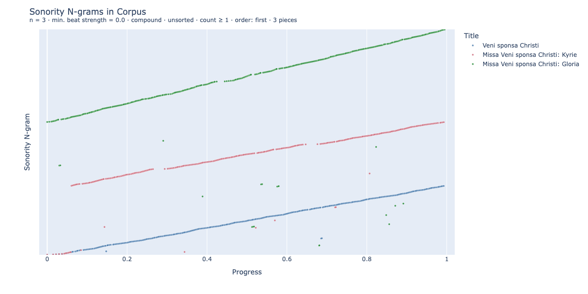


Note that you could also use `viz.sonority_ngram_progress(son_cor, min_count=2)` to see only the patterns that recur; with a corpus, these are the patterns **shared** among the pieces.

See [17_Visualizations_Summary](/tutorial/17_Visualizations_Summary.md#sonority-n-gram-progress-plots) for the other options and more examples.


## Harmonic Intervals in a Corpus

Our Corpus Tools includes a method for working with harmonic intervals in a set of pieces.  Here we show how to do this.  See more in the [Corpus Tools](/tutorial/19_Corpus_Tools.md) section of this guide.

<br>

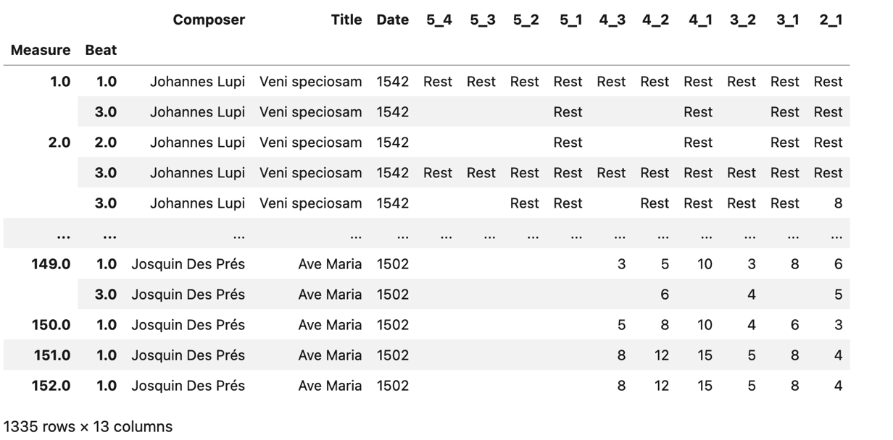

<br>

<Details>

<Summary>Code to Run</Summary>


```python
# make the corpus
remote_file_list  = ['https://crimproject.org/mei/CRIM_Model_0001.mei',
       'https://crimproject.org/mei/CRIM_Mass_0002_1.mei']
corpus = CorpusBase(remote_file_list)

# set parameters for melodic interval extraction
kind_choice = 'd'        # 'd' for diatonic, 'q' for quality
compound_choice = True   # True for compound intervals, False for simple intervals
directed_choice = True   # True for directed intervals, False for undirected intervals


# now run the corpus function
corpus_har_ints = corpus.har(kind_choice='d', compound_choice=True, directed_choice=True, key_sig=False, include_final=False)

corpus_har_ints                   
```


</Details>

## Charts with Harmonic Intervals

As we explain the [Visualizations_Summary](/tutorial/17_Visualizations_Summary.md), the **Plotly** library provides some powerful tools for displaying tabular data in various charts and plots.

In these charts the intervals run from the largest negative interval (where the voices cross), through the unison, to the largest positive one, including compound intervals such as tenths and twelfths.  The order comes from `sort_interval_values()` in `crim_intervals/sorting_lists.py`, which works for diatonic or quality intervals, simple or compound.  The colors are the shared CRIM palette, `viz.contrasting_colors`.  Both can be replaced with your own: pass any list of intervals as the order (to show only a subset, for example), or any list of colors.

### For a Single Piece

#### Voice Pairs as Separate "facets":


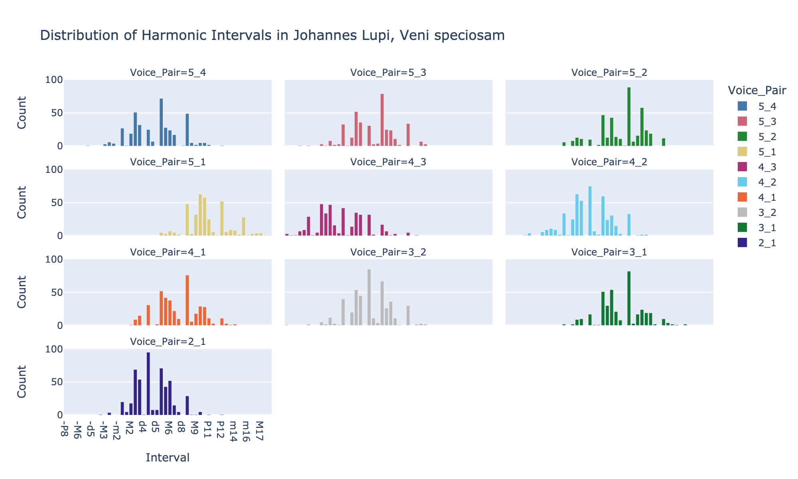


<br>

<Details>

<Summary>Code to Use</Summary>

```python
# assuming all the usual CRIM Intervals imports already done . . .
import crim_intervals.visualizations as viz
from crim_intervals.sorting_lists import sort_interval_values

# import the piece
url = 'https://crimproject.org/mei/CRIM_Model_0001.mei'
piece = importScore(url)

# give the chart a meaningful title based on your piece:
md = piece.metadata
chart_title = "Distribution of Harmonic Intervals in " + md['composer'] + ", " + md['title']

# set parameters for harmonic interval extraction
kind_choice = 'q'        # 'd' for diatonic, 'q' for quality
compound_choice = True   # True for compound intervals, False for simple intervals
directed_choice = True   # True for directed intervals, False for undirected intervals
exclude_rests = True     # True to exclude rests, False to include rests

# get the harmonic intervals
har = piece.harmonic(kind=kind_choice, compound=compound_choice, directed=directed_choice)
har = piece.numberParts(har)  # add part numbers to the column names
voice_pairs = har.columns.to_list()

# melt: the offset (index) stays fixed, every voice-pair column becomes rows
har_long = (har.rename_axis('Offset')
               .reset_index()
               .melt(id_vars='Offset',
                     value_vars=voice_pairs,
                     var_name='Voice_Pair',
                     value_name='Interval'))

# drop empty cells (and rests, if requested)
har_long = har_long.dropna(subset=['Interval'])
har_long['Interval'] = har_long['Interval'].astype(str)
if exclude_rests:
    har_long = har_long[har_long['Interval'] != 'Rest']

# order intervals: largest negative (voice crossing) ... unison ... largest positive
# (sort_interval_values from sorting_lists.py works for diatonic or quality, simple or compound)
interval_order = sort_interval_values(har_long['Interval'], include_rests=True)

# count intervals per voice pair
har_counts = (har_long.groupby(['Interval', 'Voice_Pair'])
                      .size()
                      .reset_index(name='Count'))

# each pair as a 'facet' with its own small chart, in the standard CRIM colors
fig_facet = px.bar(har_counts,
             x='Interval',
             y='Count',
             color='Voice_Pair',
             facet_col='Voice_Pair',
             facet_col_wrap=3,
             category_orders={'Interval': interval_order, 'Voice_Pair': voice_pairs},
             color_discrete_sequence=viz.contrasting_colors,
             height=600,
             width=1000,
             title=chart_title)
fig_facet.show()
```

</Details>

<br>


#### Voice Pairs Stacked in a Single Chart:

Here we stack the pairs single stacked bar chart, with each voice pair as a separate color:


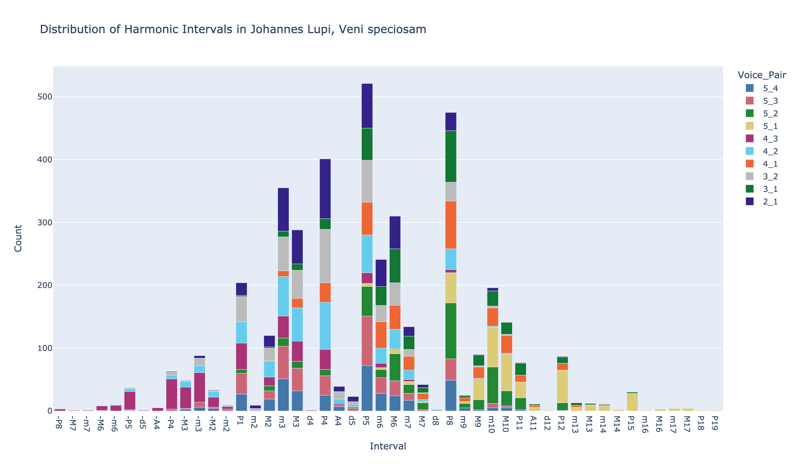


<br>

<Details>

<Summary>Code to Use</Summary>

```python
# assuming all the usual CRIM Intervals imports already done . . .
import crim_intervals.visualizations as viz
from crim_intervals.sorting_lists import sort_interval_values

# import the piece
url = 'https://crimproject.org/mei/CRIM_Model_0001.mei'
piece = importScore(url)

# give the chart a meaningful title based on your piece:
md = piece.metadata
chart_title = "Distribution of Harmonic Intervals in " + md['composer'] + ", " + md['title']

# set parameters for harmonic interval extraction
kind_choice = 'q'        # 'd' for diatonic, 'q' for quality
compound_choice = True   # True for compound intervals, False for simple intervals
directed_choice = True   # True for directed intervals, False for undirected intervals
exclude_rests = True     # True to exclude rests, False to include rests

# get the harmonic intervals
har = piece.harmonic(kind=kind_choice, compound=compound_choice, directed=directed_choice)
har = piece.numberParts(har)  # add part numbers to the column names
voice_pairs = har.columns.to_list()

# melt: the offset (index) stays fixed, every voice-pair column becomes rows
har_long = (har.rename_axis('Offset')
               .reset_index()
               .melt(id_vars='Offset',
                     value_vars=voice_pairs,
                     var_name='Voice_Pair',
                     value_name='Interval'))

# drop empty cells (and rests, if requested)
har_long = har_long.dropna(subset=['Interval'])
har_long['Interval'] = har_long['Interval'].astype(str)
if exclude_rests:
    har_long = har_long[har_long['Interval'] != 'Rest']

# order intervals: largest negative (voice crossing) ... unison ... largest positive
# (sort_interval_values from sorting_lists.py works for diatonic or quality, simple or compound)
interval_order = sort_interval_values(har_long['Interval'], include_rests=True)

# count intervals per voice pair
har_counts = (har_long.groupby(['Interval', 'Voice_Pair'])
                      .size()
                      .reset_index(name='Count'))

# all voice pairs stacked in a single chart, in the standard CRIM colors
fig = px.bar(har_counts,
             x='Interval',
             y='Count',
             color='Voice_Pair',
             category_orders={'Interval': interval_order, 'Voice_Pair': voice_pairs},
             color_discrete_sequence=viz.contrasting_colors,
             height=700,
             width=1200,
             title=chart_title)
fig.show()
```

</Details>

<br>


## Harmonic Intervals in a Corpus

Here is a chart for an entire corpus:


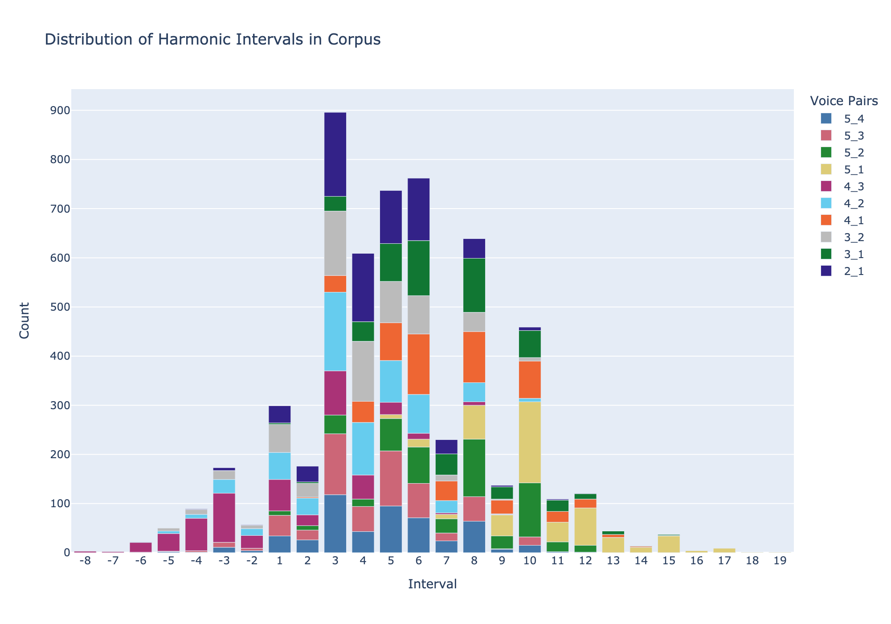

<br>

<Details>

<Summary>Code to Use</Summary>

```python
# assuming all the usual CRIM Intervals imports already done . . .
import crim_intervals.visualizations as viz
from crim_intervals.sorting_lists import sort_interval_values

remote_file_list  = ['https://crimproject.org/mei/CRIM_Model_0001.mei',
       'https://crimproject.org/mei/CRIM_Mass_0002_1.mei']
corpus = CorpusBase(remote_file_list)

# set parameters for harmonic interval extraction
kind_choice = 'd'        # 'd' for diatonic, 'q' for quality
compound_choice = True   # True for compound intervals, False for simple intervals
directed_choice = True   # True for directed intervals, False for undirected intervals
exclude_rests = True     # True to exclude rests, False to include rests

# the corpus function
corpus_har_ints = corpus.har(kind_choice=kind_choice, compound_choice=compound_choice, directed_choice=directed_choice, key_sig=False, include_final=False)

# melt: metadata/position columns stay fixed, every voice-pair column becomes rows
id_cols = ['Composer', 'Title', 'Date', 'Measure', 'Beat', 'Progress']
voice_pair_cols = [c for c in corpus_har_ints.columns if c not in id_cols]

har_long = corpus_har_ints.melt(id_vars=id_cols,
                                value_vars=voice_pair_cols,
                                var_name='Voice_Pair',
                                value_name='Interval')

# drop empty cells (and rests, if requested)
har_long = har_long.dropna(subset=['Interval'])
if exclude_rests:
    har_long = har_long[har_long['Interval'] != 'Rest']
har_long['Interval'] = har_long['Interval'].astype(str)

# order intervals: largest negative (voice crossing) ... unison ... largest positive
interval_order = sort_interval_values(har_long['Interval'], include_rests=True)

# count intervals per voice pair
har_counts = (har_long.groupby(['Interval', 'Voice_Pair'])
                      .size()
                      .reset_index(name='Count'))

# chart
chart_title = "Distribution of Harmonic Intervals in Corpus"
fig = px.bar(har_counts,
             x='Interval',
             y='Count',
             color='Voice_Pair',
             title=chart_title,
             category_orders={'Interval': interval_order, 'Voice_Pair': voice_pair_cols},
             color_discrete_sequence=viz.contrasting_colors)
fig.update_layout(xaxis_title="Interval",
                  yaxis_title="Count",
                  legend_title='Voice Pairs',
                  height=700,
                  width=1000)
fig.show()
```


</Details>

<br>


-----

## Sections in this guide

  * [01_Introduction_and_Corpus](/tutorial/01_Introduction_and_Corpus.md)
  * [02_Notes_Rests](/tutorial/02_Notes_Rests.md)
  * [03_Durations](/tutorial/03_Durations.md)
  * [04_Time_Signatures_Beat_Strength](/tutorial/04_Time_Signatures_Beat_Strength.md)
  * [05_Detail_Index](/tutorial/05_Detail_Index.md)
  * [06_Melodic_Intervals](/tutorial/06_Melodic_Intervals.md)
  * [07_Harmonic_Intervals_Sonorities](/tutorial/07_Harmonic_Intervals_Sonorities.md)
  * [08_Ngrams_Heat_Maps](/tutorial/08_Ngrams_Heat_Maps.md)
  * [09_Contrapuntal_Modules](/tutorial/09_Contrapuntal_Modules.md)
  * [10_Lyrics_Homorhythm](/tutorial/10_Lyrics_Homorhythm.md)
  * [11_Cadences](/tutorial/11_Cadences.md)
  * [12_Presentation_Types](/tutorial/12_Presentation_Types.md)
  * [13_Voice_Ranges_Melodic_Species](/tutorial/13_Voice_Ranges_Melodic_Species.md)
  * [14_Melodic_Interval_Families](/tutorial/14_Melodic_Interval_Families.md)
  * [15_Musical_Examples_Verovio](/tutorial/15_Musical_Examples_Verovio.md)
  * [16_Model_Finder](/tutorial/16_Model_Finder.md)
  * [17_Visualizations_Summary](/tutorial/17_Visualizations_Summary.md)
  * [18_Network_Graphs](/tutorial/18_Network_Graphs.md)
  * [19_Corpus_Tools](/tutorial/19_Corpus_Tools.md)
  * [20_Python_Basics](/tutorial/20_Python_Basics.md)
  * [21_Pandas_Basics](/tutorial/21_Pandas_Basics.md)
  * [22_Music21_MEI](/tutorial/22_Music21_MEI.md)
  * [99_Local_Installation](/tutorial/99_Local_Installation.md)
