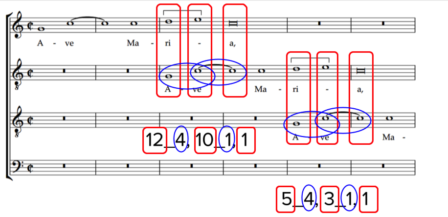
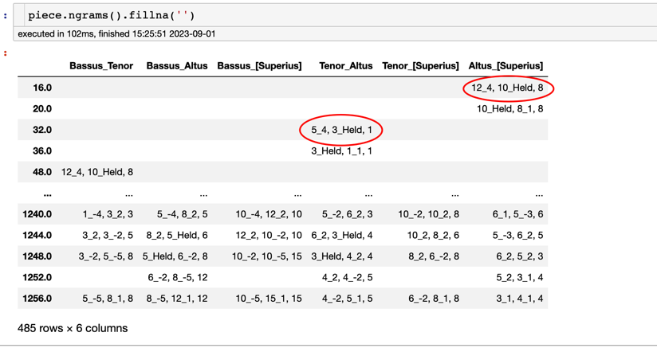
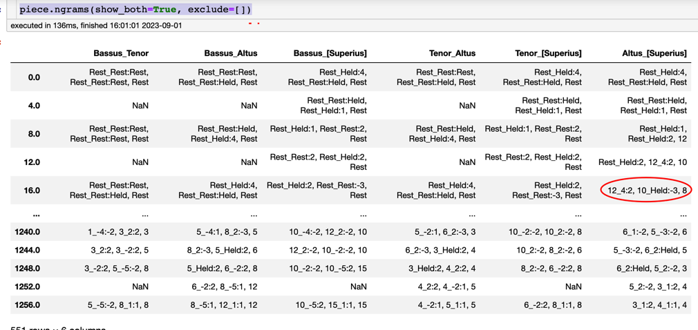
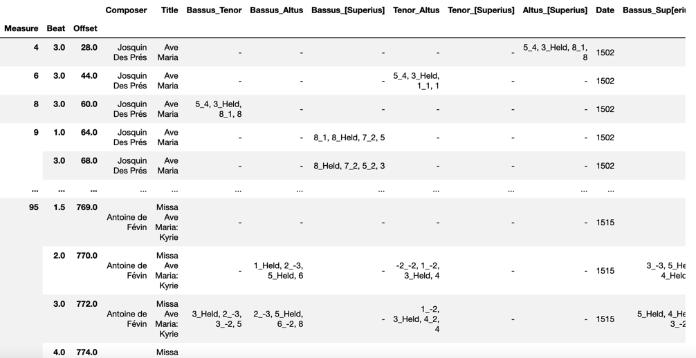
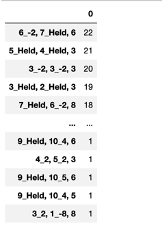
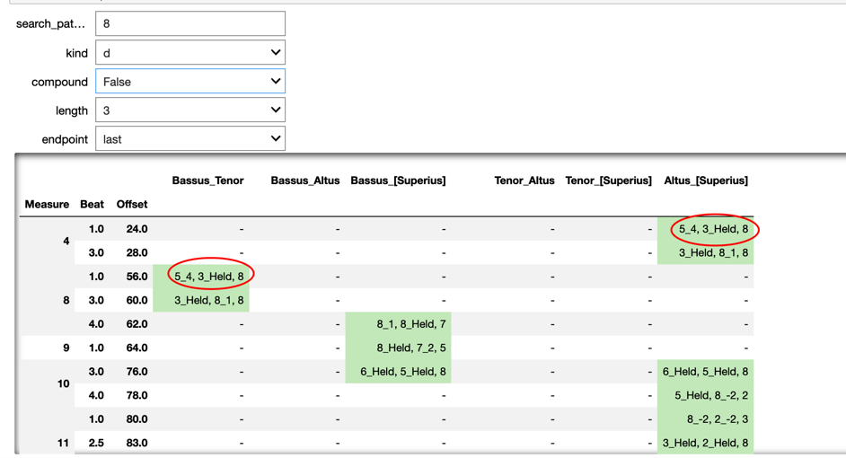

# Finding Contrapuntal Modules (and Other Complex nGrams)

## Table of Contents
1. [Contrapuntal Modules in Brief](#contrapuntal-modules-in-brief)
2. [Contrapuntal nGrams by Default with the `ngram()` Function](#contrapuntal-ngrams-by-default-with-the-ngram-function)
3. [Contrapuntal nGram Parameters](#contrapuntal-ngram-parameters)
4. [Extra Parameters: Exclude Rests and Show Both Voices](#extra-parameters--exclude-rests-and-show-both-voices)
5. [Combining Unisons](#combining-unisons)
6. [Corpus Methods with Contrapuntal nGrams](#corpus-methods-with-contrapuntal-ngrams)
7. [Filtering and Counting nGrams](#filtering-and-counting-ngrams)
8. [Searching with Interact in a Notebook](#searching-with-interact-in-a-notebook)
9. [Sections in this guide](#sections-in-this-guide)

## Contrapuntal Modules in Brief

A **contrapuntal module** (as formulated by our colleagues Julie Cumming and Peter Schubert) is a special kind **nGram** that describes the movement of any two voices:  

- a succession of **harmonic intervals** between the two voices (normally reprensented by the odd-numbered positions in the nGram), and
- a succession of **melodic intervals** made by the lower ('tenor') voice of the pair.

One might think that we would need to describe the melodic motion of *both voices* (and that is possible via an advanced setting of the CRIM Intervals `nGrams` method).  But in fact knowing the movement of the harmonic intervals and the melodic intervals of the lower voice alone is enough to fully describe the counterpoint (since we could infer the motion of the upper voice from the parts of the result).

Consider the following example from Josquin's *Ave Maria*:



The **red squares represent the harmonic intervals**; the **blue ovals represent the melodic motion in the lower part**.  Together they form a 3-gram, since there are three harmonic 'states'. The `n` parameter (explained below) allows us to find contrapuntal ngrams of any length. But '3' is the default.

## Contrapuntal nGrams by Default with the `ngram()` Function

By default, the `ngrams` method will return contrapuntal nGrams.  

All parameters and their defaults:

```python
ngrams(df=None, 
       n=3, 
       how='columnwise', 
       other=None, 
       held='Held',
       exclude=['Rest'], 
       interval_settings=('d', True, True), 
       unit=0,
       offsets='first', 
       show_both=False)
```

Simple usage with those defaults:  

```python
piece.ngrams()
```

You will probably want to fill the `na values` for readability, so you might use:

```python
piece.ngrams().fillna(')
```



## Contrapuntal nGram Parameters

By default the `ngrams` method uses `compound` intervals (melodic and harmonic alike). This is why in the chart shown above the ngrams for the Cantus-Altus pair are different from the Tenor-Bassus pair (the Altus begins a 12th below the Cantus when it first enters; the Bassus is only a 5th below the Tenor). If you would like to use `simple` intervals instead (and thus find identical modules regardless of these octave differences) then see below, where explain how to build up custom ngrams from the `melodic` and `harmonic` methods.  But for now, here are the parameters that can be used with the `ngrams` method:
​
* **Length of nGrams**.  Remember that this will be number of the odd-numbered positions.  An `n=3` will in fact show 5 intervals (three harmonic surrounding two melodic).  Thus: `piece.ngrams(n=5)`. The default value is 3.
* `interval_settings`, which accepts a *tuple* that contains custom settings for the intervals reported in the contrapuntal modules via the `kind`, `directed`, and `compound` parameters provided that *no data is passed* into the `df` or `other` parameters; default is `kind = 'd'`, `directed = True`, and `compound = True`.  For example to use chromatic, directed, and simple intervals you would run `piece.ngrams(interval_settings=('C', True, False))`
* The **'endpoint' of the offset reference** (whether the offset represents the start or end of the ngram).  Thus `piece.ngrams(offsets=first)` or `piece.ngrams(offsets=last)`. 

Thus a typical request might look like this::

```python
piece.ngrams(n=5, interval_settings='c', offsets='first').fillna('')
```

## Extra Parameters:  Exclude Rests and Show Both Voices

* **exclude** is normally used to keep Rests out of the results.  `piece.ngrams(exclude=['Rests'])` (note that the string 'Rests' must be in a list `[]`) will make sure that the results are only nGrams consisting of melodic and harmonic intervals.  If you want *include* rests, then `piece.ngrams(exclude=[])`.  Note that in fact we could *exclude* any strings included in the list, thus: `piece.ngrams(show_both=True, exclude=['8', '5'])` will eliminate any nGram that contains either of those strings.

* The **show_both** parameter, determines the results show only the melodic intervals of the lowest part (which is default), or both voices: `piece.ngrams(show_both=True)`.  This latter setting can be helpful in finding cadences.  But note:  you *must use an empty list with **exclude** in order for this to work properly.  Thus:  `piece.ngrams(show_both=True, exclude=[])`

The results will in turn look a bit dense, but in fact how we can see the melodic motion of both voices:



## Combining Unisons

By default, the `ngrams` method uses the default behaviors of the `melodic` and `harmonic` methods, then combines these as noted above. But if you would like to `combine unisons`, then you will need to build your own ngrams from the `melodic` and `harmonic` methods, then combine them by passing these to the `df` and `other` parameters in the `ngrams()` method.  Here is how:

```python
# notes with combined unisons:
nr_no_unisons = piece.notes(combineUnisons=True)

# now those results as melodic intervals, here diatonic 
mel = piece.melodic(df=nr_no_unisons, kind="d")

# harmonic intervals, here diatonic 
har = piece.harmonic(kind="d")

# combined as ngrams
ngrams = piece.ngrams(df=har, other=mel).fillna('')
ngrams.head()
```

## Corpus Methods with Contrapuntal nGrams

Corpus tools includes a convenient method for finding Contrapuntal Ngrams in any Set of Files
Define the corpus:

`corpus_contrapuntal_ngrams(corpus, ngram_length=3)`

Here is how to use it:

```python
# define the corpus
file_list = ['https://crimproject.org/mei/CRIM_Model_0008.mei',
                    'https://crimproject.org/mei/CRIM_Mass_0005_1.mei']
corpus = CorpusBase(file_list)

# run the contrapuntal ngram method on the corpus, passing in the length of the ngrams you want
corpus_contrapuntal_ngrams(corpus, ngram_length=3)
```



Note that there are several other **corpus ngram** methods available; each provides special types of patterns:

* melodic ngrams
* melodic ngrams with durational ratios
* harmonic ngrams
* sonority ngrams

See more about these in the [08_Ngrams_Heat_Maps Tutorial](/tutorial/08_Ngrams_Heat_Maps.md).

## Filtering and Counting nGrams

```python
piece.ngrams(exclude=['Rest']).stack().value_counts().to_frame()
```




## Searching with Interact in a Notebook

Note that this will only work in Jupyter Lab!  It will probably NOT work in VS Code!

```python
# be sure that ipywidgets is installed!
from ipywidgets import interact
import re  

@interact
def get_modules(search_pattern="", kind=["d", "q", "c", "z"], compound=[True, False], length=[3, 4, 5, 6], endpoint=["last", "first"]):
    
    piece_mel = piece.melodic(kind=kind)
    piece_har = piece.harmonic(kind=kind, compound=compound)
    ngrams = piece.ngrams(df=piece_har, other=piece_mel, n=length, offsets=endpoint)
    filtered_ngrams = ngrams[ngrams.apply(lambda x: x.astype(str).str.contains(search_pattern).any(), axis=1)]#.copy()
    beats_measures_mod = piece.detailIndex(filtered_ngrams, offset=True)

    return beats_measures_mod.fillna("-").map(str).style.map(lambda x: "background: #ccebc5" if re.search(search_pattern, x) else "")
```




-----  
## Sections in this guide

  * [01_Introduction_and_Corpus](/tutorial/01_Introduction_and_Corpus.md)
  * [02_Notes_Rests](/tutorial/02_Notes_Rests.md)
  * [03_Durations](/tutorial/03_Durations.md)
  * [04_TimeSignatures_Beat_Strength](/tutorial/04_TimeSignatures_Beat_Strength.md)
  * [05_Detail_Index](/tutorial/05_Detail_Index.md)
  * [06_Melodic_Intervals](/tutorial/06_Melodic_Intervals.md)
  * [07_Harmonic_Intervals_Sonorities](/tutorial/07_Harmonic_Intervals_Sonorities.md)
  * [08_Ngrams_Heat_Maps](/tutorial/08_Ngrams_Heat_Maps.md)
  * [09_Contrapuntal_Modules](/tutorial/09_Contrapuntal_Modules.md)
  * [10_Lyrics_Homorhythm](/tutorial/10_Lyrics_Homorhythm.md)
  * [11_Cadences](/tutorial/11_Cadences.md)
  * [12_Presentation_Types](/tutorial/12_Presentation_Types.md)
  * [13_Musical_Examples_Verovio](/tutorial/13_Musical_Examples_Verovio.md)
  * [14_Model_Finder](/tutorial/14_Model_Finder.md)
  * [15_Network_Graphs](/tutorial/15_Network_Graphs.md)
  * [16_Python_Basics](/tutorial/16_Python_Basics.md)
  * [17_Pandas_Basics](/tutorial/17_Pandas_Basics.md)
  * [18_Visualizations_Summary](/tutorial/18_Visualizations_Summary.md)
  * [19_Music21_Basics_MEI](/tutorial/19_Music21_Basics_MEI.md)
  * [20_Melodic_Interval_Families](/tutorial/20_Melodic_Interval_Families.md)
  * [21_Corpus_Tools](/tutorial/21_Corpus_Tools.md)
  * [99_Local_Installation](/tutorial/99_Local_Installation.md)
