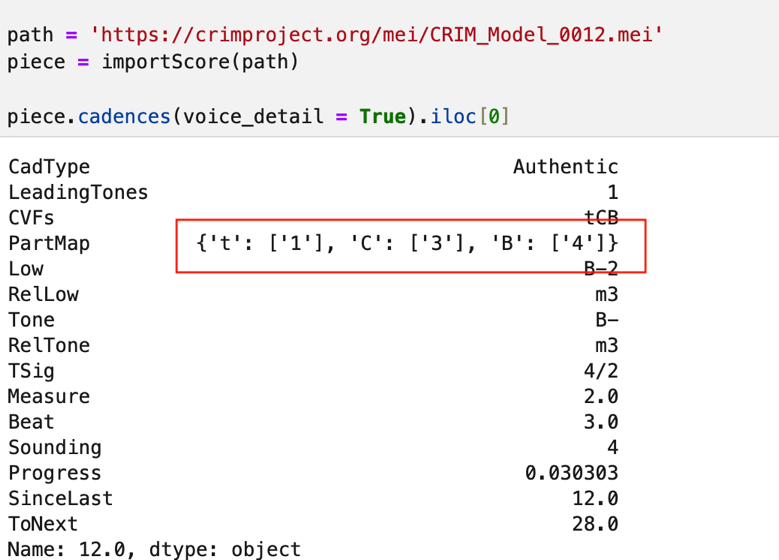

# Cadences

## Table of Contents
1. [The `piece.cadences()` Function in Brief](#the-piececadences-function-in-brief)
2. [The Column Headings for `piece.cadences()` Output in Detail](#the-column-headings-for-piececadences-output-in-detail)
3. [The Cadential Voice Functions Explained](#the-cadential-voice-functions-explained)
4. [Parameters of `piece.cadences()`](#parameters-of-piececadences)
5. [Cadences in a Corpus](#cadences-in-a-corpus)
6. [Summarizing and Grouping Cadence Results](#summarizing-and-grouping-cadence-results)
7. [Cadence Results in Score with `verovioprintCadences`](#cadence-results-in-score-with-verovioprintcadences)
8. [Cadence Radar Plots for One or Many Pieces: `piece.cadenceRadarPlot()` and `corpus.compareCadenceRadarPlots()`](#cadence-radar-plots-for-one-or-many-pieces--piececadenceradarplot-and-corpuscomparecadenceradarplots)
9. [Cadence Progress Plots](#cadence-progress-plots)
10. [Sections in this guide](#sections-in-this-guide)

## The `piece.cadences()` Function in Brief

CRIM Intervals includes a powerful tool that identifies cadences according to the combinations of two-voice modules that describe the typical contrapuntal motion between the various cadential voice functions (CVF) heard in Renaissance polyphony: cantizans and tenorizans, cantizans and bassizans, etc.

For a quick report, run:

```python
piece.cadences()
```

The complete function with its default settings is:

```python
piece.cadences(keep_keys=False, voice_detail=False, key_sig=False, include_final=False)
```

Each of these optional parameters adds columns to the output (see [Parameters of `piece.cadences()`](#parameters-of-piececadences) below).

The dataframe reported by `piece.cadences()` is quite detailed, but includes (most notably):

* **Cadence Tone** (the goal pitch, determined by the final perfect sonority)
* **Cadence Type** (authentic, phrygian, and so on, according to the CRIM Controlled Vocabulary)
* **Modifications** (evaded, incomplete, etc)
* **Contextual Information** (the place and disposition of the cadence relative to the rest of the piece)
* *Much more!* (see below for details)

The tool uses **modular ngrams** to identify conjunctions of these pairs in order to predict cadences of various kinds. But there are many combinations, especially once we consider that voices functions (or roles) can be displaced (as when the tenorizans role appears in the Superius part and the cantizans appears in the Tenor part), or through irregular motion, and even interrupted, as when a voice is suddenly silent.

It is possible to check all of the **cadential voice functions (CVFs)** for a given piece below. But this tool also conveniently labels the cadences according to type, tone, evaded and also provides information about the relative place within the piece, the adjacent cadences, and many other features, too.

Note: **Measure** and **Beat** columns are in the *body of the table*, not at the Index.

## The Column Headings for `piece.cadences()` Output in Detail:


* The **Pattern** column (only shown with `keep_keys=True`) is the combination of cadential voice functions and chromatic intervals (of the Cantizans, Tenorizans, and Altizans CVFs) that triggered the cadence.
* The **Key** column (only shown with `keep_keys=True`) is the string used by the classifier to match the Pattern against the cadence label table and so determine the label. "BC1" for instance, means "bassizans, cantizans, and one leading tone". Note that these letters appear in alphabetical order, not the order of the voices in the score. This "Key" is *not* a musical key or key signature.
<!-- check spelling of the types -->
* The **CadType** is a high-level label: 

  * **Clausula Vera** is for cadences involving only Cantizans and Tenorizans, which move via suspension formula to unison or octave; 
  * **Authentic** is for Cantizans and Bassizans (and possibly the Tenorizans, too); check the CVFs (cadential voice functions to see if the Tenorizans is present. 
  * **Phrygian Clausula Vera** is like Clausula Vera but with the half-step motion in the downward-moving (Tenorizans) part. 
  * **Phrygian** corresponds to Authentic, except that the Bassizans of course moves up a fifth or down a fourth, as is normally the case when the Tenorizans descends by half-step.  Check the Cadential Voice Functions (CVFs) in the output table to see whether the Tenorizans is present. 
  * **Altizans Only** is in cases where the Cantizans is missing and the Altizans role moves to a fifth above the lowest voice.
  * **Double Leading Tone** is heard frequently in fifteenth-century repertories, but rarely in the sixteenth century; the Contratenor voice sits between the Tenorizans and Cantizans, moving in parallel fourths with the latter and arriving at a tone a fifth above the final.  In order to avoid a tritone between it and the Cantizans, it moves by half step, thus producing the 'double leading tone' effect.
  * **Phrygian Altizans** is the Phrygian counterpart of Altizans Only, with the half-step motion in the downward-moving part.
  * **Leaping Contratenor** is a cadence in which the lowest voice leaps up an octave at the moment of perfection (the "L" CVF), instead of moving as a Bassizans.
  * **Quince** is best understood as an irregular Clausula Vera, but the Tenorizans part (usually above the Cantizans) moves up a fourth or down a fifth at the perfection, so that the Cantizans and Tenorizans arrive at a perfect fifth.  Hence the name:  "Quince". It is rare, usually heard only in thicker textures with a Quinta pars.
  * **Reinterpreted** is very rare. It first sounds like an Authentic cadence, since one pair of voices works as Cantizans and Bassizans. But a Tenorizans below the apparent Bassizans causes the Cantizans to be reinterpreted as an Altizans, and the Bassizans as a Quintizans.
  * **Evaded and Abandoned** indicate either irregular motion or some number of voices that drop out.  These are noted for **Clausula Vera**, **Authentic**, and **Double Leading Tone** types
  
See `print(piece.cvfs.__doc__)` for other labels.
  
* **LeadingTones** is the count of leading tones (semitone motions) as notated in the score, in the Cantizans, Tenorizans, or Altizans. `0` means no leading tone is notated (a likely place for editorial ficta). `-1` means the CVF that would normally carry the leading tone is evaded or abandoned, so the count does not apply.
* **CVFs** are the Cadential Voice Functions, and are listed in order from top to bottom as they appear in the score. Uppercase letters are realized CVFs; lowercase are evaded or abandoned. See `print(piece.cvfs.__doc__)` for details.
* The **PartMap** column (only shown with `voice_detail=True`) maps each CVF letter to the staff position(s) of the voice(s) that performed it (1 = highest voice), for example `{'T': ['1'], 'C': ['2'], 'B': ['4']}`.
* The **Low** and **Tone** columns give the pitches of the lowest sounding pitch (in any voice) at the perfection, and the goal tone of the cantizans (or altizans if there is no cantizans) respectively. Tone is empty (NaN) if the Cantizans is evaded or abandoned.
* **RelLow** is the lowest pitch of each cadence shown as an interval measured against the final of the piece (see `piece.final()`). This makes it easier to compare pieces in different modes or transpositions.
* Likewise, **RelTone** is the cadential tone shown as an interval measured against the final.
* **TSig** is the time signature (as encoded in the score) at the perfection.
* **Measure** and **Beat** give the location of the perfection.
* **Sounding** is the number of voices heard at the perfection, including voices that have no CVF role in the cadence.
* The **Progress** column is a relative indication of position in the piece. `0` is the beginning of the piece; `1.0` is the last attack in the piece.
* The **SinceLast** and **ToNext** columns are the time in quarter notes since the last or to the next cadence. For the first cadence, SinceLast is measured from the start of the piece; for the last, ToNext is measured to the end.
* **KeySig** (only shown with `key_sig=True`) is the key signature at the perfection, counted as sharps (positive) or flats (negative); `0` means no key signature.
* **Final** (only shown with `include_final=True`) is the final of the piece (from `piece.final()`), repeated on every row.

<!-- Check print statement  -->
Read more via the documentation: `print(piece.cadences.__doc__)` and especially `print(piece.cvfs.__doc__)` for the voice labels.

View the **Cadential Voice Function** and **Cadence Label** tables [here](https://github.com/HCDigitalScholarship/intervals/tree/main/crim_intervals/data/cadences). These can easily be updated with revised or new cadence types.

## The Cadential Voice Functions Explained

The high-level labels explained above are just that:  convenient terms that distinguish the main forms of contrapuntal closure.  Of course different analysts will want to use different terms, or consider more or fewer distinctions among types.  But all of the concepts are abstractions based on *combinations* of the **cadential voice functions** (CVFs).  Including these in the reports of cadences can be a good way to understand the subtleties of the individual subtypes, particularly since CVF results are presented *according to their position in the score*, from highest to lowest.

<!-- They all need examples! -->

**Realized Cadential Voice Functions:**

* "C": cantizans motion up a step (can also be ornamented e.g. Landini)
* "T": tenorizans motion down a step (can be ornamented with anticipations)
* "B": bassizans motion up a fourth or down a fifth
* "A": altizans motion, similar to cantizans, but cadences to a fifth above a tenorizans instead of an octave
* "L": leaping contratenor motion up an octave at the perfection
* "P": plagal bassizans motion up a fifth or down a fourth
* "Q": quintizans, like a tenorizans, but resolves down by fifth or up by fourth to a fourth below the goal tone of a cantizans or an octave below the goal tone of an altizans
* "S": sestizans, occurring in some thicker 16th century textures, this is where the agent against the cantizans is already the cantizans' note of resolution (often results in a simultaneous false relation); the melodic motion is down by third at the moment of perfection

**Evaded Cadential Voice Functions:**

* "c": evaded cantizans when it moves to an unexpected note at the perfection
* "t": evaded tenorizans when it goes up by step at the perfection
* "b": evaded bassizans when it goes up by step at the perfection
* "u": evaded bassizans when it goes down by third at the perfection (there are no evaded labels for the altizans, plagal bassizans leaping contratenor CVFs)
* "s": evaded sestizans when it resolves down by second

**Abandoned Cadential Voice Functions:**

* "x": evaded bassizans motion where the voice drops out at the perfection
* "y": evaded cantizans motion where the voice drops out at the perfection
* "z": evaded tenorizans motion where the voice drops out at the perfection

The way these CVFs combine determines which cadence labels are assigned
in the `.cadences()` method.

## Parameters of `piece.cadences()`

The `cadences()` function has four optional parameters. All are `False` by default, and each one adds one or more columns to the table.

* **keep_keys**: if set to True, adds the **Pattern** and **Key** columns, which show the combination of CVFs and intervals that triggered each cadence and the string used to match it to a cadence label.
* **voice_detail**: if set to True, adds the **PartMap** column, which shows which voice (by staff position, 1 = highest) carried each CVF. Staff positions are used instead of voice names so that results can be compared across pieces that name their voices differently.  See sample below.
* **key_sig**: if set to True, adds the **KeySig** column with the key signature at each cadence (positive numbers = sharps, negative = flats).
* **include_final**: if set to True, adds the **Final** column with the final of the piece on every row. This is useful in a corpus, for grouping or filtering cadences by final or mode.

```python
piece.cadences(keep_keys = True)
piece.cadences(voice_detail = True)
piece.cadences(key_sig = True, include_final = True)
```

With `voice_detail = True` the df includes a dictionary that gives the cadential voice function fulfilled by the individual voice parts.  1 is the top voice of the score, and so on.




## Cadences in a Corpus

The basic methods of building and working with a corpus are explained in the[Corpus_Tools](tutorial/21_Corpus_Tools.md) tutorial.


```python
#build corpus
corpus = CorpusBase(['https://crimproject.org/mei/CRIM_Mass_0014_3.mei',
                        'https://crimproject.org/mei/CRIM_Model_0009.mei'])
# pass the corpus to the method
corpus_tools.corpus_cadences(corpus)
```


## Summarizing and Grouping Cadence Results

**A quick way to reorganize the columns in the output:**

```python
cadences = piece.cadences(keep_keys = True)
col_list = ['Measure', 'Beat', 'CadType', 'Pattern', 'Key', 'Tone','LeadingTones', 'CVFs', 'Low','RelLow','RelTone', 'Sounding', 'Progress','SinceLast','ToNext']
cadences = cadences[col_list]
cadences
```

**Group the Cadences by Tone and Type**

```python
cadences = piece.cadences()
cadences.groupby(['Tone', 'CadType', 'CVFs']).size().reset_index(name = 'counts')
```


## Cadence Results in Score with `verovioprintCadences`

The simplest way to show cadences with Verovio: 

```python
piece.verovioCadences()
```

Or send a filtered list of cadences for printing. Create the cadence table, filter it in some way, and the pass those results to `verovioCadences()`:

```python
cadences = piece.cadences()
cadences_filtered = cadences[cadences['Tone'] == 'G']
piece.verovioCadences(cadences_filtered)
```


Note that pink warning messages that sometimes appear in Jupyter notebooks can be ignored!

## Cadence Radar Plots for One or Many Pieces:  `piece.cadenceRadarPlot()` and `corpus.compareCadenceRadarPlots()` 

Radar plots a good way to provide insights about the tonal 'footprint' of one or more pieces. Information derived from the `piece.cadences()` is plotted as a circular graph:  cadence tones (and types, depending on the settings) are indicated at the perimeter. The count of cadences of each tone (or type) is then used as a scalar value (0 is the very center of the plot, with increasing numbers moving out from the center to indicate relative count and therefore weight). 

The plots are interactive:

* Hover to see count details for single piece plots
* Click to include/exclude individual pieces in corpus comparison plots


### Radar Plot Parameters In Brief

#### For One Piece
Parameters Overview:

- **combinedType**: if set to True, the Cadences would be classified based on both their Type and Tone. If set to False, only Tone will be used. False by default
- **sounding**: specify how many voices are sounding (optional). Takes an integer input. Set to None by default
- **displayAll**: if set to True, the chart will display all pitches in the Default (Fifth) or Custom order
- **customOrder**: the custom order parameter. Takes in a List of Strings (see below)
- **renderer**: specify what renderer to be used for the plot (options include but are not limited to "svg", "iframe", "png", "notebook" etc)

Typical use:

```python
piece.cadenceRadarPlot(combinedType = False, displayAll = True, renderer = "iframe")
```

Default display order (could be modified for `customOrder`)

```python
order_array = ["D", "A", "E", "B", "F#", "Db", "Ab", "Eb", "Bb", "F", "C", "G"]
```

Complete function with default settings:

```python
piece.cadenceRadarPlot(combinedType = False, sounding = None, displayAll = True, customOrder = None, renderer = "iframe")
```


#### For A Corpus of Pieces

Parameters Overview:

- **combinedType**: if set to True, the Cadences would be classified based on both their Type and Tone. If set to False, only Tone will be used. False by default
- **sounding**: specify how many voices are sounding (optional). Takes an integer input. Set to None by default
- **displayAll**: if set to True, the chart will display all pitches in the Default (Fifth) or Custom order
- **customOrder**: the custom order parameter. Takes in a List of Strings
- **renderer**: specify what renderer to be used for the plot (options include but are not limited to "svg", "iframe", "png", "notebook" etc

Typical use:

```python
corpus.compareCadenceRadarPlots(combinedType = False, displayAll = True, renderer = "iframe")
```


Complete default function code:

```python
corpus.compareCadenceRadarPlots(combinedType = False, sounding = None, displayAll = True, customOrder = None, renderer = "iframe")
```

Default display order (could be modified for `customOrder`)

```python
order_array = ["D", "A", "E", "B", "F#", "Db", "Ab", "Eb", "Bb", "F", "C", "G"]
```


## Cadence Progress Plots 

These are a way to see the 'flow' of cadences in one or more pieces:  `piece.cadenceProgressPlot()` and `corpus.compareCadenceProgressPlots()`

#### For One Piece
Parameters Overview:

- **includeType**: if set to True, the Cadence markers would be set based on both their Type. If set to False, a universal (round) marker will be used
- **cadTone**: specify the Tone of cadences to explore. Takes an String input. Set to None by default
- **cadType**: specify the Type of cadences to explore. Takes an String input. Set to None by default
- **customOrder**: specify a custom order to be used for the plot, as a dictionary: e.g. {"A":0, "B":1 ...}
- **includeLegend**: flag to display legend; Default set to True
- **renderer**: specify what renderer to be used for the plot (options include but are not limited to "svg", "iframe", "png", "notebook" etc)


Typical use:

```python
piece.cadenceProgressPlot(includeType = True)
```

Complete function with defaults:

```python
piece.cadenceProgressPlot(includeType = False, cadTone = None, cadType = None, customOrder = None, includeLegend = True, renderer = "")
```


#### For A Corpus of Pieces

Parameters Overview:

- **includeType**: if set to True, the Cadence markers would be set based on both their Type. If set to False, a universal (round) marker will be used
- **cadTone**: specify the Tone of cadences to explore. Takes an String input. Set to None by default
- **cadType**: specify the Type of cadences to explore. Takes an String input. Set to None by default
- **customOrder**: specify a custom order to be used for the plot (a dictionary: e.g. {"A":0, "B":1 ...}
- **includeLegend**: flag to display legend; Default set to True

Typical use:

```python
corpus.compareCadenceProgressPlots(includeType = True)
```


Complete function with defaults:

```python
corpus.compareCadenceProgressPlots(includeType = False, cadTone = None, cadType = None, includeLegend = True, customOrder = None, renderer = "")
```

Default order dictionary (could be modified for `customOrder`)

```python
order_dict = {"Eb":0, "Bb":1, "F":2, "C":3, "G":4, "D":5, "A":6, "E":7, "B":8, "F#":9, "C#":10, "Ab":11}
```


-----

## Sections in this guide

  * [01_Introduction_and_Corpus](/tutorial/01_Introduction_and_Corpus.md)
  * [02_Notes_Rests](/tutorial/02_Notes_Rests.md)
  * [03_Durations](/tutorial/03_Durations.md)
  * [04_TimeSignatures_Beat_Strength](/tutorial/04_TimeSignatures_Beat_Strength.md)
  * [05_Detail_Index](/tutorial/05_Detail_Index.md)
  * [06_Melodic_Intervals](/tutorial/06_Melodic_Intervals.md)
  * [07_Harmonic_Intervals_Sonorities](/tutorial/07_Harmonic_Intervals_Sonorities.md)
  * [08_Ngrams_Heat_Maps](/tutorial/08_Ngrams_Heat_Maps.md)
  * [09_Contrapuntal_Modules](/tutorial/09_Contrapuntal_Modules.md)
  * [10_Lyrics_Homorhythm](/tutorial/10_Lyrics_Homorhythm.md)
  * [11_Cadences](/tutorial/11_Cadences.md)
  * [12_Presentation_Types](/tutorial/12_Presentation_Types.md)
  * [13_Musical_Examples_Verovio](/tutorial/13_Musical_Examples_Verovio.md)
  * [14_Model_Finder](/tutorial/14_Model_Finder.md)
  * [15_Network_Graphs](/tutorial/15_Network_Graphs.md)
  * [16_Python_Basics](/tutorial/16_Python_Basics.md)
  * [17_Pandas_Basics](/tutorial/17_Pandas_Basics.md)
  * [18_Visualizations_Summary](/tutorial/18_Visualizations_Summary.md)
  * [19_Music21_Basics_MEI](/tutorial/19_Music21_Basics_MEI.md)
  * [20_Melodic_Interval_Families](/tutorial/20_Melodic_Interval_Families.md)
  * [21_Corpus_Tools](/tutorial/21_Corpus_Tools.md)
  * [99_Local_Installation](/tutorial/99_Local_Installation.md)
