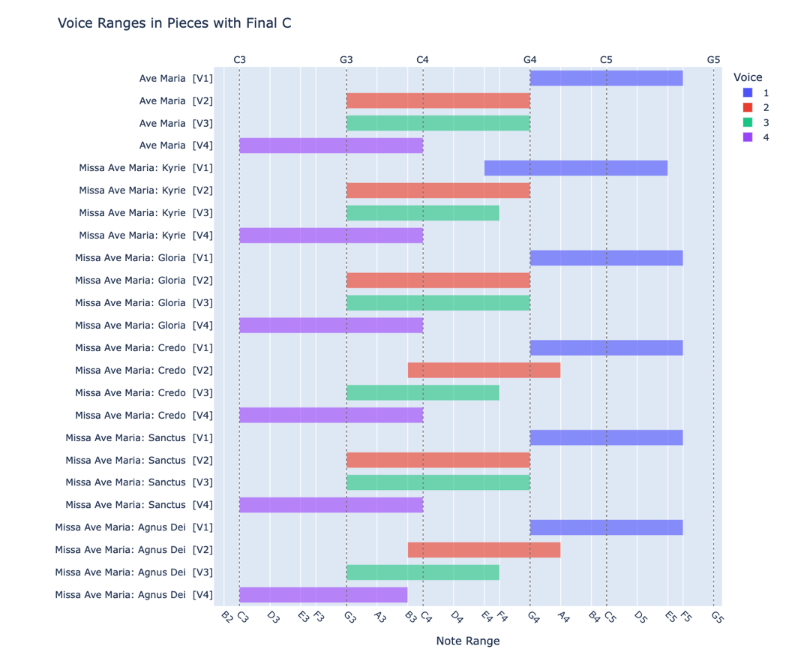
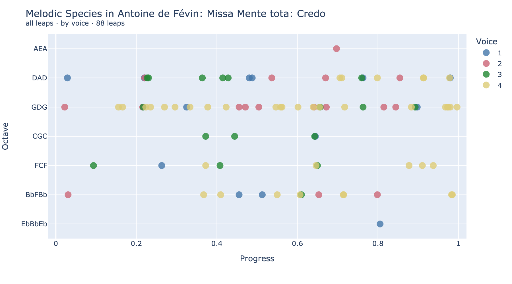
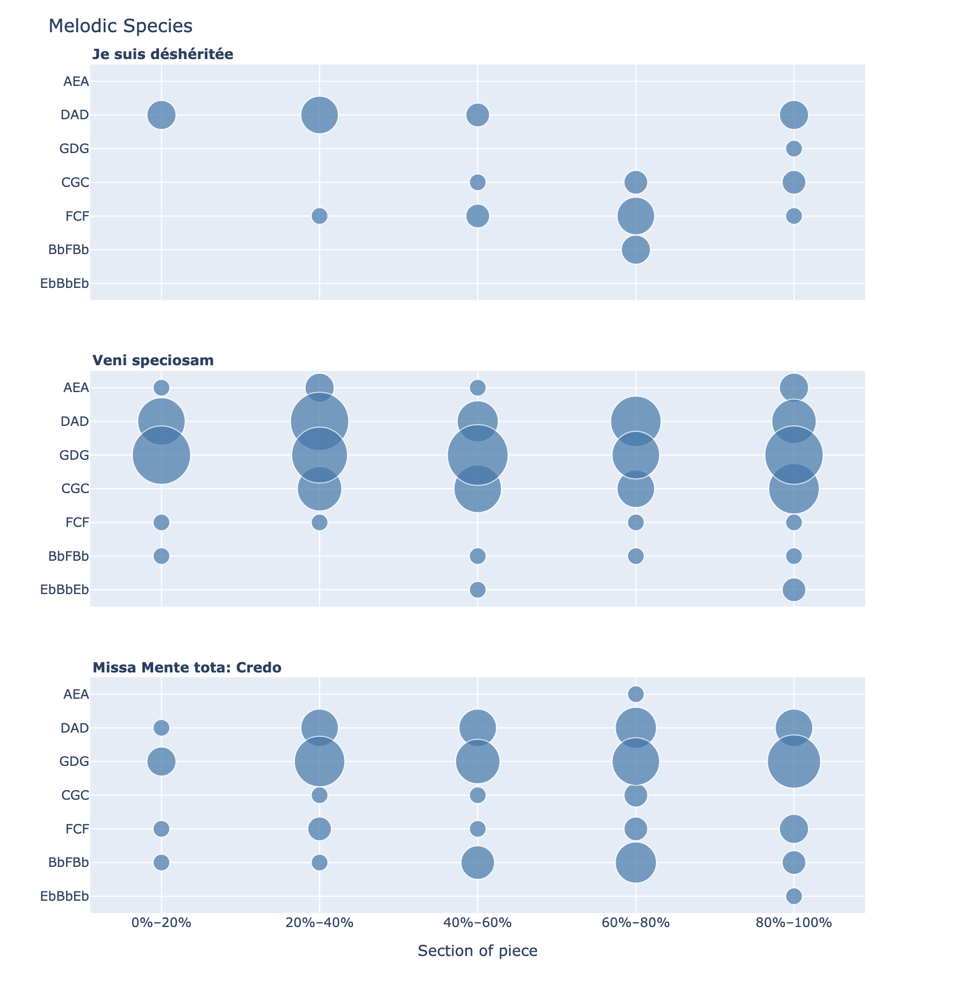
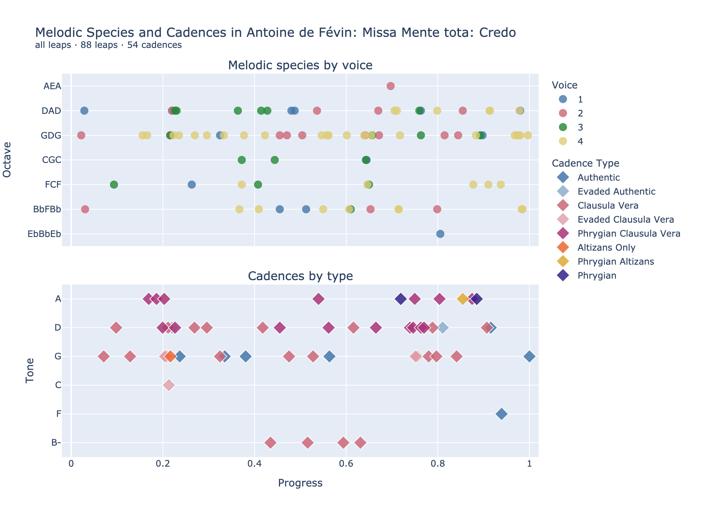

# Voice Ranges and Melodic Species

## Table of Contents
1. [Introduction](#introduction)
2. [Voice Ranges in One Piece: `piece.voice_ranges()`](#voice-ranges-in-one-piece-piecevoice_ranges)
3. [Voice Ranges in a Corpus: `corpus.voice_ranges()`](#voice-ranges-in-a-corpus-corpusvoice_ranges)
4. [Charting Voice Ranges: `voice_range_chart()`](#charting-voice-ranges-voice_range_chart)
5. [Ordering the Pieces in the Chart](#ordering-the-pieces-in-the-chart)
6. [How the Ranges Are Found](#how-the-ranges-are-found)
7. [Melodic Species in One Piece: `piece.melodic_species()`](#melodic-species-in-one-piece-piecemelodic_species)
8. [Melodic Species in a Corpus: `corpus.melodic_species()`](#melodic-species-in-a-corpus-corpusmelodic_species)
9. [Charting Melodic Species: `plot_species()`](#charting-melodic-species-plot_species)
10. [Species and Cadences Together: `plot_species_cadences()`](#species-and-cadences-together-plot_species_cadences)
11. [How the Species Are Found](#how-the-species-are-found)
12. [Sections in this guide](#sections-in-this-guide)

## Introduction

Two of the main ways to describe the mode of a Renaissance piece are the **range** of its voices and the **octave species** its melodies outline, each considered together with the final. Voices on the same final may have an authentic or plagal range; and melodies tend to state the fifths and fourths that divide the mode's octave (for a mode on G, the fifth G–D and the fourth D–G). CRIM Intervals provides methods and charts for both:

* `piece.voice_ranges()` and `corpus.voice_ranges()`: the range of each voice
* `voice_range_chart()`: a chart of those ranges, one bar per voice, with reference lines for the final
* `piece.melodic_species()` and `corpus.melodic_species()`: each melodic fourth and fifth, with the octave species it helps to articulate
* `plot_species()`: where those species occur across the piece
* `plot_species_cadences()`: species and cadences on one timeline

As usual, start with:

```python
import crim_intervals
from crim_intervals import *
import crim_intervals.visualizations as viz
import pandas as pd
```

The chart functions are also available without the `viz.` prefix after `from crim_intervals import *`; see [17_Visualizations_Summary](/tutorial/17_Visualizations_Summary.md).

## Voice Ranges in One Piece: `piece.voice_ranges()`

Rather than reporting the absolute lowest and highest notes of each voice (which a single brief excursion can distort), `voice_ranges()` finds the **most prominent pitches** in each voice (those that take up the most time) and reports the lowest and highest of them.

```python
piece = importScore('https://crimproject.org/mei/CRIM_Mass_0014_3.mei')
piece.voice_ranges()
```

| Composer | Title | Voice | Final | LowestNote | HighestNote | Range |
|---|---|---|---|---|---|---|
| Antoine de Févin | Missa Mente tota: Credo | 1 | G | F4 | D5 | F4 to D5 |
| Antoine de Févin | Missa Mente tota: Credo | 2 | G | A3 | G4 | A3 to G4 |
| Antoine de Févin | Missa Mente tota: Credo | 3 | G | G3 | F4 | G3 to F4 |
| Antoine de Févin | Missa Mente tota: Credo | 4 | G | C3 | B-3 | C3 to B-3 |

* **Composer** and **Title**: from the piece's metadata.
* **Voice**: the staff position of the voice, where 1 is the highest staff. Numbers rather than names make results comparable across pieces with different voice names.
* **Final**: the final of the piece as a pitch class (see `piece.final()`).
* **LowestNote** and **HighestNote**: the lowest and highest of the voice's most prominent pitches.
* **Range**: the two combined, as a label.

Parameters:

* **top_n** (default 7): how many of each voice's most prominent pitches to consider. Use a smaller number for a narrower, "core" range, or a larger one to include more of the voice's outer notes.
* **number_parts** (default True): if False, the **Voice** column shows the part names (e.g. "Tenor") instead of staff numbers.
* **include_final** (default True): if False, the **Final** column is left out.

```python
piece.voice_ranges(top_n=7)
piece.voice_ranges(number_parts=False)
```

## Voice Ranges in a Corpus: `corpus.voice_ranges()`

`corpus.voice_ranges()` runs `piece.voice_ranges()` on every piece in the corpus and combines the results, adding a **Date** column alongside **Composer** and **Title**. (See [19_Corpus_Tools](/tutorial/19_Corpus_Tools.md) for building a corpus.)

```python
corpus = CorpusBase(['https://crimproject.org/mei/CRIM_Model_0009.mei',
                     'https://crimproject.org/mei/CRIM_Model_0001.mei',
                     'https://crimproject.org/mei/CRIM_Mass_0014_3.mei'])
voice_ranges_df = corpus.voice_ranges()
voice_ranges_df
```

Parameters:

* **top_n** (default 7): as for `piece.voice_ranges()`.
* **final** (optional): keep only pieces with this final, e.g. `final='G'`, or several finals as a list, e.g. `final=['D', 'G']`.
* **voices** (optional): keep only these voices, by staff number, e.g. `voices=2` or `voices=[1, 4]`.

```python
# only the pieces on G
corpus.voice_ranges(final='G')

# only the second voice from the top in each piece
corpus.voice_ranges(voices=2)
```

The result is an ordinary DataFrame, so you can group, filter or sort it as usual. For example, to compare the second voice across pieces with the same final:

```python
voice_ranges_df = corpus.voice_ranges(final='G', voices=2)
voice_ranges_df[['Title', 'Range']]
```

## Charting Voice Ranges: `voice_range_chart()`

Pass the output of `piece.voice_ranges()` or `corpus.voice_ranges()` to `voice_range_chart()`. Each voice is a horizontal bar running from its lowest to its highest prominent pitch. When all the pieces in the chart share one final, dotted lines mark the reference pitches for that final.

```python
voice_ranges_df = corpus.voice_ranges()
fig = viz.voice_range_chart(voice_ranges_df, final='G')
fig.show()
```

The function returns a Plotly figure, so you can display it with `.show()`, save it with `fig.write_html('voice_ranges.html')`, or change it further with the usual Plotly methods (see [17_Visualizations_Summary](/tutorial/17_Visualizations_Summary.md)). Hover over a bar to see its piece, voice and range.

It works the same way for a single piece:

```python
viz.voice_range_chart(piece.voice_ranges()).show()
```

Parameters:

* **final** (optional): chart only the pieces with this final. If you leave it out and all the pieces share one final, the reference lines for that final are drawn. If the pieces have several finals, no reference lines are drawn (since they would differ from piece to piece), and the chart title says so. Filtering by final is usually the most useful way to compare modal ranges.
* **piece_order** (default `'mass'`): the order of the pieces, from top to bottom (see below).
* **sort_voice** (default `'2'`): the voice used to sort pieces by range (see below).
* **title** (optional): a chart title of your own.

## Ordering the Pieces in the Chart

Within each piece, voices always run from the highest staff (V1) down. The order of the **pieces** is set with `piece_order`:

| `piece_order` | Order of pieces |
|---|---|
| `'mass'` (default) | models first (titles without a Mass movement name), then Mass movements in liturgical order (Kyrie, Gloria, Credo, Sanctus, Agnus Dei); within each group, by the lowest note of `sort_voice` |
| `'range'` | by the lowest note of `sort_voice` only, without grouping models and Mass movements |
| `'alpha'` | alphabetically by title |
| `'given'` | the order of the rows in the DataFrame you pass in, so you can sort it yourself first |
| a list of titles | exactly that order |

The default suits a CRIM corpus of models and the Masses based on them. For pieces that are not related as model and Mass, `'range'`, `'alpha'` or `'given'` will usually make more sense:

```python
# from the lowest-pitched to the highest-pitched pieces, judged by voice 2
viz.voice_range_chart(voice_ranges_df, piece_order='range')

# judged by the lowest voice instead (voice 4 in four-voice pieces)
viz.voice_range_chart(voice_ranges_df, piece_order='range', sort_voice='4')

# sort the DataFrame yourself, e.g. by composer, then keep that order
viz.voice_range_chart(voice_ranges_df.sort_values(['Composer', 'Title']), piece_order='given')

# an order of your own
viz.voice_range_chart(voice_ranges_df, piece_order=['Veni speciosam',
                                                    'Je suis déshéritée',
                                                    'Missa Mente tota: Credo'])
```

With a list, any titles you leave out are added at the end, and any titles that don't match the data (for example because of a typo) are reported in a printed message. To leave pieces out of the chart, filter the DataFrame before passing it in.




## How the Ranges Are Found

For each voice, `voice_ranges()`:

1. Adds up the total time (in quarter notes) spent on each pitch, keeping octaves distinct (so G3 and G4 are different pitches).
2. Divides each total by the voice's whole duration, **including rests**, to get that pitch's share of the voice.
3. Takes the `top_n` pitches with the largest shares. Rests are counted in the voice's duration but never chosen.
4. Reports the lowest and highest of those pitches, ordered by sounding pitch, so that B-3 (B flat) is below B3, and C6 is above B5.

Because the most prominent pitches are chosen by duration, two pitches with nearly equal shares can trade places at the `top_n` cut-off. If a range looks surprising, try a slightly different `top_n`.

The reference pitches drawn for each final are defined in `crim_intervals/sorting_lists.py` (`_RANGE_REFERENCE_BY_FINAL`); for a final on D, for example, they are D and G in each octave.

## Melodic Species in One Piece: `piece.melodic_species()`

An octave can be divided into a fifth and a fourth. The octave on G used in a mode on G, for example, divides at D: a fifth G–D below a fourth D–G. We call this octave species **GDG**. When a melody leaps a fifth or a fourth, it outlines one half of such an octave: a leap from D up to G (a fourth), or from G up to D (a fifth), both point to GDG.

`melodic_species()` finds these leaps in every voice and labels the octave species each one helps to articulate. The balance of species across a piece (and how it changes from section to section) is one sign of the piece's modal orientation.

```python
piece = importScore('https://crimproject.org/mei/CRIM_Mass_0014_3.mei')
species_df = piece.melodic_species()
species_df
```

| Composer | Title | Measure | Beat | Progress | System | Final | Voice | Interval | Species | Octave |
|---|---|---|---|---|---|---|---|---|---|---|
| Antoine de Févin | Missa Mente tota: Credo | 146 | 3 | 0.504 | -1 | G | 2 | D_4 | D/G | GDG |
| Antoine de Févin | Missa Mente tota: Credo | 80 | 4 | 0.270 | -1 | G | 4 | D_4 | D/G | GDG |
| Antoine de Févin | Missa Mente tota: Credo | 123 | 3 | 0.423 | -1 | G | 4 | D_4 | D/G | GDG |
| Antoine de Févin | Missa Mente tota: Credo | 205 | 1 | 0.706 | -1 | G | 4 | D_5 | D/A | DAD |

* **Composer** and **Title**: from the piece's metadata.
* **Measure**, **Beat** and **Progress**: where the leap begins. Progress runs from 0 (the start of the piece) to 1 (the end).
* **System**: the key signature at the start of the piece, counted in sharps: 0 for none, -1 for one flat, 1 for one sharp, and so on.
* **Final**: the final of the piece as a pitch class.
* **Voice**: the staff position of the voice, where 1 is the highest staff.
* **Interval**: the note the leap starts on and the leap itself: `D_4` is a leap up a fourth from D, `G_-5` a leap down a fifth from G.
* **Species**: the two notes of the leap, starting note first (`D/G`).
* **Octave**: the octave species the leap belongs to (`GDG`). Flats are written with `b` here (`BbFBb`), but with `-` in the other columns (`B-`).

The rows are listed voice by voice. Sort them with `species_df.sort_values('Progress')` to read them in the order they occur.

### Entries only, or every leap?

By default, `melodic_species()` keeps only the leaps that **begin a melodic entry**: the first interval of the piece in each voice, and the first after each rest or fermata. These opening gestures are where a melody most clearly states its modal identity, so they are a good place to start, but there may be only a few of them (just four in this Credo). To find every leap of a fourth or fifth, use `limit_to_entries=False`:

```python
species_df = piece.melodic_species(limit_to_entries=False)
species_df['Octave'].value_counts()
```

| Octave | count |
|---|---|
| GDG | 37 |
| DAD | 22 |
| BbFBb | 14 |
| FCF | 9 |
| CGC | 4 |
| EbBbEb | 1 |
| AEA | 1 |

In this Credo on G (with one flat), GDG is by far the most common species, followed by DAD.

Since the result is an ordinary DataFrame, you can compare voices with a cross-tabulation:

```python
pd.crosstab(species_df['Voice'], species_df['Octave'])
```

| Voice | AEA | BbFBb | CGC | DAD | EbBbEb | FCF | GDG |
|---|---|---|---|---|---|---|---|
| 1 | 0 | 2 | 1 | 6 | 1 | 1 | 2 |
| 2 | 1 | 3 | 0 | 4 | 0 | 0 | 9 |
| 3 | 0 | 1 | 3 | 6 | 0 | 3 | 4 |
| 4 | 0 | 8 | 0 | 6 | 0 | 5 | 22 |

Parameters:

* **limit_to_entries** (default True): keep only leaps that begin an entry (see above), or every leap if False.
* **species_intervals** (default `['5', '-5', '4', '-4']`): the leaps to look for, as diatonic intervals (positive is ascending).
* **four_five_dict** and **octave_dict**: the tables used to label each leap (see [How the Species Are Found](#how-the-species-are-found)). You can pass your own.

## Melodic Species in a Corpus: `corpus.melodic_species()`

`corpus.melodic_species()` runs `piece.melodic_species()` on every piece in the corpus and combines the results, adding a **Date** column. Like `corpus.voice_ranges()`, it can be limited by final and voice:

```python
corpus = CorpusBase(['https://crimproject.org/mei/CRIM_Model_0009.mei',
                     'https://crimproject.org/mei/CRIM_Model_0001.mei',
                     'https://crimproject.org/mei/CRIM_Mass_0014_3.mei'])
species_df = corpus.melodic_species()

# count the species in each piece
species_df.groupby(['Title', 'Final'])['Octave'].value_counts().unstack(fill_value=0)
```

| Title | Final | CGC | DAD | FCF | GDG |
|---|---|---|---|---|---|
| Je suis déshéritée | D | 0 | 1 | 2 | 0 |
| Missa Mente tota: Credo | G | 0 | 1 | 0 | 3 |
| Veni speciosam | G | 7 | 8 | 0 | 14 |

Parameters (besides those of `piece.melodic_species()`):

* **final** (optional): keep only pieces with this final, e.g. `final='G'`, or several as a list, e.g. `final=['D', 'G']`. Use `-` for flats (`'B-'`, not `'Bb'`).
* **voices** (optional): keep only these voices, by staff number, e.g. `voices=2` or `voices=[1, 4]`.

```python
# the second voice from the top, in the pieces on G
corpus.melodic_species(final='G', voices=2)
```

## Charting Melodic Species: `plot_species()`

Pass the output of `piece.melodic_species()` or `corpus.melodic_species()` to `plot_species()`. Each dot is one leap, placed by where it falls in the piece (`Progress`) and the octave species it articulates, and colored by voice:

```python
species_df = piece.melodic_species(limit_to_entries=False)
viz.plot_species(species_df)
```



For a corpus, each piece gets its own row, since progress is measured within each piece. To see the overall pattern rather than individual leaps, use `show_voice_detail=False`: each piece is divided into equal sections, and the size of each dot shows how many leaps articulate that species in that section. Hover over a dot to see the leaps and measures it includes.

```python
species_df = corpus.melodic_species(limit_to_entries=False)
viz.plot_species(species_df, show_voice_detail=False)
```



Parameters:

* **show_voice_detail** (default True): one dot per leap, colored by voice; or, if False, dots sized by count in each section.
* **progress_bins** (default 5): the number of sections when `show_voice_detail=False`.
* **octave_order** (optional): the order of species on the vertical axis, from bottom to top. The default, from `sorting_lists.species_octave_order`, runs by fifths from EbBbEb up to BF#B.
* **chart_title** (optional): a title of your own.

Leaps whose species is not in the `octave_dict` (for example, if you add other intervals to `species_intervals`) are not plotted, and a note lists them.

## Species and Cadences Together: `plot_species_cadences()`

Do the species stated in the melodies match the tones on which the piece cadences? `plot_species_cadences()` puts the two on one timeline: species above (colored by voice), cadences below (colored by cadence type, as in the other cadence charts):

```python
viz.plot_species_cadences(piece.melodic_species(limit_to_entries=False), piece.cadences())
```



In this Credo, the G and D cadences sit alongside the many GDG and DAD leaps, while the stretch of cadences on B-flat (around the middle of the piece) coincides with more BbFBb leaps.

The chart shows one piece at a time. With corpus results, name the piece with `title=`, or loop over the titles:

```python
species_df = corpus.melodic_species(limit_to_entries=False)
cadences = corpus.cadences()
for title in species_df['Title'].unique():
    viz.plot_species_cadences(species_df, cadences, title=title).show()
```

See [11_Cadences](/tutorial/11_Cadences.md) for more about cadences.

## How the Species Are Found

For each voice, `melodic_species()`:

1. Finds the diatonic melodic intervals (as in `piece.melodic(kind='d')`) and keeps only those in `species_intervals`: by default, fourths and fifths, up or down. With `limit_to_entries=True`, it keeps only those that begin an entry (via `piece.entries()`).
2. Joins each one to the pitch class of its starting note, giving a label such as `D_4` or `G_-5`. Octaves are ignored, so a leap from D3 and one from D4 are labeled alike, but accidentals are kept, so a leap from B-flat (`B-_5`) is distinct from one from B (`B_5`).
3. Looks up the label in `four_five_dict` to find the two notes of the leap (`D_4` → `D/G`).
4. Looks up those two notes in `octave_dict` to find the octave species (`D/G` → `GDG`).

The two dictionaries are defined in `crim_intervals/sorting_lists.py` (`species_four_five_dict` and `species_octave_dict`), and can be replaced with your own through the `four_five_dict` and `octave_dict` parameters.

Because the intervals are diatonic, they do not distinguish perfect from augmented or diminished fourths and fifths, and the dictionaries assume perfect ones. So a tritone leap from F up to B natural is labeled `F_4` and classified as BbFBb. Such leaps are rare in this repertory (in six CRIM pieces we checked, one leap in more than 450), but it is worth checking the **Interval** column if a species looks out of place.

## Sections in this guide

  * [01_Introduction_and_Corpus](/tutorial/01_Introduction_and_Corpus.md)
  * [02_Notes_Rests](/tutorial/02_Notes_Rests.md)
  * [03_Durations](/tutorial/03_Durations.md)
  * [04_Time_Signatures_Beat_Strength](/tutorial/04_Time_Signatures_Beat_Strength.md)
  * [05_Detail_Index](/tutorial/05_Detail_Index.md)
  * [06_Melodic_Intervals](/tutorial/06_Melodic_Intervals.md)
  * [07_Harmonic_Intervals_Sonorities](/tutorial/07_Harmonic_Intervals_Sonorities.md)
  * [08_Ngrams_Heat_Maps](/tutorial/08_Ngrams_Heat_Maps.md)
  * [09_Contrapuntal_Modules](/tutorial/09_Contrapuntal_Modules.md)
  * [10_Lyrics_Homorhythm](/tutorial/10_Lyrics_Homorhythm.md)
  * [11_Cadences](/tutorial/11_Cadences.md)
  * [12_Presentation_Types](/tutorial/12_Presentation_Types.md)
  * [13_Voice_Ranges_Melodic_Species](/tutorial/13_Voice_Ranges_Melodic_Species.md)
  * [14_Melodic_Interval_Families](/tutorial/14_Melodic_Interval_Families.md)
  * [15_Musical_Examples_Verovio](/tutorial/15_Musical_Examples_Verovio.md)
  * [16_Model_Finder](/tutorial/16_Model_Finder.md)
  * [17_Visualizations_Summary](/tutorial/17_Visualizations_Summary.md)
  * [18_Network_Graphs](/tutorial/18_Network_Graphs.md)
  * [19_Corpus_Tools](/tutorial/19_Corpus_Tools.md)
  * [20_Python_Basics](/tutorial/20_Python_Basics.md)
  * [21_Pandas_Basics](/tutorial/21_Pandas_Basics.md)
  * [22_Music21_MEI](/tutorial/22_Music21_MEI.md)
  * [99_Local_Installation](/tutorial/99_Local_Installation.md)
