# Engraving Musical Examples with Verovio

## Table of Contents
1. [`piece.verovioPrintExample()`](#pieceverovioprintexample)
2. [`piece.verovioCadences()`](#pieceveroviocadences)
3. [`piece.verovioHomorhythm()`](#pieceveroviohomorhythm)
4. [`piece.verovioPtypes()`](#pieceverovioptypes)
5. [`piece.verovioNgrams()`](#pieceveroviongrams)
6. [Highlighting Notes in Red: `highlights=True`](#highlighting-notes-in-red-highlightstrue)
7. [Print with Analytic Highlights: `linkExamples()`](#print-with-analytic-highlights--linkexamples)
8. [Sections in this guide](#sections-in-this-guide)

Thanks to Laurent Pugin's powerful suite of [Verovio](https://www.verovio.org/index.xhtml) engraving library, it is also possible to render musical examples from MEI and MusicXML files.  

Here we present TWO approaches to creating musical examples in your notebook:

* with various **`verovioPrint . . .()`** works with ONE piece at a time (for specific measure ranges, cadences, presntation types and homorhythym outputs); these produce LONG sequences of all the results
* with various **`linkExamples()`** can work with ONE piece or a corpus, producing table(s) with embedded links that you can view selectively, or even download as linked sheets.

**NB:**  For BOTH methods you must load your MEI files from a URL (and not locally)

###  *A Note about Saving and Printing Examples*

As in the case of charts and figures, you might want to save or print your work for review outside the Jupyterlab environment.  The best solution in this case is to Export your notebook to *html*, which is essentially a web page downloaded to your computer.  You can then open the html file in your browser for review or printing.  Here is now to do it:


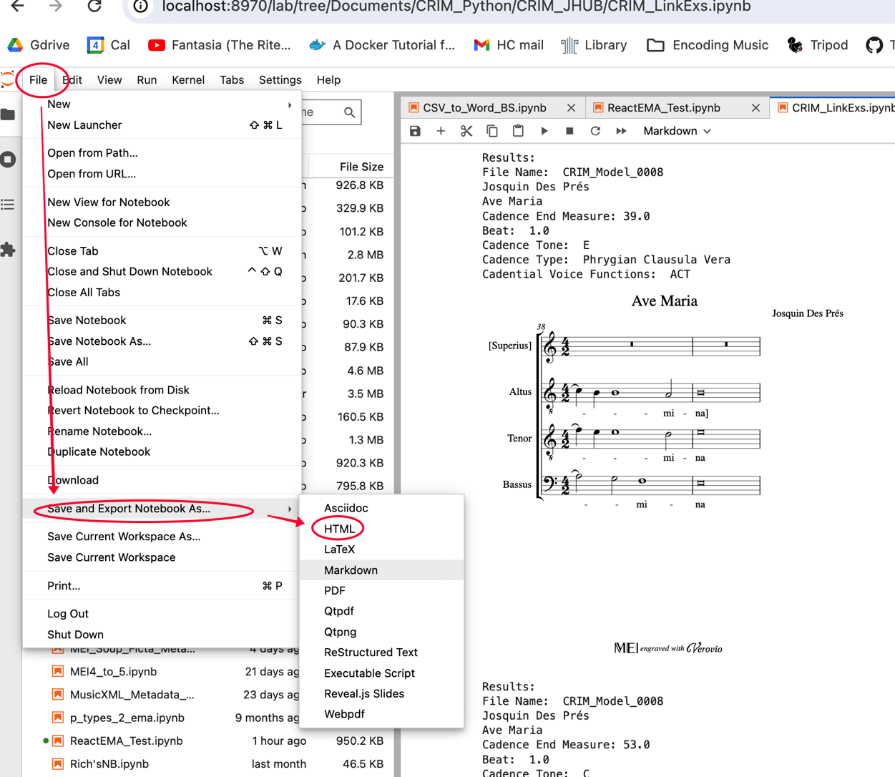


# How to Use the *verovioPrint . . .* Functions

CRIM Intervals works with Verovio in various ways:

## `piece.verovioPrintExample()`

Pass a range of measures (as integers) to print the given range.

Note that the given MEI file MUST be loaded via some URL:


Measures 10-15, for instance:

```python
# must load file via URL
path = 'https://crimproject.org/mei/CRIM_Model_0008.mei'
piece = importScore(path)
piece.verovioPrintExample(10, 15)
```

The result looks like this:

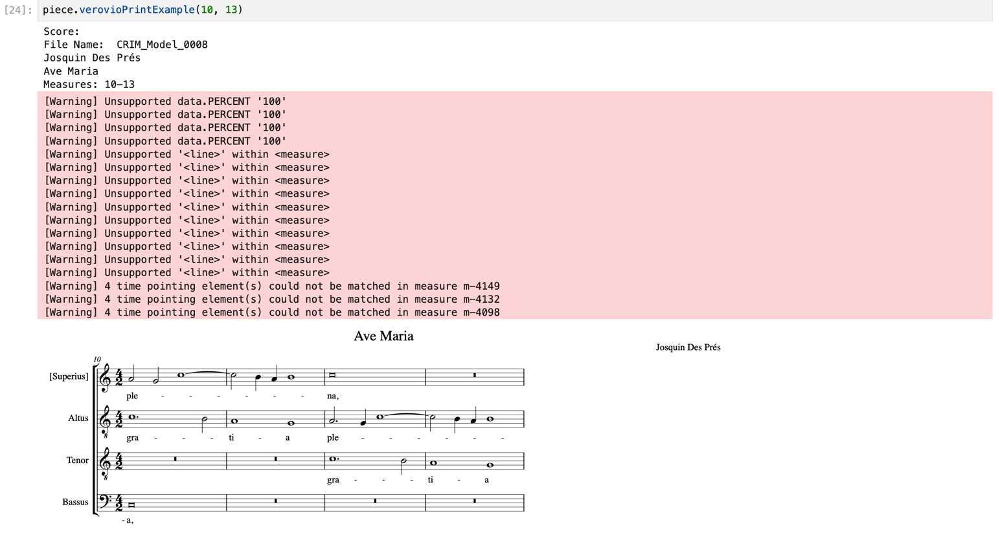

Depending on how your MEI file has been encoded it is possible you will see Verovio warnings (but you can ignore these).  You can nevertheless suppress these by adding the following code (although this will also suppress the metadata printed by the `verovioPrintExample` function):


```python
%%capture --no-display
path = 'https://crimproject.org/mei/CRIM_Model_0008.mei'
piece = importScore(path)
piece.verovioPrintExample(10, 15)
```

The cleaned result looks like this:

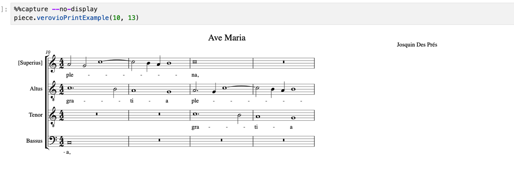

For last measure you can also use '-1'; thus for all measures you would use the following:


```python
path = 'https://crimproject.org/mei/CRIM_Model_0008.mei'
piece = importScore(path)
piece.verovioPrintExample(1, -1)
```

If your example is long, it will be broken into several pages.  You will need to scroll through the pages in your notebook.


## `piece.verovioCadences()`

This function is used to display the results of the Cadence
classifier in the Notebook with Verovio.  Each excerpt is
two measures long:  the measure of the final tone of the cadence
and the previous measure.

The function also displays metadata about each excerpt, drawn from the
cadence results dataframe:  piece ID, composer, title, measures, type of
cadence, beat of the bar in which the final tone is heard, and evaded
status.

How to use it:

You will first need to find the cadences, then pass them to Verovio:


```python
path = 'https://crimproject.org/mei/CRIM_Model_0008.mei'
piece = importScore(path)
cads = piece.cadences()
piece.verovioCadences(cads)
```

Notice that the output can be *very long* in this case, since all of the cadences in your dataframe of results will be printed, one after the other.


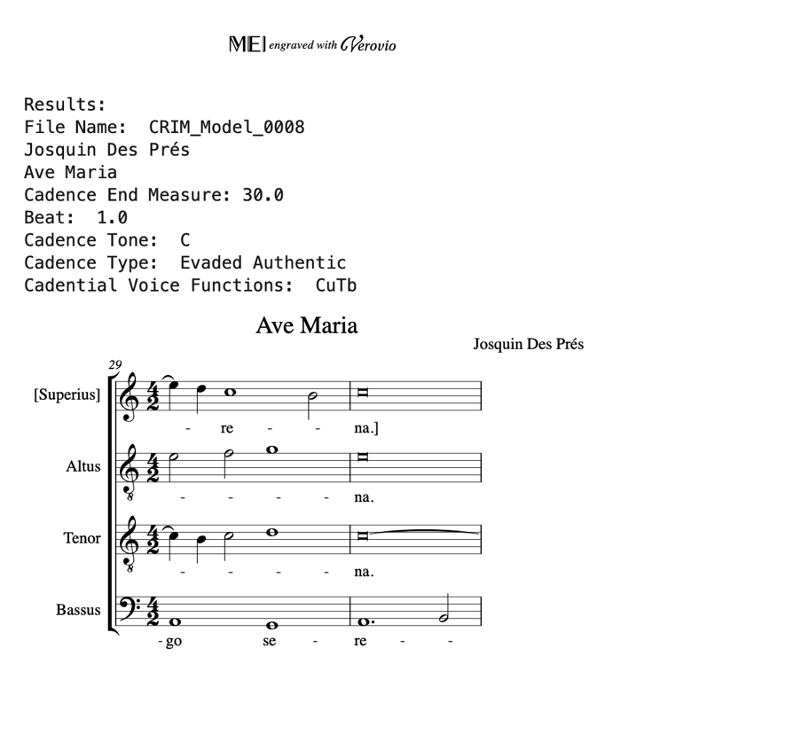

You can scroll through these.  But you might also find it helpful to *Export to HTML* as explained above.


It is also possible to pass a *filtered* list of cadences to this function 
by specifying a df into verovioCadences() as shown below:

```python
path = 'https://crimproject.org/mei/CRIM_Model_0008.mei'
piece = importScore(path)
cads = piece.cadences()
cads_filtered = cads[cads['Tone'] == 'G']
piece.verovioCadences(cads_filtered)
```

## `piece.verovioHomorhythm()`

Prints HR passages for a given piece with Verovio, based on imported piece and 
other parameters.

Users can supply either of two arguments:

- 'ngram_length' (which is 4 by default, and determines the number of durations and syllables that must be in common among the voices in order to be marked as HR);

- 'full_hr' (which is True by default).  When `full_hr=True` the method will find any passage where _all active voices_ share the same durational ngram and syllables; if `full_hr=False` the method will find any passage where even *two voices* share the same durational ngram and the same syllables.

Typical use:

```python
path = 'https://crimproject.org/mei/CRIM_Model_0008.mei'
piece = importScore(path)
piece.verovioHomorhythm()
```

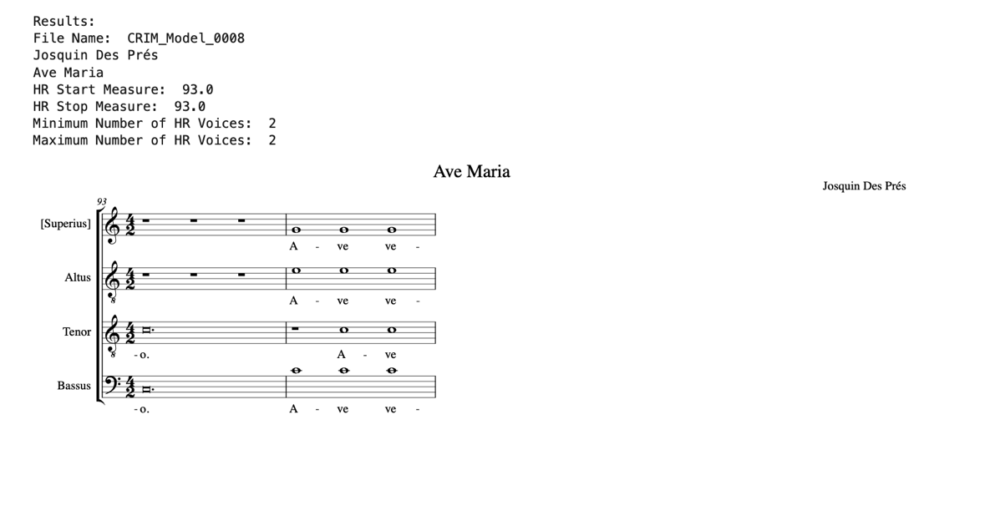

OR with custom parameters:

```python
path = 'https://crimproject.org/mei/CRIM_Model_0008.mei'
piece = importScore(path)
piece.verovioHomorhythm(ngram_length=5, full_hr=False)
```

It is also to run `piece.homorhythm()`, then filter the results in some way and pass those results to the print function:

```python
path = 'https://crimproject.org/mei/CRIM_Model_0008.mei'
piece = importScore(path)
# first, run hr function and convert hr['syllable_set'] to string
hr = piece.homorhythm(ngram_length=6, full_hr=True).fillna('')
hr["hr_voices"] = hr["hr_voices"].apply(lambda x: ', '.join(map(str, x))).copy()

# now supply names of voices.  They must match the voice names in `piece.notes.columns()` 
chosen_voices = ["Tenor", "Bassus"]

# next, filter the results for hr passages involving chosen voices:
hr_with_chosen_voices = hr[hr.apply(lambda x: hr['hr_voices'].str.contains('|'.join(chosen_voices)))].dropna()

# finally, render just the hr_with_chosen_voices using `piece.verovioHomorhythm()`:
piece.verovioHomorhythm(hr_with_chosen_voices)
```


## `piece.verovioPtypes()`

This function is used to display the results of the *presentationTypes* function
in the Notebook with Verovio.  Each excerpt begins with
the *first* measure of the given presentation type and continues through *four
measures after* the last entry.

The function also displays metadata about each excerpt, drawn from the
presentation type dataframe:  piece ID, composer, title, measure range,
presentation type, voices in order of entry, number of entries, the soggetti
, melodic entry intervals, time entry intervals.

How to use it:

You must first run presentationTypes to build the initial list of results and define
these as a new variable name, such as "p_types":

```python
path = 'https://crimproject.org/mei/CRIM_Model_0008.mei'
piece = importScore(path)
p_types = piece.presentationTypes()
```

Remember that there are many options in the *presentationTypes* methods to
determine the length of soggetti, degree of head or body flex, status
of unisons, whether to use main entries only (or moving window of soggetti)
and status of hidden entries.

After any additional filtering, pass the results of that work to *verovioPtypes* to print all of the results with metadata before each one:

```python
piece.verovioPtypes(p_types)
```

Here is the complete code:

```python
path = 'https://crimproject.org/mei/CRIM_Model_0008.mei'
piece = importScore(path)
p_types = piece.presentationTypes()
piece.verovioPtypes(p_types)
```

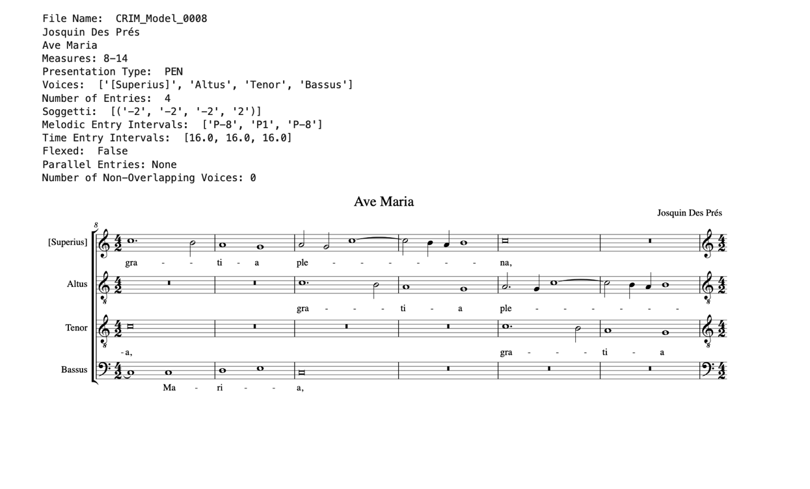

## `piece.verovioNgrams()`

This function shows the passages behind a table of n-grams: one excerpt for each row of the table, covering the measures of every n-gram in that row, with a caption listing each voice's n-gram. It works with the results of `piece.ngrams()` (melodic intervals or notes) and of `piece.entries()`.

A full n-gram table has a row for nearly every offset in the piece, so **filter it first**. For example, to find every statement of one soggetto:

```python
path = 'https://crimproject.org/mei/CRIM_Model_0008.mei'
piece = importScore(path)
mel = piece.melodic(kind='d', end=False)
ngrams = piece.ngrams(df=mel, n=4)
soggetto = ('4', '1', '2', '2')
matches = ngrams[ngrams.isin([soggetto])].dropna(how='all')
piece.verovioNgrams(matches)
```

Or to show the first ten entries (n-grams that follow a rest):

```python
entries = piece.entries(n=4)
piece.verovioNgrams(entries.head(10))
```

## Highlighting Notes in Red: `highlights=True`

`verovioCadences()`, `verovioPtypes()`, `verovioHomorhythm()` and `verovioNgrams()` can color the notes of each result in red. Add `highlights=True`:

```python
piece.verovioCadences(cads_filtered, highlights=True)   # arrival notes of each cadence
piece.verovioPtypes(p_types, highlights=True)           # the soggetto in every entry
piece.verovioHomorhythm(highlights=True)                # the homorhythmic voices
piece.verovioNgrams(matches, highlights=True)           # the notes of each n-gram
```

What gets colored:

- **Cadences:** the notes sounding at the moment of arrival, in the voices that take part in the cadence (its cadential voice functions).
- **Presentation types:** every note of each entry's soggetto. When needed, the excerpt is extended so the last entry is shown in full.
- **Homorhythm:** the notes of each voice in the homorhythmic passage.
- **N-grams and entries:** the notes of each n-gram. An n-gram of 4 melodic intervals colors 5 notes.

The notes are counted exactly as your analysis counted them. CRIM Intervals remembers settings such as `combine_unisons`, `end` and the n-gram length with each result, so you do not need to pass them again.

Use `highlight_color` to choose another color, for example `highlight_color='blue'` or `highlight_color='#1f77b4'`.

To color notes of your own choosing, pass their MEI `xml:id`s to `verovioPrintExample()`. Each note's xml:id is its music21 `.id`:

```python
objs = piece._getM21Objs()['Tenor'].dropna()
ids = [n.id for n in objs if n.isNote and n.measureNumber <= 4]
piece.verovioPrintExample(1, 4, highlight_ids=ids)
```

**NB:** highlights work with **MEI files only**. With MusicXML files the music is still shown, but without colored notes.

## Print with Analytic Highlights:  `linkExamples()`

Finally it is now also possible to print examples with analytic highlights corresponding to the notes identified by various CRIM Intervals methods.  This is accomplished with the `piece.linkExamples()` function, which takes in a dataframe of results produced with any of the following:

- **ngrams** (these could be melodic, harmonic, lyrics, durations, or modular ngrams)
- **cadences**
- **homorhythm**
- **presentation types**

The `linkExamples` works by calculating the 'address' of each pattern, in this case formulated according to the Raffaele Viglianti's [Enhancing Music Addressability](https://music-encoding.org/projects/ema.html) API, which reduces any complex of selected notes to a string representing measures/staves/beats that can be used to return a valid segment of any MEI score corresponding to the passage in question.

These score selections can then be rendered by Verovio with highlights and relevant metadata, thanks to a [JS REACT](https://github.com/eleon024/ema_react_app/tree/main) application created by Haverford College student Edgar Leon. 

Note that `linkExamples()` will **only work with MEI files** and will **only work with files stored in a remote repository** such as **github**. For example:

```python
prefix = 'https://raw.githubusercontent.com/CRIM-Project/CRIM-online/master/crim/static/mei/MEI_4.0/'
piece_id = 'CRIM_Model_0008.mei'
url = prefix + piece_id
piece = importScore(url)
cd=piece.cadences()
piece.linkExamples(df=cd, piece_url=url)
```

The table looks like this:

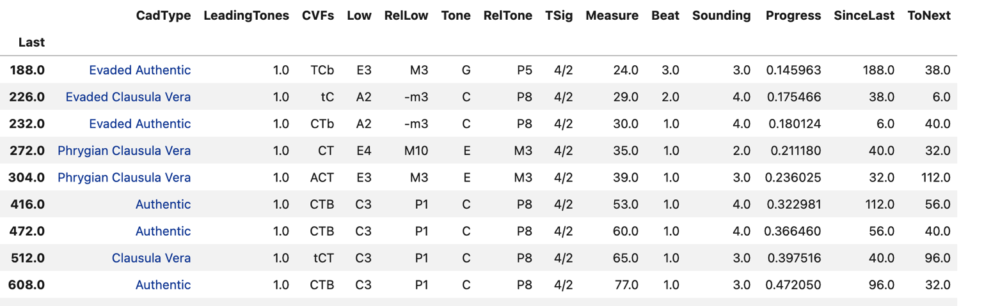


And a single rendered example (with highlights) looks like this:


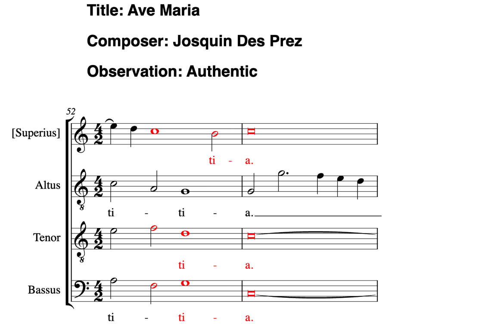


### How to use `linkExamples()`

In practice we combined these tools with Juypyter Notebook:

- Return your chosen pattern in a dataframe
- Filter it as needed (to narrow the results, for instance)
- Pass the results to `piece.linkExamples(df=my_data_frame)`
- View the dataframe with and click on individual cells (they are 'links') to view the score with highlights and basic metadata about the composer, piece, and musical type.


Given a dataframe of EMA addresses, return a dataframe of clickable links to the EMA React app. The `piece_url` parameter is the URL of the piece on the EMA React app. If you don't pass a `piece_url`, the method will try to construct one based on the piece's metadata. The resulting dataframe will have the same data results, but instead of plain text they will be links to highlighted examples of each result.


### `linkExamples()` with Cadences

```python
url = 'https://crimproject.org/mei/CRIM_Model_0008.mei'
piece = importScore(url)
cd=piece.cadences()
piece.linkExamples(df=cd, piece_url=url)
```

The 'linked' dataframe:

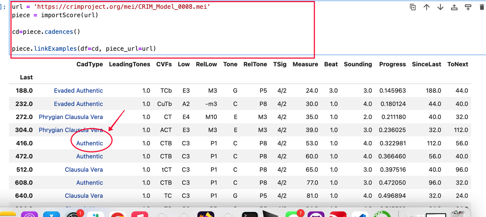

A 'highlighted' result for one cadence:

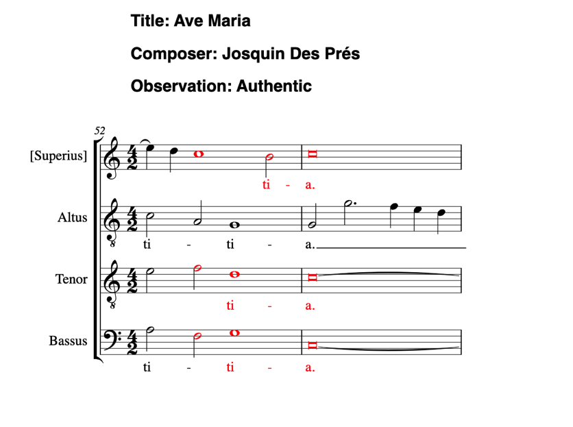

It is also possible to load MEI files from any github or other public repository:

```python
prefix = 'https://raw.githubusercontent.com/CRIM-Project/CRIM-online/master/crim/static/mei/MEI_4.0/'
piece_id = 'CRIM_Model_0008.mei'
url = prefix + piece_id
piece = importScore(url)
cd=piece.cadences()
piece.linkExamples(df=cd, piece_url=url)
```

The method can also be used with other CRIM Intervals functions.

### `linkExamples()` with Melodic nGrams:

Note that you must use `offsets='both'` with the ngram function!

```python
prefix = 'https://raw.githubusercontent.com/CRIM-Project/CRIM-online/master/crim/static/mei/MEI_4.0/'
piece_id = 'CRIM_Model_0008.mei'
url = prefix + piece_id
piece = importScore(url)
mel = piece.melodic(kind='d')
ng = piece.ngrams(df=mel, n=6, offsets='both')
piece.linkExamples(df=ng, piece_url=url)
```

The result for melodic ngrams.  Note that this dataframe will be *very long*.  You might want to filter it before passing it to the `linkExamples()` function!

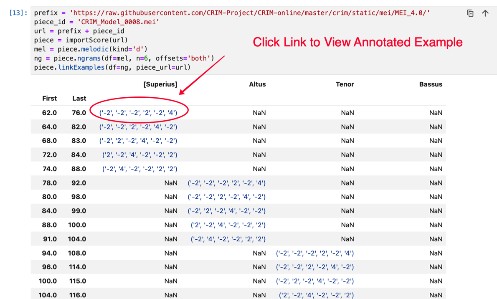

And view an individual example:


### `linkExamples()` with Presentation Types

Remember that the `presentationTypes` function has many parameters to set:

```python
prefix = 'https://raw.githubusercontent.com/CRIM-Project/CRIM-online/master/crim/static/mei/MEI_4.0/'
piece_id = 'CRIM_Model_0008.mei'
url = prefix + piece_id
piece = importScore(url)
# note that you must ALSO pass the combine_unisons status to both the presentationTypes method AND the linkExamples method!
combine_unisons = False
pt = piece.presentationTypes(limit_to_entries = True,
                        head_flex=1,
                        body_flex = 0,
                        include_hidden_types = False,
                        combine_unisons = combine_unisons,
                        melodic_ngram_length = 4)
```

Then pass (or perhaps first filter) these results to the `linkExamples` function:

Here we filter for Imitative Duos only:

```python
ids = pt[pt['Presentation_Type'] == "ID"]
```

And then pass these ID's to the `linkExamples` function:


```python
# remember to include the combine_unisons status!
piece.linkExamples(df=ids, piece_url=url, combine_unisons=combine_unisons)
```

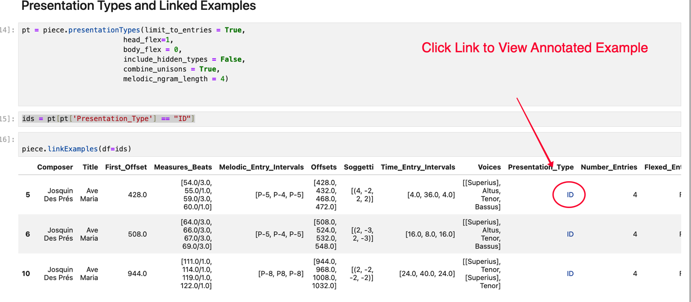

A single result:


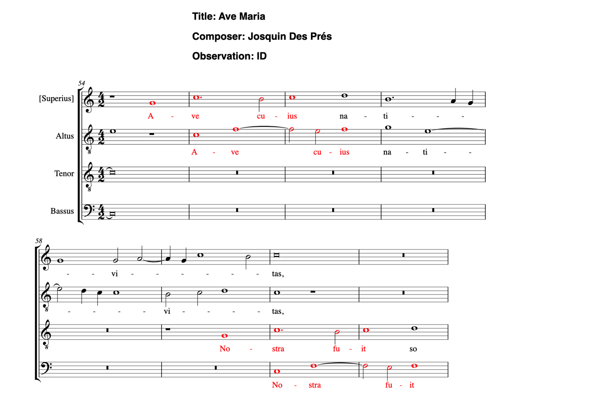

### `linkExamples()` with Homorhythm

```python
prefix = 'https://raw.githubusercontent.com/CRIM-Project/CRIM-online/master/crim/static/mei/MEI_4.0/'
piece_id = 'CRIM_Model_0008.mei'
url = prefix + piece_id
piece = importScore(url)
hr = piece.homorhythm()
piece.linkExamples(df=hr, piece_url=url)
```

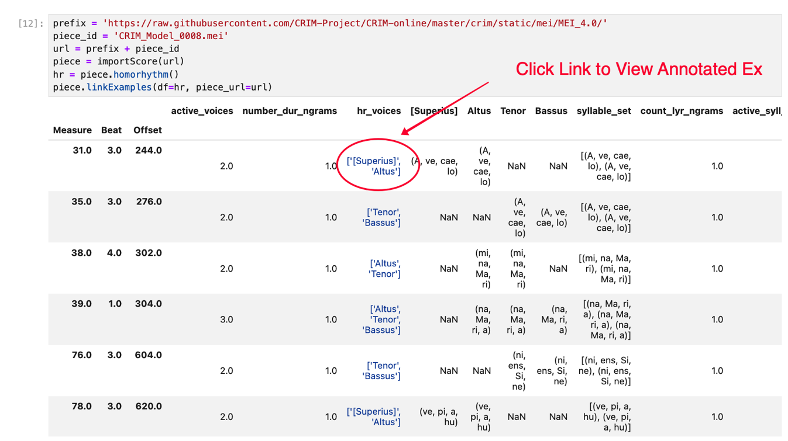

Click any link to view the annotated result:

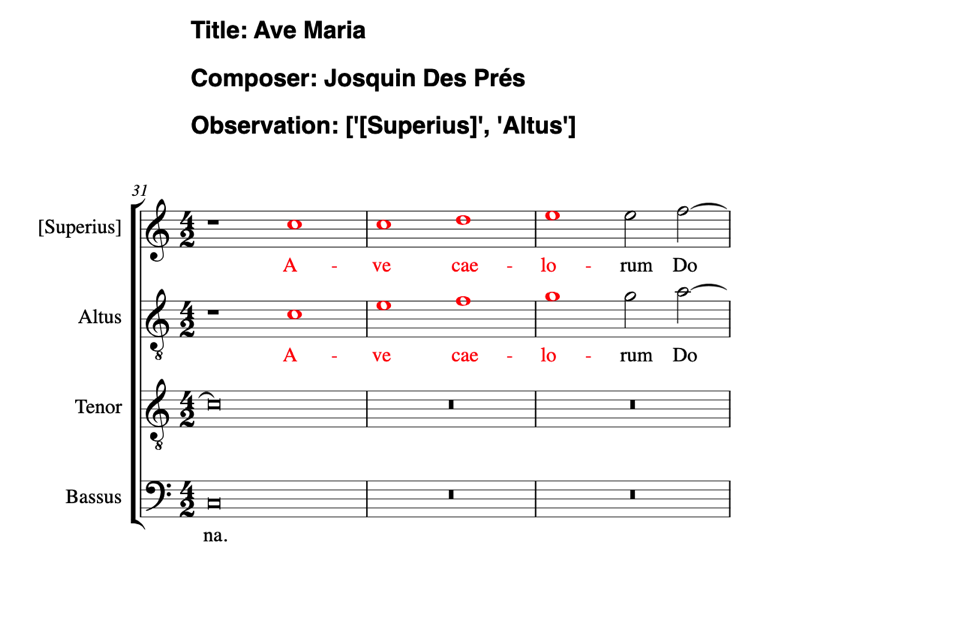


## Sections in this guide

  * [01_Introduction_and_Corpus](/tutorial/01_Introduction_and_Corpus.md)
  * [02_Notes_Rests](/tutorial/02_Notes_Rests.md)
  * [03_Durations](/tutorial/03_Durations.md)
  * [04_Time_Signatures_Beat_Strength](/tutorial/04_Time_Signatures_Beat_Strength.md)
  * [05_Detail_Index](/tutorial/05_Detail_Index.md)
  * [06_Melodic_Intervals](/tutorial/06_Melodic_Intervals.md)
  * [07_Harmonic_Intervals_Sonorities](/tutorial/07_Harmonic_Intervals_Sonorities.md)
  * [08_Ngrams_Heat_Maps](/tutorial/08_Ngrams_Heat_Maps.md)
  * [09_Contrapuntal_Modules](/tutorial/09_Contrapuntal_Modules.md)
  * [10_Lyrics_Homorhythm](/tutorial/10_Lyrics_Homorhythm.md)
  * [11_Cadences](/tutorial/11_Cadences.md)
  * [12_Presentation_Types](/tutorial/12_Presentation_Types.md)
  * [13_Voice_Ranges_Melodic_Species](/tutorial/13_Voice_Ranges_Melodic_Species.md)
  * [14_Melodic_Interval_Families](/tutorial/14_Melodic_Interval_Families.md)
  * [15_Musical_Examples_Verovio](/tutorial/15_Musical_Examples_Verovio.md)
  * [16_Model_Finder](/tutorial/16_Model_Finder.md)
  * [17_Visualizations_Summary](/tutorial/17_Visualizations_Summary.md)
  * [18_Network_Graphs](/tutorial/18_Network_Graphs.md)
  * [19_Corpus_Tools](/tutorial/19_Corpus_Tools.md)
  * [20_Python_Basics](/tutorial/20_Python_Basics.md)
  * [21_Pandas_Basics](/tutorial/21_Pandas_Basics.md)
  * [22_Music21_MEI](/tutorial/22_Music21_MEI.md)
  * [99_Local_Installation](/tutorial/99_Local_Installation.md)
