# Visualizations with CRIM Intervals

## Table of Contents
1. [Plotly Charts](#plotly-charts)
2. [CRIM Plots with Altair](#crim-plots-with-altair)
3. [Ready-Made Chart Functions](#ready-made-chart-functions)
4. [Plotly Charts in Detail](#plotly-charts-in-detail)
5. [Plotly Bar Charts](#plotly-bar-charts)
6. [Bar Graphs of Notes in Each Voice](#bar-graphs-of-notes-in-each-voice)
7. [Barcharts of Notes in Each Voice Stacked in One Chart](#barcharts-of-notes-in-each-voice-stacked-in-one-chart)
8. [Barcharts of Notes in a Corpus](#barcharts-of-notes-in-a-corpus)
9. [Bar Charts with Melodic and Harmonic Intervals](#bar-charts-with-melodic-and-harmonic-intervals)
10. [NGram Heat Maps](#ngram-heat-maps)
11. [Melody Families](#melody-families)
12. [Cadence Radar Plots](#cadence-radar-plots)
13. [Cadence Progress Plots](#cadence-progress-plots)
14. [Cadence Bar Charts](#cadence-bar-charts)
15. [Pitch Class Radar Plots](#pitch-class-radar-plots)
16. [Voice Range Charts](#voice-range-charts)
17. [Melodic Species Plots](#melodic-species-plots)
18. [Sonority N-gram Progress Plots](#sonority-n-gram-progress-plots)
19. [Networks](#networks)
20. [Sections in this guide](#sections-in-this-guide)

There are three different resources for creating various kinds of charts, plots, and networks with CRIM Intervals.  Unless otherwise noted, all the necessary libraries are already imported when you `import crim_intervals` and `from crim_intervals import *`.  We show the import statements below just to remind you!

## Plotly Charts

Our main resource is the [Plotly Express](https://plotly.com/python/plotly-express/) library, which allows for interactive visualizations and more complex/powerful graphs with less code. . The Plotly Express documentation details the very wide range of bar charts, histograms, scatter plots, heat maps, polar (radar) figures you can create, and various ways of adding captions, legends, colors, etc.

The charts and plots produced with **Plotly** (and described below) include:

* **Bar Graphs and Histograms** (to show distribution or ranges of notes and melodic intervals, for example)
* **Cadence Radar Plots** (circular grids that show the distribution of cadences in one or more pieces)
* **Cadence Progress Plots** (showing the succession of cadences across one or more pieces)
* **Cadence Bar Charts** (cadence types or tones, compared across pieces)
* **Pitch Class Radar Plots** (how much of each piece is spent on each pitch class)
* **Voice Range Charts** (horizontal bars that show the range of each voice in one or more pieces, for comparing modal types)
* **Melodic Species Plots** (the octave species articulated by melodic leaps, alone or together with cadences)
* **Sonority N-gram Progress Plots** (where each sequence of sonorities, with its bass motion, occurs and recurs across one or more pieces)

## CRIM Plots with Altair

The following methods have been developed especially for **CRIM Intervals**, and use the [Altair](https://altair-viz.github.io/) library.  Read more about the functions [here](https://github.com/HCDigitalScholarship/intervals/blob/main/crim_intervals/visualizations.py).  Since **Altair** is already imported as part of the **import crim_intervals.visualizations as viz** statement, you will not need to import that library separated for these methods:

* **Ngram Heat Maps** (showing grams across one or more works, including comparison of shared ngrams)
* **Melodic Families** (showing melodies as a branching series of intervallic steps)

### Networks with NetworkX and Pyvis

* [Networks](/tutorial/18_Network_Graphs.md) are a complex topic, and are covered in a separate tutorial.


## Ready-Made Chart Functions

CRIM Intervals includes functions that turn the results of a few common methods straight into a chart. Each one works with the result of a single piece **or** a whole corpus: run the method on `piece` or `corpus`, then pass the result to the chart function.

```python
from crim_intervals import *
import crim_intervals.visualizations as viz

piece = importScore('https://crimproject.org/mei/CRIM_Model_0008.mei')
corpus = CorpusBase(['https://crimproject.org/mei/CRIM_Model_0008.mei',
                     'https://crimproject.org/mei/CRIM_Mass_0005_1.mei',
                     'https://crimproject.org/mei/CRIM_Mass_0005_2.mei'])

viz.cadence_radar(piece.cadences())      # one piece
viz.cadence_radar(corpus.cadences())     # a corpus: one polygon per piece
```

| Chart function | Pass it the result of | What it shows |
|---|---|---|
| `viz.cadence_radar` | `piece.cadences()` / `corpus.cadences()` | Share of cadences on each tone |
| `viz.cadence_progress` | `piece.cadences()` / `corpus.cadences()` | Where each cadence falls in the piece, by tone and type |
| `viz.cadence_bar_chart` | `piece.cadences()` / `corpus.cadences()` | Cadence types or tones, compared across pieces |
| `viz.radar_note_plot` | `piece.note_weights()` / `corpus.note_weights()` | Share of time spent on each pitch class |
| `viz.voice_range_chart` | `piece.voice_ranges()` / `corpus.voice_ranges()` | Range of each voice |
| `viz.plot_species` | `piece.melodic_species()` / `corpus.melodic_species()` | Octave species articulated by melodic leaps |
| `viz.plot_species_cadences` | `melodic_species()` **and** `cadences()` | Species and cadences on one timeline (one piece at a time) |
| `viz.sonority_ngram_progress` | `piece.sonority_ngrams()` / `corpus.sonority_ngrams()` | Where each sonority n-gram occurs and recurs |

Each chart's title names the piece (or says "Corpus"), and a smaller line beneath it lists the **settings** behind the chart: first those used to make the data (for example `all leaps` for `melodic_species(limit_to_entries=False)`, or `melodic: diatonic, directed, compound · n = 4` for n-grams), then the chart's own options (tone order, count filters, number of pieces, and so on). The data settings come from a note that CRIM Intervals attaches to each result; see [Which Settings Made This Result?](/tutorial/01_Introduction_and_Corpus.md#which-settings-made-this-result-get_settings) in the introduction. If you pass your own `chart_title`, the settings line is still added beneath it.

All of them share the same colors (a piece has the same color in every chart, and each cadence type has the same color in every cadence chart) and return a Plotly figure:

* In a notebook, a figure on the last line of a cell displays by itself; otherwise call `fig.show()`.
* Save it with `fig.write_html('chart.html')` (interactive) or `fig.write_image('chart.png', scale=2)` (needs the `kaleido` package: `pip install kaleido==0.2.1`).
* Adjust it like any Plotly figure, for example `fig.update_layout(title='My title', width=1200)`.

These functions are also available without the `viz.` prefix after `from crim_intervals import *`. The prefix is safer: if you later import another module with a function of the same name, it can't silently replace these.


## Plotly Charts in Detail
---

The first step is always to import the relevant library (but this will already have been imported with `crim_intervals`:

```python
import plotly.express as px
```

From here you will normally:

- Define a figure by passing a dataframe to a method (such as `fig = px.histogram(df_hist(df)`)
- Specify special labels, formatting, legend, or other features
- Show the figure with `fig.show()`, or specify a file name if you would prefer to save it.

For example, the final fixgure update might include any of the following arguments.

<br>

```python
fig = px.bar(melted_nr, 
             x='pitch', 
             y='count', 
             color='voice', 
             barmode='stack',
             height=700,
             width=1000,
             title="Chart of Notes")

fig.show(legend=True)
```
<br>


## Plotly Bar Charts

Bar charts are used to display categorical data. They consist of vertical or horizontal bars that represent different categories and their corresponding values. Bar charts are excellent for comparing data across different categories.  Learn more at [Plotly Express](https://plotly.com/python/bar-charts/)


## Bar Graphs of Notes in Each Voice

Here we the counts of each pitch (including octave) in each voice of a given piece.  Note that we can declare a custom 'order' for the pitches, so it's possible to present these as you like.  Here we have sorted them from lowest to highest.  You could also display only a subset of pitches.

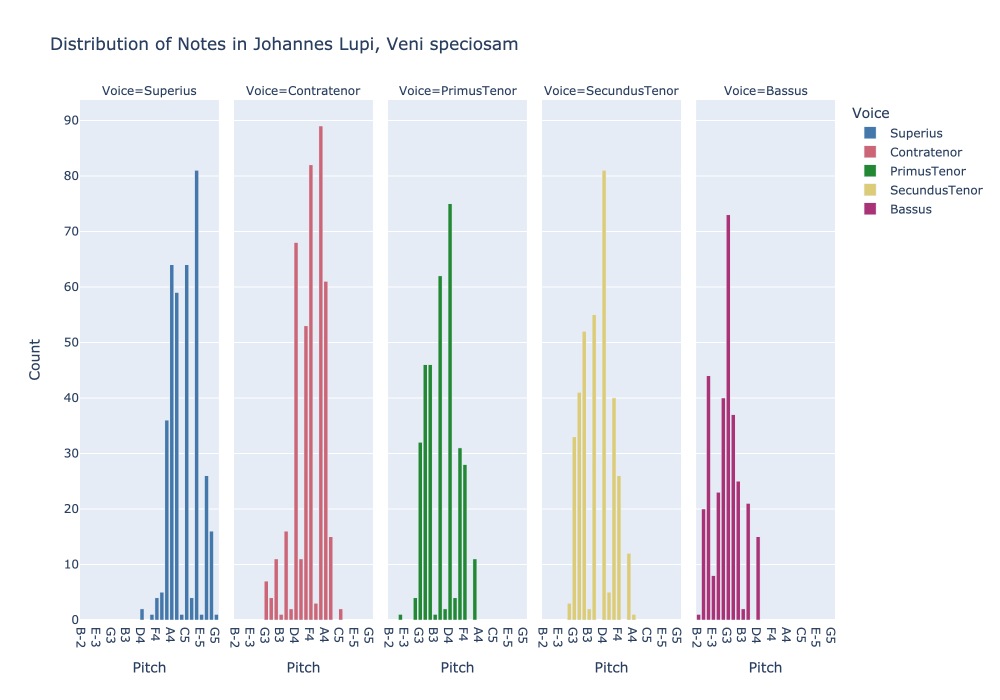

<br>

<Details>

<Summary>Code to Produce this Chart</Summary>

```python
# assuming all the usual CRIM Intervals imports already done .  . 
url = 'https://crimproject.org/mei/CRIM_Model_0001.mei'
piece = importScore(url)

# give the chart a meaningful title based on your piece:
md = piece.metadata  
chart_title = "Distribution of Notes in " + md['composer'] + ", " + md['title']

# set the custom order for pitches
pitch_order = ['E-2', 'E2', 'F2', 'F#2', 'G2', 'A2', 'B-2', 'B2', 
               'C3', 'C#3', 'D3', 'E-3','E3', 'F3', 'F#3', 'G3', 'G#3','A3', 'B-3','B3',
               'C4', 'C#4','D4', 'E-4', 'E4', 'F4', 'F#4','G4', 'A4', 'B-4', 'B4',
               'C5', 'C#5','D5', 'E-5','E5', 'F5', 'F#5', 'G5', 'A5', 'B-5', 'B5']

# get the notes and create the dataframe for the chart
nr = piece.notes().fillna('-')  
nr = nr.apply(pd.Series.value_counts).fillna(0).astype(int).reset_index().copy()  
nr.rename(columns={'index': 'pitch'}, inplace=True)  
nr['pitch'] = pd.Categorical(nr["pitch"], categories=pitch_order)  
nr = nr.sort_values(by="pitch").dropna().copy()  
voices = nr.columns.to_list()[1:]  # Exclude 'pitch' column
# melt the dataframe to long format suitable for px.bar
melted_nr = nr.melt(id_vars='pitch', var_name='voice', value_name='count')
# create a custom color palette
custom_palette = px.colors.qualitative.Plotly + px.colors.qualitative.Dark24 + px.colors.qualitative.Light24
color_dict = {voice: custom_palette[i % len(custom_palette)] for i, voice in enumerate(voices)}
# Plot using Plotly Express with stacked bars
fig = px.bar(melted_nr, 
             x='pitch', 
             y='count', 
             color='voice', 
             facet_col='voice', 
             category_orders={'pitch': pitch_order}, 
             color_discrete_map=color_dict, barmode='stack',
             height=700,
             width=1000,
             title=chart_title)

fig.update_layout(showlegend=True)
fig.show()
``` 
</Details>


## Barcharts of Notes in Each Voice Stacked in One Chart


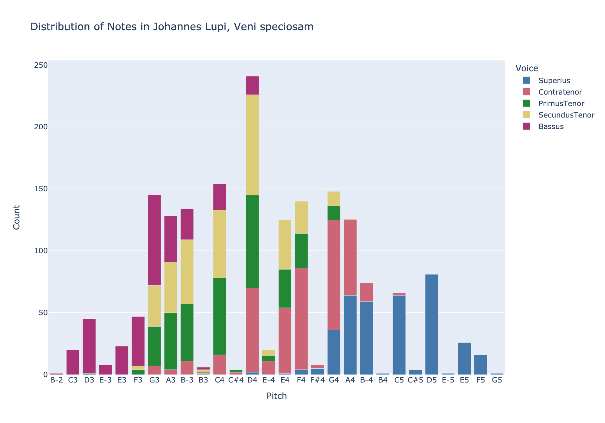

<Details>

<Summary>Code to Produce this Chart</Summary>

```python
import plotly.express as px
# set order of tones
pitch_order = ['E-2', 'E2', 'F2', 'F#2', 'G2', 'A2', 'B-2', 'B2', 
               'C3', 'C#3', 'D3', 'E-3','E3', 'F3', 'F#3', 'G3', 'G#3','A3', 'B-3','B3',
               'C4', 'C#4','D4', 'E-4', 'E4', 'F4', 'F#4','G4', 'A4', 'B-4', 'B4',
               'C5', 'C#5','D5', 'E-5','E5', 'F5', 'F#5', 'G5', 'A5', 'B-5', 'B5']
nr = piece.notes().fillna('-')  
nr = nr.apply(pd.Series.value_counts).fillna(0).astype(int).reset_index().copy()  
nr.rename(columns={'index': 'pitch'}, inplace=True)  
nr['pitch'] = pd.Categorical(nr["pitch"], categories=pitch_order)  
nr = nr.sort_values(by="pitch").dropna().copy()  

voices = nr.columns.to_list()[1:]  # Exclude 'pitch' column

# Melt the dataframe to long format suitable for px.bar
melted_nr = nr.melt(id_vars='pitch', var_name='voice', value_name='count')

# Create a custom color palette
custom_palette = px.colors.qualitative.Plotly + px.colors.qualitative.Dark24 + px.colors.qualitative.Light24
color_dict = {voice: custom_palette[i % len(custom_palette)] for i, voice in enumerate(voices)}

# Create the stacked bar chart
fig = px.bar(nr_melted, 
             x='pitch', 
             y='count', 
             color='voice', 
             barmode='stack',
            title="Chart of Melodic Intervals")

fig.show()
```

</Details>


## Barcharts of Notes in a Corpus

with the `corpus.batch` methods, it is also possible to do same kind of thing for a collection of pieces.

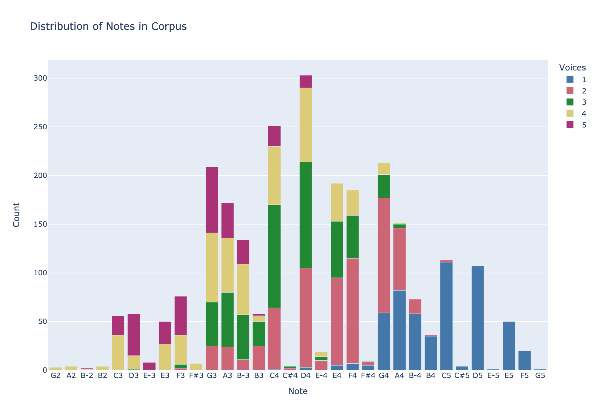

<br>


<Details>

<Summary>Code to Run</Summary>

```python
# notes in a corpus
def corpus_notes(corpus, combine_unisons_choice, combine_rests_choice):
    func = ImportedPiece.notes  # <- NB there are no parentheses here
    list_of_dfs = corpus.batch(func = func, 
                                kwargs = {'combineUnisons': combine_unisons_choice, 'combineRests': combine_rests_choice}, 
                                metadata=False)
    func1 = ImportedPiece.numberParts
    list_of_dfs = corpus.batch(func = func1,
                               kwargs = {'df' : list_of_dfs},
                               metadata=True)
    
    
    nr = pd.concat(list_of_dfs)
    cols_to_move = ['Composer', 'Title', 'Date']
    nr = nr[cols_to_move + [col for col in nr.columns if col not in cols_to_move]]
    return nr

# settings
combine_unisons_choice = False
combine_rests_choice = False
kind_choice = 'd'
directed = True
compound = True
exclude_rests = True

# load corpus
file_list = ['https://crimproject.org/mei/CRIM_Model_0001.mei', 'https://crimproject.org/mei/CRIM_Model_0008.mei']
corpus = CorpusBase(file_list)

# run function and create chart
nr = corpus_notes(corpus, combine_unisons_choice, combine_rests_choice)
nr_no_mdata = nr.drop(['Composer', 'Title', "Date"], axis=1)

nr_counts = pd.DataFrame(nr_no_mdata.apply(pd.Series.value_counts))

if exclude_rests == True:
    nr_counts = nr_counts.drop('Rest', axis=0)
                                                               
voices = nr_counts.columns.to_list() 

chart_title = "Distribution of Notes in Corpus"
fig = px.bar(nr_counts, x=nr_counts.index, y=list(nr_counts.columns),
                    title=chart_title)
fig.update_layout(xaxis_title="Note", 
                    yaxis_title="Count",
                    legend_title='Voices',
                       height=700,
                       width=1000)
fig.show()
```

</Details>

<br>


## Bar Charts with Melodic and Harmonic Intervals

See the tutorials for [Melodic](/tutorial/06_Melodic_Intervals.md) and [Harmonic](/tutorial/07_Harmonic_Intervals_Sonorities.md) for ways to create charts like this for one or more pieces using those methods.


## NGram Heat Maps

### Heat Map of Ngrams in One Piece

The CRIM Intervals visualization library makes it possible to display ngrams as a dynamic chart, with each nGram displayed from the start (left) to end (right) of the piece, voice-by-voice.  Identical nGrams receive the same color.

Note that these are built-in functions, and work with the Altair library.  Find the documentation via [CRIM Interval Visualization](https://github.com/HCDigitalScholarship/intervals/blob/main/crim_intervals/visualizations.py) module.

As with the other charts, a subtitle lists the settings used to make the n-grams, followed by any patterns or voices you selected. For the example below it reads: `unisons combined · melodic: diatonic, directed, simple · n = 4 · thematic entries · 10 selected patterns`.

Here is a map for just one piece:

<br>


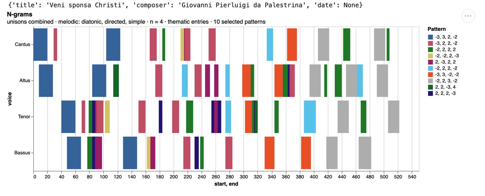

<br>

<Details>

<Summary>Code to Produce this Chart</Summary>

```python
# import piece
url = 'https://crimproject.org/mei/CRIM_Model_0019.mei' 
model = importScore(url)

# settings:
combineUnisons = True
kind = "d"
compound = False
ngram_length = 4


# find entries for model
nr = model.notes(combineUnisons=combineUnisons)
mel = model.melodic(df=nr, kind=kind, compound=compound, unit=0, end=False)
mod_mel_ngrams = model.ngrams(df=mel, n=ngram_length)
mod_entry_ngrams = model.entries(df=mel, n=ngram_length, thematic=True, anywhere=True)
mod_mel_ngrams_duration = model.durations(df=mel, n=ngram_length, mask_df=mod_entry_ngrams)
mod_entries_stack = list(mod_entry_ngrams.stack().unique())

print(model.metadata)

display(viz.plot_ngrams_heatmap(mod_entry_ngrams, mod_mel_ngrams_duration, 
                        selected_patterns=mod_entries_stack,
                        voices=[]))
```


</Details>


<br>

### Heat Map of Shared Ngrams in Two or More Pieces

Now for a corpus consisting of a 'model' (the first piece in the list) and any set of other pieces (normally the movements of a Mass). Note that the code below shows only the 'entry' ngrams shared by each pair of pieces. Here we show just the first pair:


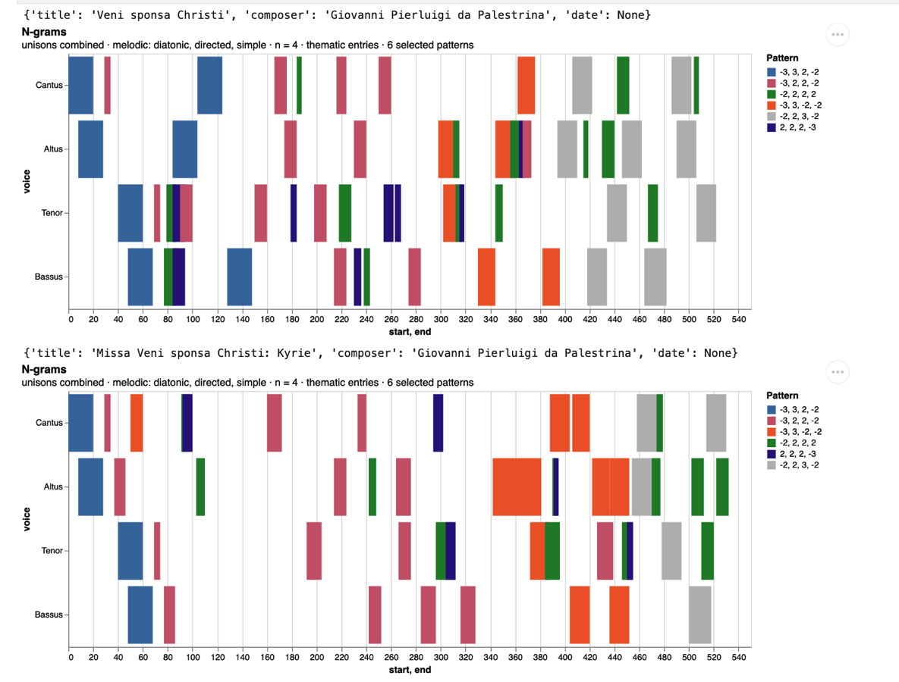

<Details>

<Summary>Code to Use</Summary>

```python

# settings:
combineUnisons = True
kind = "d"
compound = False
ngram_length = 4

# define piece list
piece_list = ['CRIM_Model_0019.mei',
                     'CRIM_Mass_0019_1.mei',
                     'CRIM_Mass_0019_2.mei',
                     'CRIM_Mass_0019_3.mei',
                     'CRIM_Mass_0019_4.mei',
                     'CRIM_Mass_0019_5.mei']
# select the model from the list
model = piece_list[0]
prefix = 'https://crimproject.org/mei/' 
# prefix = 'Music_Files/'
url = prefix + model
model = importScore(url)

# find entries for model
nr = model.notes(combineUnisons=combineUnisons)
mel = model.melodic(df=nr, kind=kind, compound=compound, unit=0, end=False)
mod_mel_ngrams = model.ngrams(df=mel, n=ngram_length)
mod_entry_ngrams = model.entries(df=mel, n=ngram_length, thematic=True, anywhere=True)
mod_mel_ngrams_duration = model.durations(df=mel, n=ngram_length, mask_df=mod_entry_ngrams)
mod_entries_stack = list(mod_entry_ngrams.stack().unique())

# find entries mass movements:
mass_movements = piece_list[1:6]

for movement in mass_movements:
    
    prefix = 'https://crimproject.org/mei/' 
    url = prefix + movement
    m_movement = importScore(url)
    nr = m_movement.notes(combineUnisons=combineUnisons)
    mel = m_movement.melodic(df=nr, kind=kind, compound=compound, unit=0, end=False)
    mass_mvmt_mel_ngrams = m_movement.ngrams(df=mel, n=ngram_length)
    mass_mvmt_entries = m_movement.entries(df=mel, n=ngram_length, thematic=True, anywhere=True)
    mass_mvmt_mel_ngrams_duration = m_movement.durations(df=mel, n=ngram_length, mask_df=mass_mvmt_entries)
    mass_mvmt_entries_stack = mass_mvmt_entries.stack()

    
    # find shared entries
    
    shared_entries = list(set(mass_mvmt_entries_stack).intersection(mod_entries_stack))

    # print model metadata and chart
    print(model.metadata)

    display(viz.plot_ngrams_heatmap(mod_entry_ngrams, mod_mel_ngrams_duration, 
                        selected_patterns=shared_entries,
                        voices=[])) #.plot_ngrams_heatmap(entry_ngrams,


    # print mass movement metadata and chart
    print(m_movement.metadata)
    display(viz.plot_ngrams_heatmap(mass_mvmt_entries, mass_mvmt_mel_ngrams_duration, 
                                selected_patterns=shared_entries,
                                voices=[])) #.plot_ngrams_heatmap(entry_ngrams,
```

</Details>

<br>

## Melody Families

The **Melodic Interval Families** method allows you to chart the "progress" of one or more melodies (in one or more pieces).  The results are presented as a series of branching line charts:

<br>


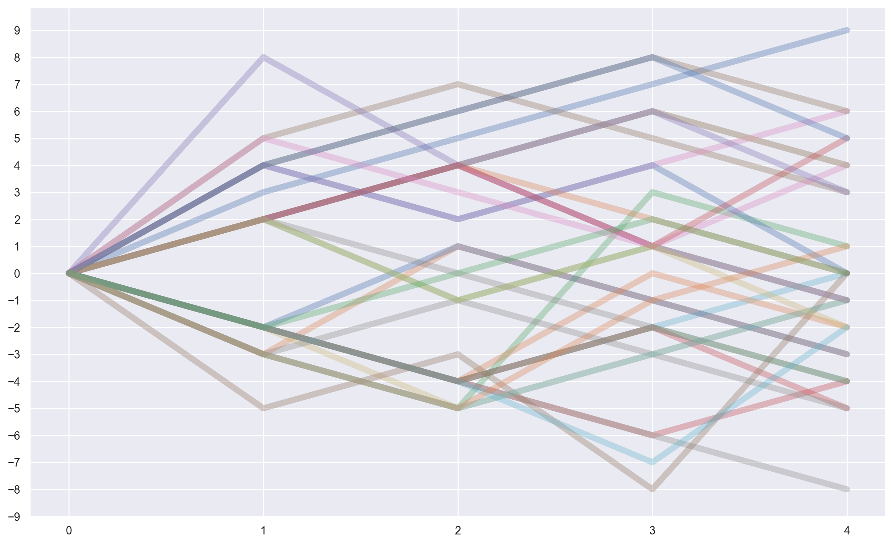

<br>

See more in the [Melodic Interval Families](/tutorial//14_Melodic_Interval_Families.md) tutorial.


## Cadence Radar Plots

Radar plots give a quick picture of the tonal 'footprint' of one or more pieces. Cadence tones are arranged around the circle, and the distance from the center shows what percentage of the piece's cadences fall on that tone. Pass the result of `piece.cadences()` or `corpus.cadences()` to `cadence_radar()`; a corpus gives one polygon per piece.

```python
# one piece
viz.cadence_radar(piece.cadences())

# a corpus, with tones arranged by fifths
cadences = corpus.cadences()
viz.cadence_radar(cadences, tone_ordering='Fifths')
```

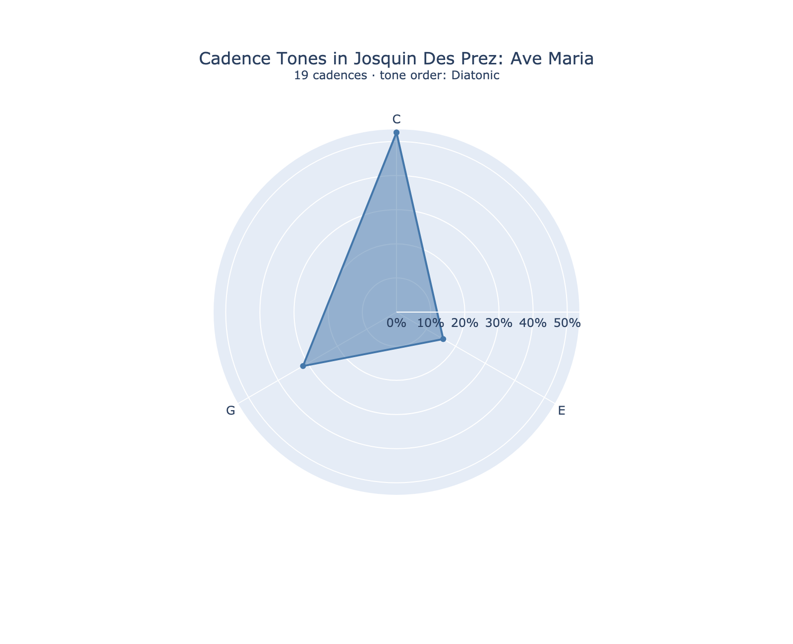

<br>

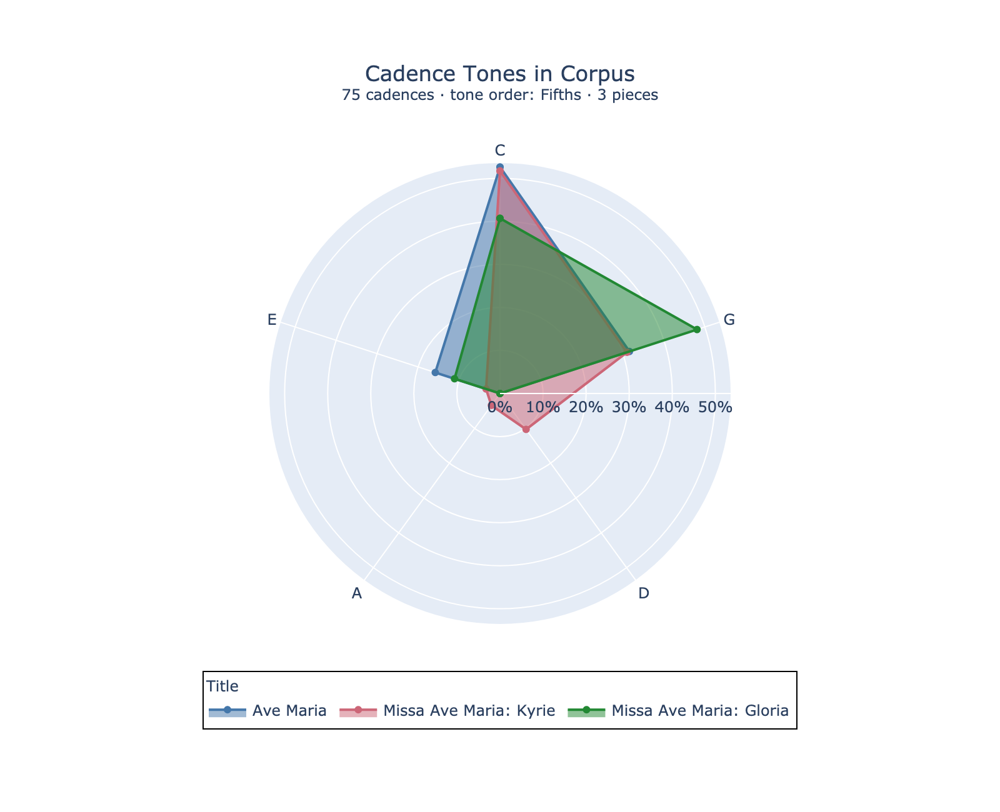

Options:

* `tone_ordering`: how tones are arranged around the circle: `'Diatonic'` (default), `'Fifths'`, `'Thirds'`, `'Chromatic'`, or your own list such as `['D', 'A', 'F', 'G', 'C']`.
* `limit_to_active=False`: show every tone in the ordering, not just those with cadences.
* `groupby_column='Composer'`: one polygon per composer instead of per piece.
* `chart_title='...'`: your own title.

The plots are interactive: hover to see the number of cadences, and click a piece in the legend to hide or show it.

## Cadence Progress Plots

These show the 'flow' of cadences through a piece: each dot is a cadence, placed by how far through the piece it falls (`Progress`, from 0 at the start to 1 at the end), with its tone on the vertical axis and its type shown by color. With a corpus, each piece gets its own row, since progress is measured within each piece.

```python
viz.cadence_progress(piece.cadences())
viz.cadence_progress(corpus.cadences())
```

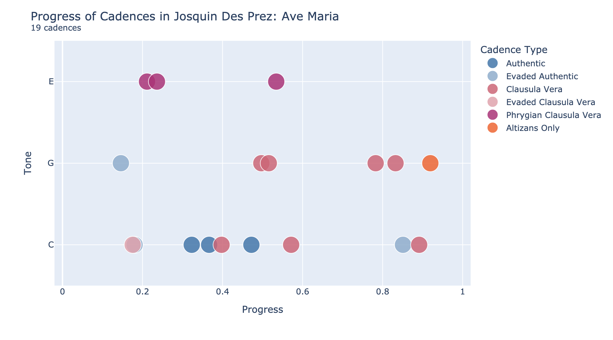

<br>

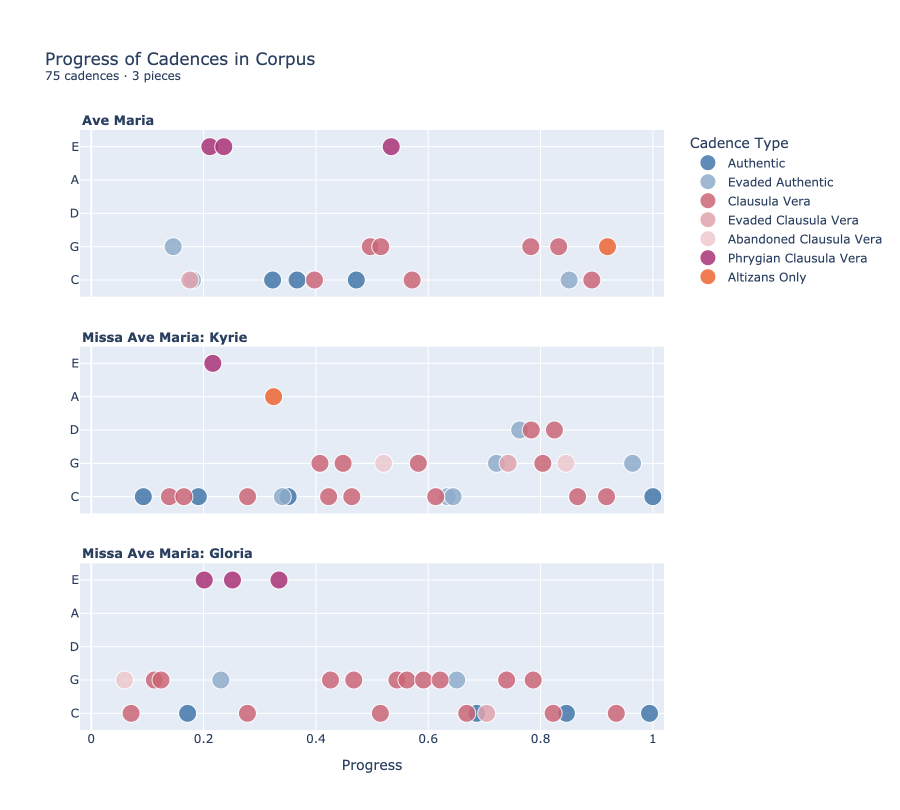

Hover over a dot to see the measure and beat of that cadence.

## Cadence Bar Charts

`cadence_bar_chart()` compares cadence types (or tones) across pieces, one colored bar per piece. By default each bar shows the percentage of that piece's cadences, so long and short pieces can be compared fairly.

```python
cadences = corpus.cadences()

# cadence types
viz.cadence_bar_chart(cadences)

# cadence tones
viz.cadence_bar_chart(cadences, by='Tone')
```

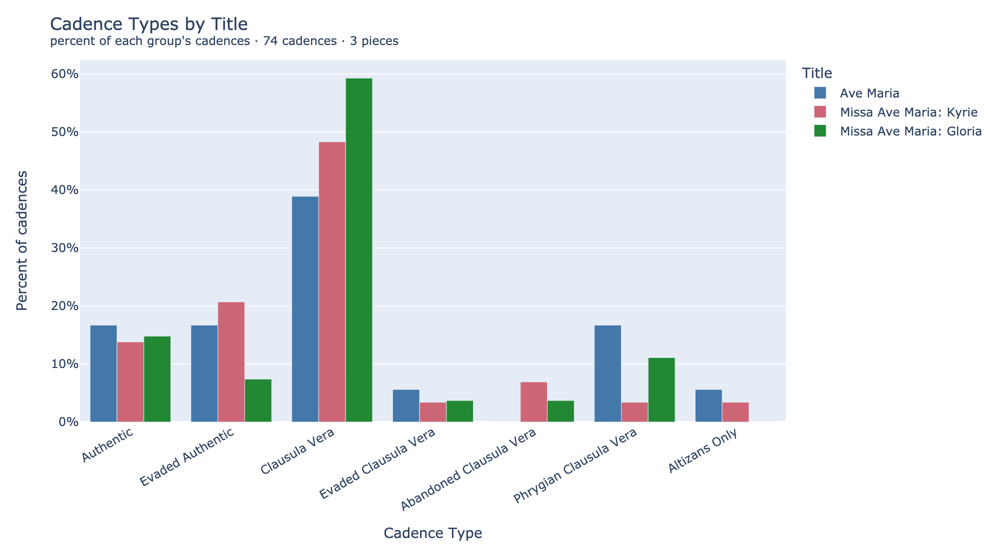

<br>

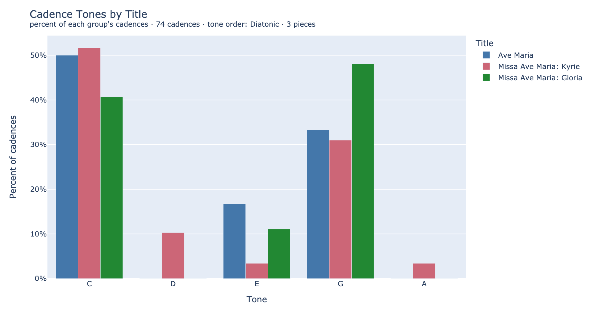

Options:

* `percent=False`: show the number of cadences instead of percentages.
* `groupby_column='Composer'`: compare composers instead of pieces.
* `tone_ordering`: the order of tones when `by='Tone'` (as for radar plots).

Evaded and abandoned cadences have no final tone, so they are counted in the cadence-type chart but left out of the tone chart (a note says how many).

### Something You Might Try: Cadence Tones and Types Together

The bar charts show types *or* tones. This chart shows both at once: one panel per piece, with a dot for each combination of tone and type, sized by its share of that piece's cadences. It is built directly with Plotly Express, so you can adapt it freely.

```python
import plotly.express as px
from crim_intervals.sorting_lists import cadence_type_order, cadence_type_colors, cadence_tone_orders

cadences = corpus.cadences().dropna(subset=['Tone'])
tone_type = (cadences.groupby(['Title', 'Tone', 'CadType'])
                     .size().reset_index(name='Count'))
tone_type['Percent'] = (100 * tone_type['Count'] /
                        tone_type.groupby('Title')['Count'].transform('sum')).round(1)

# use the standard orders, limited to what is in the data
tones = [t for t in cadence_tone_orders['Fifths'] if t in set(tone_type['Tone'])]
types = [c for c in cadence_type_order if c in set(tone_type['CadType'])]
titles = list(dict.fromkeys(cadences['Title']))   # keep the corpus order

fig = px.scatter(tone_type, x='Tone', y='CadType', size='Percent', color='CadType',
                 facet_col='Title', facet_col_wrap=3,
                 color_discrete_map=cadence_type_colors,
                 category_orders={'Tone': tones, 'CadType': types, 'Title': titles},
                 hover_data=['Count', 'Percent'], height=500, width=1100,
                 title='Cadence Tones and Types in Each Piece')
fig.for_each_annotation(lambda a: a.update(text=a.text.split('=')[-1][:35]))  # shorter panel titles
fig.update_layout(showlegend=False)
fig.show()
```

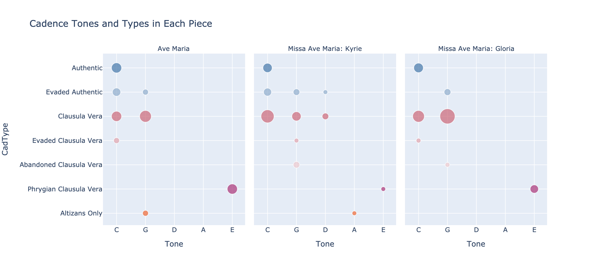

The older methods `piece.cadenceRadarPlot()`, `piece.cadenceProgressPlot()` and `corpus.compareCadenceProgressPlots()` are still available. See [11_Cadences](/tutorial/11_Cadences.md) to learn more about cadences.


## Pitch Class Radar Plots

How much of a piece is spent on each pitch class? `piece.note_weights()` adds up the duration of every note in every voice by pitch class (so C4 and C5 both count as C), and `radar_note_plot()` shows the result as a percentage of the piece's sounding time. Comparing pieces this way is a quick guide to their tonal emphasis and to which pitches are altered.

```python
weights = corpus.note_weights(include_final=True)
viz.radar_note_plot(weights)
```

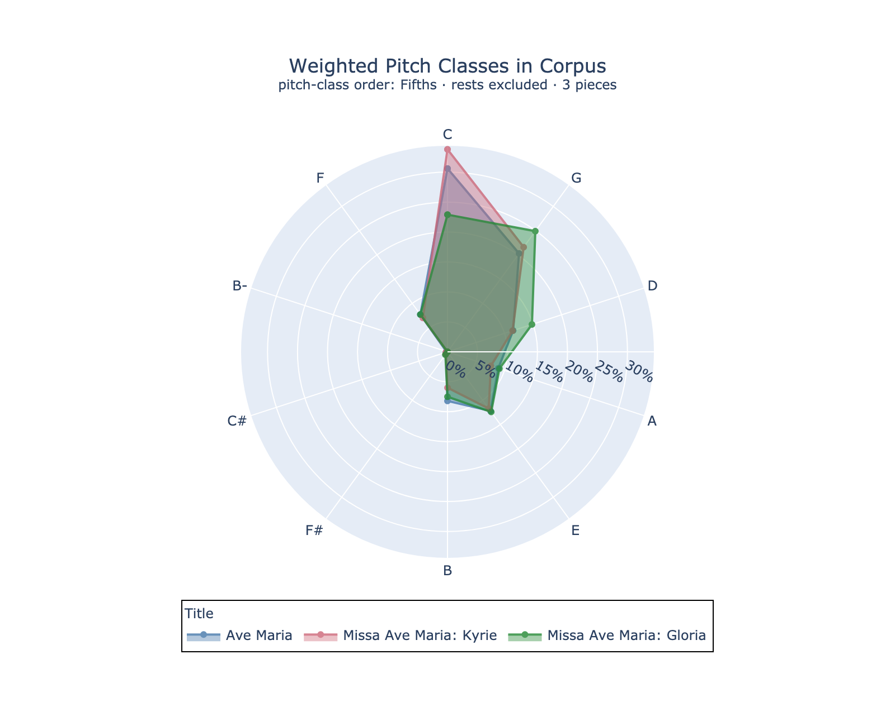

Options:

* `pitch_class_order`: `'Fifths'` (default), `'Diatonic'`, `'Chromatic'`, or your own list.
* `color_grouping='final'`: one polygon per final instead of per piece (this needs `include_final=True`, as above). `'composer'` also works.
* `exclude_rests=False`: include rests as a slice of the piece.
* `limit_to_active=False`: show every pitch class in the ordering, even those that never occur.


## Voice Range Charts

Voice range charts show the range of each voice as a horizontal bar, one row per voice, for one piece or a whole corpus. They are a quick way to compare modal types: pieces with the same final but different voice ranges (for example, authentic and plagal) stand out clearly. When all the pieces in the chart share one final, dotted reference lines mark the significant pitches for that final.

Each range runs from the lowest to the highest of the voice's most prominent pitches (those that take up the most time), so a single brief excursion doesn't distort it. First find the ranges with `piece.voice_ranges()` or `corpus.voice_ranges()`, then pass them to `viz.voice_range_chart()`:

```python
# one piece
piece = importScore('https://crimproject.org/mei/CRIM_Mass_0005_1.mei')
viz.voice_range_chart(piece.voice_ranges()).show()

# a corpus, limited to the pieces on G
corpus = CorpusBase(['https://crimproject.org/mei/CRIM_Model_0008.mei',
                     'https://crimproject.org/mei/CRIM_Mass_0005_3.mei'])
ranges = corpus.voice_ranges()
fig = viz.voice_range_chart(ranges, final='C')
fig.show()
fig.write_html('voice_ranges.html')   # optional: save the interactive chart
```

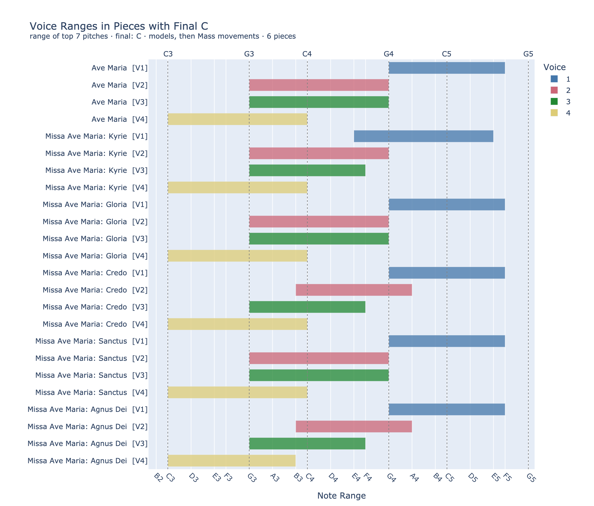

By default, models are listed first, then Mass movements in liturgical order. For pieces not related as model and Mass, use `piece_order='range'` (by range), `'alpha'` (by title), `'given'` (the order of the DataFrame you pass), or a list of titles in the order you want.

See [13_Voice_Ranges_Melodic_Species](/tutorial/13_Voice_Ranges_Melodic_Species.md) to learn more.


## Melodic Species Plots

`piece.melodic_species()` finds melodic fourths and fifths and labels the octave species each helps to articulate (for example, D up to A, or A down to D, both point to the DAD octave). `plot_species()` shows where in the piece each one occurs, colored by voice. By default only leaps that begin a phrase (after a rest) are found; `limit_to_entries=False` finds them all.

```python
species = piece.melodic_species(limit_to_entries=False)
viz.plot_species(species)
```

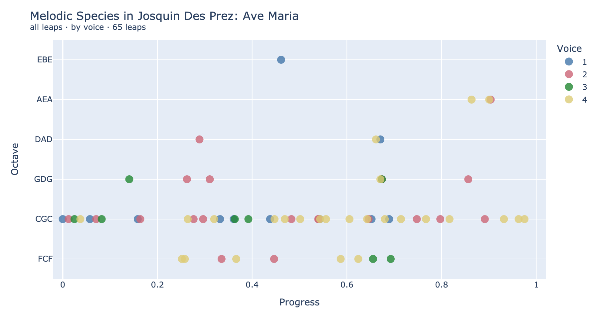

For a corpus, each piece gets its own row. To see the overall pattern rather than individual leaps, use `show_voice_detail=False`: the piece is divided into equal sections (5 by default; change with `progress_bins`), and the size of each dot shows how many leaps articulate that octave species in that section.

```python
species = corpus.melodic_species(limit_to_entries=False)
viz.plot_species(species, show_voice_detail=False)
```

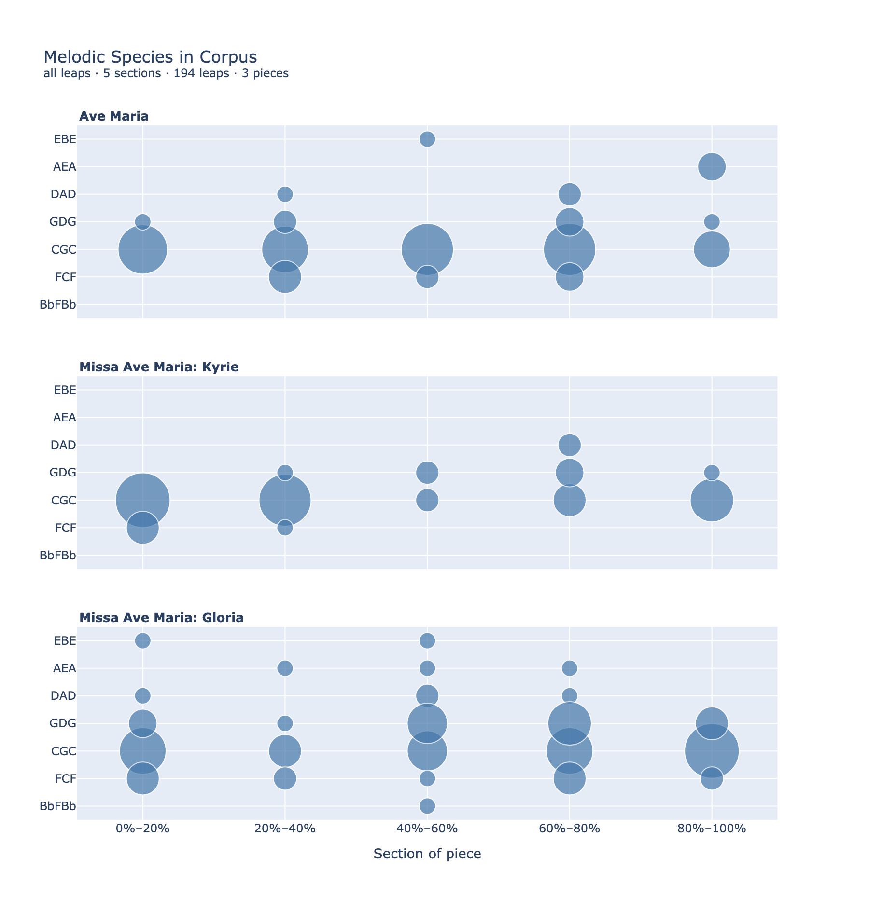

### Species and Cadences Together

`plot_species_cadences()` puts melodic species (top) and cadences (bottom) on the same timeline, so you can see whether the octave species stated in the melody match the cadence tones around them.

```python
viz.plot_species_cadences(piece.melodic_species(limit_to_entries=False), piece.cadences())
```

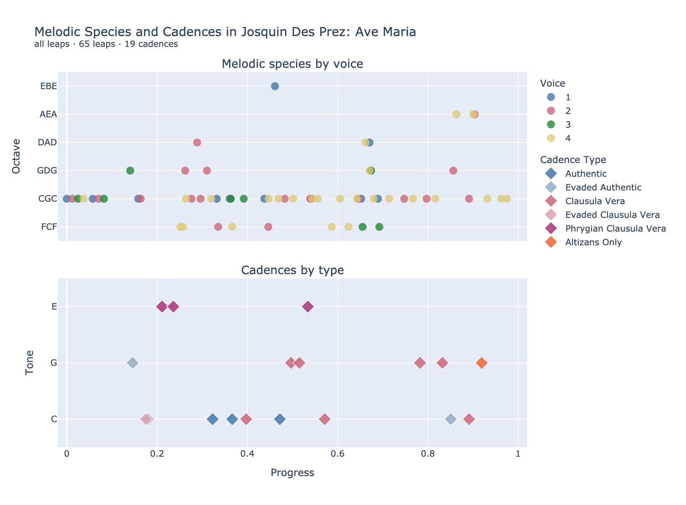

This chart shows one piece at a time. With corpus results, name the piece with `title=`, or loop over the titles:

```python
species = corpus.melodic_species(limit_to_entries=False)
cadences = corpus.cadences()
for title in species['Title'].unique():
    viz.plot_species_cadences(species, cadences, title=title).show()
```


## Sonority N-gram Progress Plots

Sonority n-grams are short sequences of sonorities (the intervals above the lowest voice at each moment), each paired with the melodic motion of the bass, for example `-M2_10/1_Held_9/1_Held_8/1_M2_10/1`. Because they ignore which voice sings what, they are good at finding **block repetitions**: passages that return, within a piece or across pieces, even when the voices are redistributed. `piece.sonority_ngrams()` and `corpus.sonority_ngrams()` find them (see [07_Harmonic_Intervals_Sonorities](/tutorial/07_Harmonic_Intervals_Sonorities.md#sonority-n-grams-with-the-bass-line)), and `sonority_ngram_progress()` shows where each one falls.

Each n-gram pattern has its own row, and each dot is one occurrence, placed by how far through the piece it falls (`Progress`, from 0 at the start to 1 at the end). By default the rows are stacked in the order the patterns first appear, so the plot reads like this:

* **A diagonal climb** is new material: each n-gram is heard for the first time, so it gets a new row above the ones before.
* **A dot that falls back below the climb** is a return: a pattern heard earlier, landing on its original row.
* **Several dots on one horizontal line** are a pattern that recurs.

```python
# one piece
son = piece.sonority_ngrams(ngram_length=4)
viz.sonority_ngram_progress(son)
```

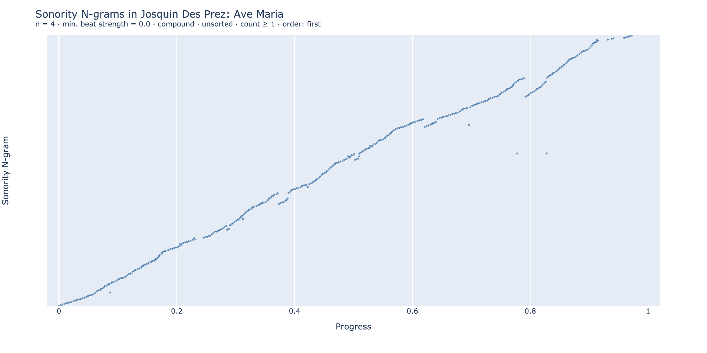

Most four-sonority n-grams occur only once, so a piece on its own is mostly one long climb; the returns are the few dots below it. To see only the recurring patterns, use `min_count=2`. With a corpus this shows the patterns that are **shared** among the pieces, colored by piece (here a model and two movements of the Mass based on it):

```python
# a corpus: only patterns heard at least twice
son = corpus.sonority_ngrams(ngram_length=4)
viz.sonority_ngram_progress(son, min_count=2)
```

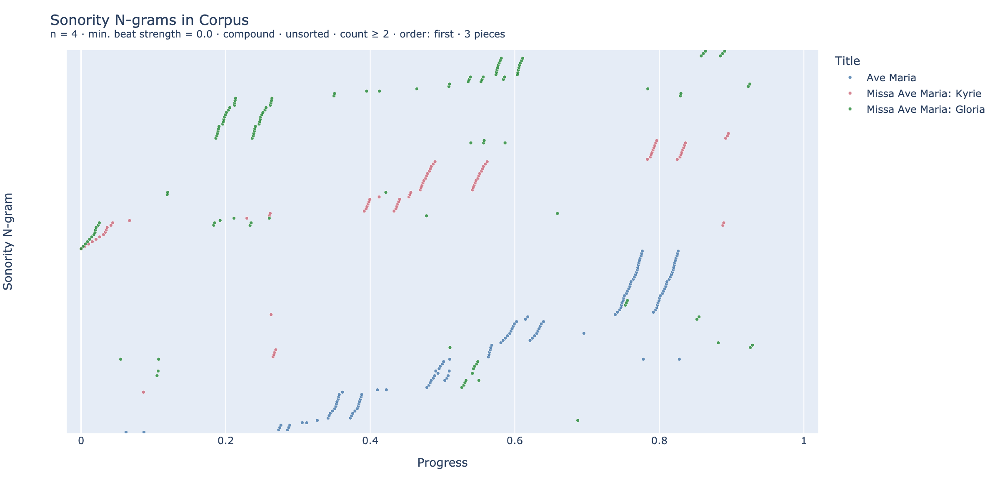

With `facet=True`, each piece gets its own panel, which makes it easier to compare where the same patterns fall in each one:

```python
viz.sonority_ngram_progress(son, min_count=2, facet=True)
```

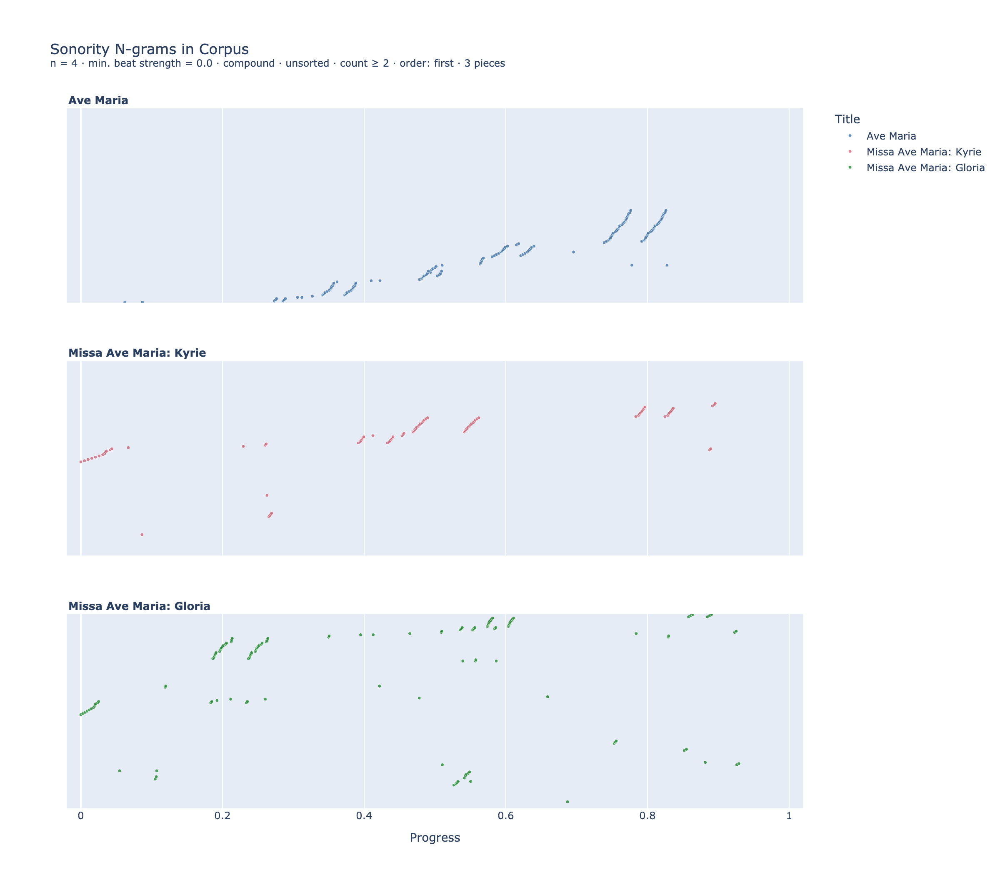

The title names the piece (or says "Corpus"), and the line beneath it repeats the settings that produced the chart: the n-gram length and other `sonority_ngrams()` settings, then the filters and order chosen for the plot.

Options:

* `min_count`, `max_count`: keep only patterns whose total count (across all the pieces given) is in this range.
* `top_n=20`: keep only the 20 most frequent patterns.
* `patterns=[...]`: plot only the patterns you list.
* `order`: how the rows are stacked: `'first'` (default, order of first appearance), `'count'` (most frequent at the top), or `'alpha'`.
* `facet=True`: one panel per piece.
* `height=`: the figure height in pixels (600 by default, or 300 per piece with `facet=True`). The chart keeps this height however many patterns there are, so the overall flow stays visible; with more than 40 patterns the n-gram labels are hidden (`show_labels=True` brings them back).

Hover over a dot to see the n-gram, the piece, its measure and beat, and how many times the pattern occurs.


## Networks

# Networks:  Basic Concepts and Methods 

In the field of data science, networks (also known as graphs) are powerful tools used to represent and study relationships between entities. A network is composed of **nodes** (also called vertices) and **edges** (also called links). Each node represents an entity, while each edge represents a relationship between two entities.

Learn more in the [Networks Tutorial](/tutorial/18_Network_Graphs.md).


---

## Sections in this guide

  * [01_Introduction_and_Corpus](/tutorial/01_Introduction_and_Corpus.md)
  * [02_Notes_Rests](/tutorial/02_Notes_Rests.md)
  * [03_Durations](/tutorial/03_Durations.md)
  * [04_Time_Signatures_Beat_Strength](/tutorial/04_Time_Signatures_Beat_Strength.md)
  * [05_Detail_Index](/tutorial/05_Detail_Index.md)
  * [06_Melodic_Intervals](/tutorial/06_Melodic_Intervals.md)
  * [07_Harmonic_Intervals_Sonorities](/tutorial/07_Harmonic_Intervals_Sonorities.md)
  * [08_Ngrams_Heat_Maps](/tutorial/08_Ngrams_Heat_Maps.md)
  * [09_Contrapuntal_Modules](/tutorial/09_Contrapuntal_Modules.md)
  * [10_Lyrics_Homorhythm](/tutorial/10_Lyrics_Homorhythm.md)
  * [11_Cadences](/tutorial/11_Cadences.md)
  * [12_Presentation_Types](/tutorial/12_Presentation_Types.md)
  * [13_Voice_Ranges_Melodic_Species](/tutorial/13_Voice_Ranges_Melodic_Species.md)
  * [14_Melodic_Interval_Families](/tutorial/14_Melodic_Interval_Families.md)
  * [15_Musical_Examples_Verovio](/tutorial/15_Musical_Examples_Verovio.md)
  * [16_Model_Finder](/tutorial/16_Model_Finder.md)
  * [17_Visualizations_Summary](/tutorial/17_Visualizations_Summary.md)
  * [18_Network_Graphs](/tutorial/18_Network_Graphs.md)
  * [19_Corpus_Tools](/tutorial/19_Corpus_Tools.md)
  * [20_Python_Basics](/tutorial/20_Python_Basics.md)
  * [21_Pandas_Basics](/tutorial/21_Pandas_Basics.md)
  * [22_Music21_MEI](/tutorial/22_Music21_MEI.md)
  * [99_Local_Installation](/tutorial/99_Local_Installation.md)
