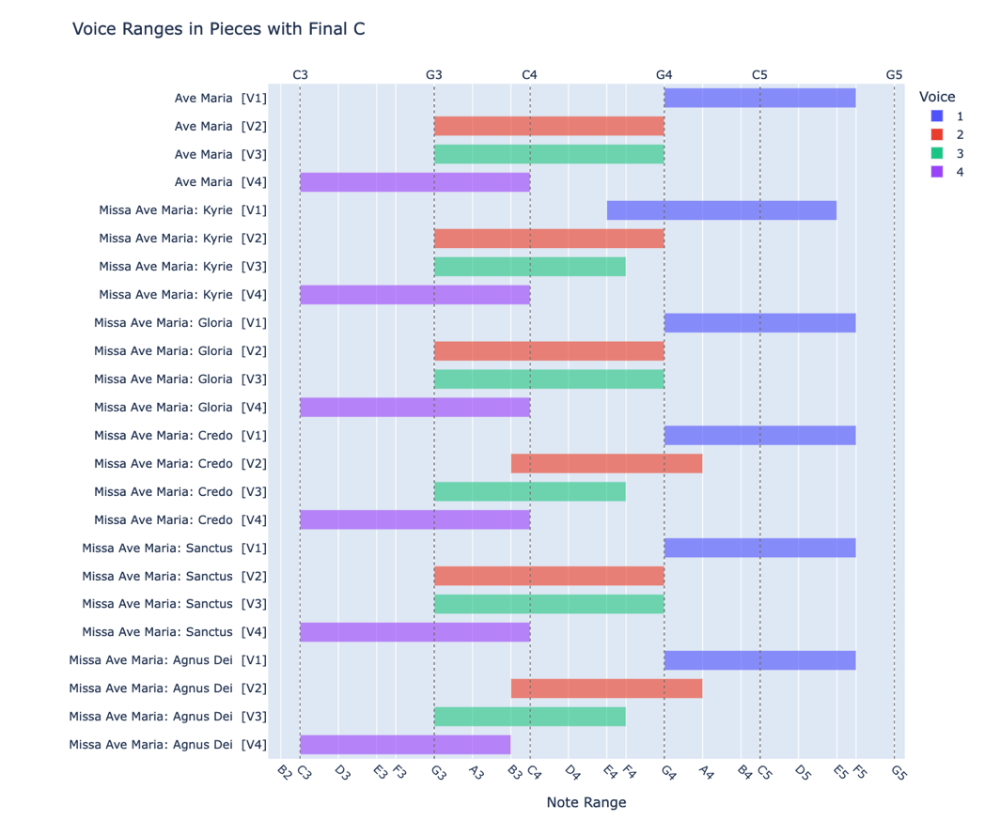

# Voice Ranges and Mode

## Table of Contents
1. [Introduction](#introduction)
2. [Voice Ranges in One Piece: `piece.modeRanges()`](#voice-ranges-in-one-piece-piecemoderanges)
3. [Voice Ranges in a Corpus: `corpus.mode_ranges()`](#voice-ranges-in-a-corpus-corpusmode_ranges)
4. [Charting Voice Ranges: `voice_range_chart()`](#charting-voice-ranges-voice_range_chart)
5. [Ordering the Pieces in the Chart](#ordering-the-pieces-in-the-chart)
6. [How the Ranges Are Found](#how-the-ranges-are-found)
7. [Sections in this guide](#sections-in-this-guide)

## Introduction

The range of each voice, considered together with the final, is one of the main ways to distinguish modal types (for example, authentic and plagal ranges on the same final). CRIM Intervals provides:

* `piece.modeRanges()`: the range of each voice in one piece
* `corpus.mode_ranges()`: the same for every piece in a corpus, in one table
* `voice_range_chart()`: a chart of those ranges, one bar per voice, with reference lines for the final

Rather than reporting the absolute lowest and highest notes of each voice (which a single brief excursion can distort), these methods find the **most prominent pitches** in each voice (those that take up the most time) and report the lowest and highest of them.

As usual, start with:

```python
import crim_intervals
from crim_intervals import *
import pandas as pd
```

## Voice Ranges in One Piece: `piece.modeRanges()`

```python
piece = importScore('https://crimproject.org/mei/CRIM_Mass_0014_3.mei')
piece.modeRanges()
```

| Voice | Final | LowestNote | HighestNote | Range |
|---|---|---|---|---|
| 1 | G | F4 | D5 | F4 to D5 |
| 2 | G | A3 | G4 | A3 to G4 |
| 3 | G | G3 | F4 | G3 to F4 |
| 4 | G | C3 | B-3 | C3 to B-3 |

* **Voice**: the staff position of the voice, where 1 is the highest staff. Numbers rather than names make results comparable across pieces with different voice names.
* **Final**: the final of the piece as a pitch class (see `piece.final()`).
* **LowestNote** and **HighestNote**: the lowest and highest of the voice's most prominent pitches.
* **Range**: the two combined, as a label.

Parameters:

* **top_n** (default 7): how many of each voice's most prominent pitches to consider. Use a smaller number for a narrower, "core" range, or a larger one to include more of the voice's outer notes.
* **number_parts** (default True): if False, the **Voice** column shows the part names (e.g. "Tenor") instead of staff numbers.
* **include_final** (default True): if False, the **Final** column is left out.

```python
piece.modeRanges(top_n=7)
piece.modeRanges(number_parts=False)
```

## Voice Ranges in a Corpus: `corpus.mode_ranges()`

`corpus.mode_ranges()` runs `piece.modeRanges()` on every piece in the corpus and combines the results, adding **Composer**, **Title** and **Date** columns. (See [21_Corpus_Tools](/tutorial/21_Corpus_Tools.md) for building a corpus.)

```python
corpus = CorpusBase(['https://crimproject.org/mei/CRIM_Model_0009.mei',
                     'https://crimproject.org/mei/CRIM_Model_0001.mei',
                     'https://crimproject.org/mei/CRIM_Mass_0014_3.mei'])
ranges = corpus.mode_ranges()
ranges
```

Parameters:

* **top_n** (default 7): as for `piece.modeRanges()`.
* **final** (optional): keep only pieces with this final, e.g. `final='G'`, or several finals as a list, e.g. `final=['D', 'G']`.
* **voices** (optional): keep only these voices, by staff number, e.g. `voices=2` or `voices=[1, 4]`.

```python
# only the pieces on G
corpus.mode_ranges(final='G')

# only the second voice from the top in each piece
corpus.mode_ranges(voices=2)
```

The result is an ordinary DataFrame, so you can group, filter or sort it as usual. For example, to compare the second voice across pieces with the same final:

```python
ranges = corpus.mode_ranges(final='G', voices=2)
ranges[['Title', 'Range']]
```

## Charting Voice Ranges: `voice_range_chart()`

Pass the output of `piece.modeRanges()` or `corpus.mode_ranges()` to `voice_range_chart()`. Each voice is a horizontal bar running from its lowest to its highest prominent pitch. When all the pieces in the chart share one final, dotted lines mark the reference pitches for that final.

```python
ranges = corpus.mode_ranges()
fig = voice_range_chart(ranges, final='G')
fig.show()
```

The function returns a Plotly figure, so you can display it with `.show()`, save it with `fig.write_html('voice_ranges.html')`, or change it further with the usual Plotly methods (see [18_Visualizations_Summary](/tutorial/18_Visualizations_Summary.md)). Hover over a bar to see its piece, voice and range.

It works the same way for a single piece:

```python
voice_range_chart(piece.modeRanges()).show()
```

Parameters:

* **final** (optional): chart only the pieces with this final. If you leave it out and all the pieces share one final, the reference lines for that final are drawn. If the pieces have several finals, no reference lines are drawn (since they would differ from piece to piece), and the chart title says so. Filtering by final is usually the most useful way to compare modal ranges.
* **piece_order** (default `'mass'`): the order of the pieces, from top to bottom (see below).
* **sort_voice** (default `'2'`): the voice used to sort pieces by range (see below).
* **title** (optional): a chart title of your own.

## Ordering the Pieces in the Chart

Within each piece, voices always run from the highest staff (V1) down. The order of the **pieces** is set with `piece_order`:

| `piece_order` | Order of pieces |
|---|---|
| `'mass'` (default) | models first (titles without a Mass movement name), then Mass movements in liturgical order (Kyrie, Gloria, Credo, Sanctus, Agnus Dei); within each group, by the lowest note of `sort_voice` |
| `'range'` | by the lowest note of `sort_voice` only, without grouping models and Mass movements |
| `'alpha'` | alphabetically by title |
| `'given'` | the order of the rows in the DataFrame you pass in, so you can sort it yourself first |
| a list of titles | exactly that order |

The default suits a CRIM corpus of models and the Masses based on them. For pieces that are not related as model and Mass, `'range'`, `'alpha'` or `'given'` will usually make more sense:

```python
# from the lowest-pitched to the highest-pitched pieces, judged by voice 2
voice_range_chart(ranges, piece_order='range')

# judged by the lowest voice instead (voice 4 in four-voice pieces)
voice_range_chart(ranges, piece_order='range', sort_voice='4')

# sort the DataFrame yourself, e.g. by composer, then keep that order
voice_range_chart(ranges.sort_values(['Composer', 'Title']), piece_order='given')

# an order of your own
voice_range_chart(ranges, piece_order=['Veni speciosam',
                                       'Je suis déshéritée',
                                       'Missa Mente tota: Credo'])
```

With a list, any titles you leave out are added at the end, and any titles that don't match the data (for example because of a typo) are reported in a printed message. To leave pieces out of the chart, filter the DataFrame before passing it in.




## How the Ranges Are Found

For each voice, `modeRanges()`:

1. Adds up the total time (in quarter notes) spent on each pitch, keeping octaves distinct (so G3 and G4 are different pitches).
2. Divides each total by the voice's whole duration, **including rests**, to get that pitch's share of the voice.
3. Takes the `top_n` pitches with the largest shares. Rests are counted in the voice's duration but never chosen.
4. Reports the lowest and highest of those pitches, ordered by sounding pitch, so that B-3 (B flat) is below B3, and C6 is above B5.

Because the most prominent pitches are chosen by duration, two pitches with nearly equal shares can trade places at the `top_n` cut-off. If a range looks surprising, try a slightly different `top_n`.

The reference pitches drawn for each final are defined in `crim_intervals/sorting_lists.py` (`_RANGE_REFERENCE_BY_FINAL`); for a final on D, for example, they are D and G in each octave.

## Sections in this guide

  * [01_Introduction_and_Corpus](/tutorial/01_Introduction_and_Corpus.md)
  * [02_Notes_Rests](/tutorial/02_Notes_Rests.md)
  * [03_Durations](/tutorial/03_Durations.md)
  * [04_TimeSignatures_Beat_Strength](/tutorial/04_TimeSignatures_Beat_Strength.md)
  * [05_Detail_Index](/tutorial/05_Detail_Index.md)
  * [06_Melodic_Intervals](/tutorial/06_Melodic_Intervals.md)
  * [07_Harmonic_Intervals_Sonorities](/tutorial/07_Harmonic_Intervals_Sonorities.md)
  * [08_Ngrams_Heat_Maps](/tutorial/08_Ngrams_Heat_Maps.md)
  * [09_Contrapuntal_Modules](/tutorial/09_Contrapuntal_Modules.md)
  * [10_Lyrics_Homorhythm](/tutorial/10_Lyrics_Homorhythm.md)
  * [11_Cadences](/tutorial/11_Cadences.md)
  * [12_Presentation_Types](/tutorial/12_Presentation_Types.md)
  * [13_Musical_Examples_Verovio](/tutorial/13_Musical_Examples_Verovio.md)
  * [14_Model_Finder](/tutorial/14_Model_Finder.md)
  * [15_Network_Graphs](/tutorial/15_Network_Graphs.md)
  * [16_Python_Basics](/tutorial/16_Python_Basics.md)
  * [17_Pandas_Basics](/tutorial/17_Pandas_Basics.md)
  * [18_Visualizations_Summary](/tutorial/18_Visualizations_Summary.md)
  * [19_Music21_Basics_MEI](/tutorial/19_Music21_Basics_MEI.md)
  * [20_Melodic_Interval_Families](/tutorial/20_Melodic_Interval_Families.md)
  * [21_Corpus_Tools](/tutorial/21_Corpus_Tools.md)
  * [22_Voice_Ranges_Modes](/tutorial/22_Voice_Ranges_Modes.md)
  * [99_Local_Installation](/tutorial/99_Local_Installation.md)
